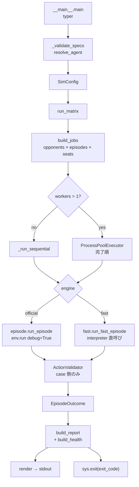

# simulate 実装解説

> 対象: `backend/src/simulate/`（`jaxenv/` を含む）
> 規模: 15 ファイル / 2,962 行
> 分析日: 2026-08-11
> コミット: `133e83b`
> 読み込み深度: `simulate/` 直下 10 ファイルは全文精読、`jaxenv/` 5 ファイル（約 1,000 行）は docstring と関数シグネチャ中心の概観

## 概要

`backend/src/simulate` は、自作エージェント（`backend/pipeline/<family>/case<N>/main.py`）を `kaggle-environments` の `kaggriculture` 環境でローカル対戦させ、勝率と「エージェントが壊れていないか」を同時に報告する開発専用の評価パッケージ。

存在理由は 1 つに尽きる: **エンジンがエージェントの故障を隠す**こと。例外を投げても `status == "DONE"`、`actTimeout` を超えても `DONE`、不正アクションは無言の no-op。つまり素の `env.run` では「壊れたエージェント」と「弱いエージェント」が区別できない。本パッケージは crash / timeout / invalid-action を**それぞれ独立の経路で**検出し、勝率の隣に並べて出す。

外からの入口は 3 つ: CLI `python -m simulate`（ラッパ `dev/simulate`）、ライブラリ API `from simulate import SimConfig, run_matrix, build_report`、そして旧 API の `run_episode` / `run_match`（`runner.py` の互換ファサード）。

## 1. ディレクトリ構成

```
backend/src/simulate/
├── __init__.py      公開 API の再エクスポート。他パッケージが触る唯一の面
├── __main__.py      typer CLI。引数 → SimConfig → run_matrix → render → sys.exit
├── config.py        MatchSpec / SimConfig / Engine / ReplayMode。実行前に確定する全パラメータ
├── agents.py        エージェント指定文字列の解決（builtin 名 / ファイルパス / case パス）
├── episode.py       official エンジンで 1 エピソード実行。crash/timeout/replay の抽出
├── fast.py          engine.interpreter を直接叩く高速パス（約 30 倍、replay 不可）
├── validate.py      エージェント出力をエンジン到達前に検査し、無言 no-op を記録
├── matrix.py        SimConfig を _Job 群に展開し、逐次 or ProcessPool で実行
├── report.py        EpisodeOutcome 群を対戦相手別に集約し、health ブロック付きで整形
├── runner.py        旧 run_episode / run_match の後方互換ファサード
└── jaxenv/          GPU バッチ化の実験用ポート（評価本線からは独立）
    ├── state.py     EnvState（struct-of-arrays, 先頭軸 B）と market_price
    ├── env.py       jit 対応の step()。ルールを全てマスク更新で表現
    ├── town.py      町ショップ解禁スケジュールをホスト側で生成しテーブル化
    └── benchmark.py official / fast / jax の env-steps/sec を比較計測
```

### エントリポイント

| 入口 | 実体 | 用途 |
|---|---|---|
| `dev/simulate` | `uv run --directory backend python -m simulate` | 日常のローカル評価 |
| `python -m simulate` | `__main__.main()` (typer) | CLI 本体 |
| `simulate.run_matrix(config)` | `matrix.py:108` | スクリプト・テストからの主 API |
| `simulate.run_episode(agents, ...)` | `runner.py:133` | **旧 API**。`__init__` では `run_episode` の名でこちらが公開され、新しい方は `run_single_episode` という別名になっている（後述） |
| `python -m simulate.jaxenv.benchmark` | `benchmark.py:179` | JAX ポートのスループット計測 |

### 依存方向

きれいに一方向に層になっている。

```
config.py  ←  agents.py
    ↑             ↑
    └── episode.py ──→ validate.py
    ↑        ↑
    │     fast.py
    ↑        ↑
    └──── matrix.py ──→ report.py
                ↑
          __main__.py

runner.py → episode.py（互換ファサードなので matrix より下ではなく横）
jaxenv/   → 独立（fast.py を benchmark からのみ参照）
```

`config.py` は誰にも依存しない値オブジェクト層。`episode.py` / `fast.py` が「1 エピソード」層で、両者は同じ `EpisodeOutcome` を返すため `matrix.py` から差し替え可能。`report.py` は `EpisodeOutcome` のリストしか知らない。

### ここに無いもの

- **ゲームルール本体** — `kaggle_environments.envs.kaggriculture` にある。`fast.py` はそれを import して呼ぶだけで、再実装していない。唯一の再実装が `jaxenv/`（それゆえ乖離リスクを負う、と docstring が明言）。
- **エージェント実装** — `backend/pipeline/<family>/case<N>/`。`agents.py` はパス解決するのみ。
- **リプレイの解析・学習データ化** — `backend/src/dataset/`。ここは JSON を書き出すところまで。
- **提出パッケージング** — `backend/src/submit/`。

## 2. クラス / メソッド一覧

### 中核オブジェクト

#### `MatchSpec`（frozen dataclass, `config.py:52`）— 評価マトリクスの 1 セル

| フィールド | 型 | 意味 |
|---|---|---|
| `case` | `str` | 評価対象のエージェント指定 |
| `opponent` | `str` | 対戦相手の指定 |
| `seed` | `int` | エンジン設定に渡す seed |
| `steps` | `int` | 既定 720（= フルシーズン） |
| `swap_sides` | `bool` | True なら case が player 1 に座る |

派生プロパティ `case_player` / `opponent_player` / `agent_order()` / `label`。**席順が結果に影響する**（player 0 が先に同じ市場板に注文を出す）ため、`swap_sides` は公平評価に必須という設計意図が docstring に書かれている。

#### `SimConfig`（frozen dataclass, `config.py:88`）— 1 回の実行全体の設定

`case` / `opponents: tuple[str, ...]` / `episodes` / `steps` / `seed_base` / `swap_sides` / `workers` / `engine` / `replay_mode` / `output_dir` / `validate_actions` / `strict` / `act_timeout` / `extra_config`。

- `__post_init__` が `engine=FAST` かつ `replay_mode != NONE` を **例外で弾く**（fast は step 履歴を持たないので原理的に replay が作れない）。
- `iter_specs()` が `opponents × episodes`（× 2 席）に展開。seed は `seed_base + i` なので、summary の 2 数値だけで再現できる。
- `slow_turn_threshold` = `act_timeout * 0.5`。

#### `EpisodeOutcome`（frozen dataclass, `episode.py:52`）— 1 エピソードの結果、常に case 視点

| フィールド | 型 | 意味 |
|---|---|---|
| `spec` | `MatchSpec` | 何を走らせたか |
| `case_money` / `opponent_money` | `float` | 最終所持金（reward） |
| `statuses` | `tuple[str, ...]` | エンジンの最終 status。両者 `DONE` が正常 |
| `steps` | `int` | 実際に進んだステップ数 |
| `crashed` / `crash_repr` | `bool` / `str \| None` | `debug=True` で再送出された例外の traceback |
| `timeouts` | `tuple[TurnCost, ...]` | `act_timeout` 超過ターン |
| `slow_turns` | `tuple[TurnCost, ...]` | 閾値超過だが timeout 未満のターン |
| `max_duration` | `float` | 全ターン中の最大所要秒 |
| `issues` | `tuple[ValidationIssue, ...]` | 無言 no-op になるアクション |
| `replay_path` | `Path \| None` | 書き出した replay JSON |
| `stderr` | `str` | case 側 stderr（無ければエンジンの stderr） |

派生: `margin` / `winner_is_case` / `is_tie` / `bad_status` / `invalid_actions` / **`failed`**。`failed` は「壊れている（crash or timeout or bad status）」であって「負けた」ではない、という区別が明示されている。

#### `EnvState`（NamedTuple, `jaxenv/state.py:124`）— JAX 版のバッチ状態

タイル 1 枚を dict にせず、`kind` / `crop` / `planted_day` / `watered_today` / `consecutive_unwatered` / `yield_units` / `max_lifespan_step` をそれぞれ `(B, 2, H, W)` の平面として持つ struct-of-arrays。加えて `step (B,)`, `money (B,2)`, `farmer_x/y (B,2)`, `shed/carried (B,2,N_PRODUCTS)`, `seeds (B,2,5)`, `market_inv (B,N_PRODUCTS)`。`day` / `hour` は `step` からの派生プロパティ。

### 関数・クラス責務表

| 名前 | 種別 | 責務 | 入力 | 出力 |
|---|---|---|---|---|
| `resolve_agent` | 関数 (`agents.py:28`) | 指定文字列を builtin 名 or 絶対 `main.py` パスへ。順に builtin → 実在ファイル → `pipeline/<spec>/main.py` | `str` | `str`（失敗時 `AgentResolutionError`） |
| `available_cases` | 関数 | `pipeline/*/*/main.py` を走査して `family/case` 一覧 | — | `list[str]` |
| `run_episode`（新） | 関数 (`episode.py:206`) | official パスで 1 エピソード。crash/timeout/issue/replay を収集 | `MatchSpec`, `act_timeout`, `validate_actions`, `replay_path`, `keep_replay` | `EpisodeOutcome` |
| `_execute` | 関数 (`episode.py:174`) | `make(..., debug=True)` + `env.run`。stderr を握り潰さず buffer へ | agents, steps, seed, extra_config | `(_RunArtifacts, stderr)` |
| `_turn_costs` | 関数 (`episode.py:97`) | `env.logs[step][player]["duration"]` から timeout / slow / max を抽出 | `env.logs` | `(timeouts, slow, max)` |
| `_harvest` | 関数 (`episode.py:159`) | 完走した env から reward/status/logs/replay を取り出す | `env` | `_RunArtifacts` |
| `run_fast_episode` | 関数 (`fast.py:91`) | `engine.interpreter` を素のループで叩く高速パス | `MatchSpec` ほか | `EpisodeOutcome`（同じ型） |
| `_AgentSlot` | dataclass (`fast.py:59`) | 1 プレイヤーの callable + 例外/計測の帳簿。**例外を PASS に落として記録**（フレームワークの代役） | `act` | `take_turn(obs) -> (action, duration)` |
| `ActionValidator` | クラス (`validate.py:144`) | エージェント出力をエンジン到達前に検査し `ValidationIssue` を蓄積。`max_issues=200` で打ち止め | `player` | `.issues`, `.wrap(agent)` |
| `ActionValidator.wrap` | メソッド | agent を包み、出力を検査してからそのまま返す。**検査自体の例外も握って `validator_error` として記録**（評価が検査で壊れない） | agent or path | 検査付き callable |
| `as_callable` | 関数 (`validate.py:425`) | パス文字列をエンジンの `build_agent` で callable 化。arity を見て `(obs)` か `(obs, config)` を決める | agent spec | callable |
| `_Job` | frozen dataclass (`matrix.py:31`) | 1 spec + worker が単独実行に必要な全設定。`run()` が engine 別に分岐 | — | `EpisodeOutcome` |
| `run_matrix` | 関数 (`matrix.py:108`) | jobs を組み、`workers<=1` なら in-process、それ以外は `ProcessPoolExecutor` | `SimConfig`, `on_result` | `list[EpisodeOutcome]` |
| `default_workers` | 関数 | `cpu_count() - 1`（OS に 1 コア残す） | — | `int` |
| `OpponentReport` | frozen dataclass (`report.py:29`) | 相手 1 人分の集約（W/L/T, win_rate, mean_money, mean_margin, worst_margin） | outcomes | — |
| `HealthReport` | frozen dataclass (`report.py:88`) | 「壊れている」側の指標一式 + crash サンプル + issue 種別カウント | outcomes | `.clean` |
| `MatrixReport` | frozen dataclass (`report.py:119`) | 実行全体。`exit_code` を決める | — | `ExitCode` |
| `build_report` / `render` | 関数 | 相手別グルーピング（設定順を保持）と人間可読整形 | config, outcomes | `MatrixReport` / `str` |
| `EpisodeResult` / `MatchSummary` | dataclass (`runner.py`) | 旧 API 用のプレイヤー添字ベース表現 | — | — |
| `jaxenv.step` | 関数 (`env.py:407`) | 全環境を 1 ターン進める。unit ops → market → decay → end-of-day | `EnvState` + 5 本のアクション配列 | `EnvState` |
| `jaxenv.market_price` | 関数 (`state.py:180`) | 在庫から価格を算出（`I0` 上下で形状関数が変わる） | inventory | 価格配列 |
| `unlocked_shops_by_day` | 関数 (`town.py:52`) | エンジンの RNG ストリームをホスト側で再生し、解禁ショップを列挙 | seed, 日ごとの空きタイル数 | 解禁表 |

### 名前や署名が誤解を招くところ

- **`simulate.run_episode` は 2 つある。** `__init__.py` は旧 API（`runner.run_episode`, 引数は `agents: list`）を `run_episode` として公開し、新 API（`episode.run_episode`, 引数は `MatchSpec`）を **`run_single_episode`** という別名で公開している。`from simulate import run_episode` が拾うのは旧い方。
- **`runner.run_episode(debug=...)` は受け取るが無視される**（`del debug`）。常に `debug=True` で走る。互換のために残っている引数。
- **`ActionValidator.wrap` は「検証してから通す」のであって止めない。** 不正アクションもそのままエンジンに渡る。記録するだけ。
- **`fast.py` の `_AgentSlot.crash_repr` は最初の 1 件しか保持しない**（`if self.crash_repr is None`）。以降のクラッシュは PASS に落とされるだけで残らない。
- **`EpisodeOutcome.failed` に `invalid_actions` は含まれない。** 不正アクションは `--strict` を付けたときだけ exit code に反映される（`ExitCode.INVALID_ACTIONS = 2`）。

## 3. 処理ステップ

### 主経路: `dev/simulate --case rulebase/case1 --opponent starter --episodes 10`

```
 1. typer が引数を受け取り、--opponent をカンマ分割           (__main__.py:96)
 2. case と全 opponent を resolve_agent で先に解決。
    typo は BadParameter で即死                              (__main__.py:42)
 3. engine=fast × replay 指定の組み合わせを拒否               (__main__.py:99)
 4. SimConfig を構築。workers 未指定なら cpu_count-1          (__main__.py:104)
 5. run_matrix(config)                                       (matrix.py:108)
 6.   config.specs() が opponents × episodes（×2 席）を展開    (config.py:120)
 7.   各 spec を _Job に包む。replay パスもここで確定           (matrix.py:81)
 8.   workers<=1 → 逐次、それ以外 → ProcessPoolExecutor        (matrix.py:124)
 9.   _Job.run() が engine で分岐（official / fast）           (matrix.py:43)
10.     [official] agent_order() で席を決め resolve_agent      (episode.py:225)
11.     [official] validate_actions なら case 側だけ
        ActionValidator.wrap で包む                           (episode.py:230)
12.     [official] make(debug=True) + env.run。stderr は
        StringIO へ退避、例外は捕まえて crash_repr に          (episode.py:191)
13.     [official] env.logs から timeout / slow / max を抽出    (episode.py:237)
14.     [official] reward を case/opponent 視点に並べ替え       (episode.py:241)
15.     [official] replay_path があり keep_replay を通れば
        JSON 書き出し、outcome を差し替えて返す                 (episode.py:263)
16. 全 outcome を build_report が opponent 別に集約
    （config.opponents の順を保持）                            (report.py:179)
17. build_health が crash / timeout / slow / bad status /
    invalid action を横断集計、issue 種別も Counter で         (report.py:156)
18. render がテーブル + health ブロックを文字列化              (report.py:217)
19. --json 指定時は report.as_dict() を書き出し                (__main__.py:129)
20. sys.exit(report.exit_code)                                (__main__.py:137)
```

### 副経路: fast エンジン（`--engine fast`）

`env.run` を使わず、フレームワークがやっている仕事を自前ループで肩代わりする。

```
 1. make(..., debug=False) して env.state だけ取る            (fast.py:108)
 2. 両プレイヤーの _AgentSlot を作る。case 側だけ validator    (fast.py:113)
 3. steps-1 回ループ（env.state が既に 1 step 分のため）        (fast.py:123)
 4.   各プレイヤーが take_turn → 所要時間を計測、
      例外は PASS_TURN に落として crash_repr に記録            (fast.py:67)
 5.   engine.interpreter(state, env) を直接呼ぶ                (fast.py:133)
 6.   state[0].observation.step = n + 1 を **手で進める**       (fast.py:137)
 7. 最終 farms から money を読み、statuses は ("DONE","DONE")
    を決め打ちして EpisodeOutcome を返す                       (fast.py:143)
```

ステップ 6 が最重要の落とし穴として docstring に書かれている: `observation.step` はインタプリタではなく **フレームワークの持ち物**（`core.py:626`）で、これを忘れると `day` / `hour` が凍り、水やり判定・雑草湧き・動物生産・町需要といった end-of-day 処理が一切走らないまま、それらしいスコアでエピソードが完走してしまう。この種の無言の乖離を捕まえるために `tests/e2e/src/simulate/test_fast_equivalence.py` がある。

fast が速い理由も測定値として記録されている: フルシーズンのプロファイルでゲームロジックは **1.7%** しかなく、残りは `structify`（30.5%）/ `deepcopy`（25.7%）/ `jsonschema` 検証（11.9%）などのフレームワーク機構。ルールは公式のまま、機構だけ剥がして約 30 倍。

### 副経路: アクション検証（`ActionValidator.validate`）

`--no-validate` を付けない限り case 側にだけ挟まる。1 ターン分の検査順序:

1. action が dict でなければ `action_not_dict` を記録して終了（エンジンは PASS 扱い）
2. **ユニット系** — `farmer` キー欠落 / `hands` が list でない / hands の個数が雇用数と不一致 / 未知 op / `PLANT` の作物引数欠落・不正
3. 盤外移動（`move_off_board`）、shed op なのに shed 隣接タイルにいない（`shed_not_adjacent`）、ロック済み象限へのタイル op（`locked_quadrant`）
4. **`PLACE <animal>` の例外**: エンジンは家畜配置を shed drop より先に解決するので、対応する空き構造物さえあれば盤上どこからでも合法（`_is_animal_placement`, `validate.py:112`）
5. **種の予算** — 同一作物への `PLANT` 要求が所持種数を超えると、エンジンはその作物の `PLANT` を**全部**捨てる。1 つの過剰要求がそのターンの全ユニットを無駄にするため、`plant_over_seeds` として個別に検査（`validate.py:311`）
6. **市場系** — `maxMarketOrdersPerTurn`（既定 10）超過分は末尾から破棄されるので `market_orders_truncated`、以降は cap 内の注文だけ op 名 / `[op, item, n]` の 3 要素 / 数量が正の整数か / 品目が op に対して妥当か（`BUY_PRODUCT` は WHEAT と FERTILIZER のみ）を検査

### 分岐まとめ

| 条件 | 挙動 |
|---|---|
| `engine=official` | `env.run` 経由。replay 可、フレームワーク計測の duration が取れる |
| `engine=fast` | interpreter 直呼び。約 30 倍、replay 不可（`SimConfig.__post_init__` と CLI の両方で拒否） |
| `workers<=1` | in-process 逐次。traceback とデバッガが使える |
| `workers>1` | `ProcessPoolExecutor`。**完了順に返る**ので順序が必要な呼び出し側はソートすること |
| `replay_mode=FAILED` | `keep_replay=lambda o: o.failed` で失敗回のみ保存 |
| `replay_mode=ALL` | 全エピソード保存（1 本およそ 5 MB） |
| `swap_sides` | 同じ seed を両席で 2 回プレイ |
| `strict` | health が clean でも invalid action があれば exit 2 |

### エラーハンドリング

- **握って記録するもの**: エージェントの例外（official は `debug=True` で再送出されたものを捕捉、fast は PASS に差し替え）、validator 自身の例外（`validator_error`）、agent の stderr。
- **伝播させるもの**: `AgentResolutionError`（CLI では `BadParameter` に変換して即死）、`SimConfig.__post_init__` の `ValueError`。エージェント指定を先に解決するのは、typo をエンジンに渡すと**無言で no-op エージェントに差し替えられ、正当な敗北に見えてしまう**ため。
- **無言で落ちるもの（意図的）**: `ValidationIssue` は 200 件で打ち止め（`max_issues`）。壊れっぱなしのエージェントが 720 ターン分の同一 issue でレポートを埋め尽くすのを防ぐ。crash サンプルもレポートには先頭 3 件、issue 種別は上位 8 種のみ表示。
- **fast の 2 件目以降のクラッシュは残らない**（前述）。

### 副作用

- replay JSON の書き出し（`config.output_dir/replays/ep{i:04d}_{opponent}_seed{seed}_{seat}.json`）。`--output-dir` 未指定かつ replay 有効なら `data/output/simulate/{YYYYmmdd_HHMMSS}/` を自動生成。
- `--json` 指定時のサマリ JSON。
- `ProcessPoolExecutor` によるプロセス生成。`_run_job` がモジュールレベル関数なのは spawn での pickle 可能性のため。
- `validate.as_callable` が `make("kaggriculture", debug=True)` を呼ぶ（agent ロード用の env を余計に 1 つ作る）。
- 終了コード: 0 / 1（health 不良）/ 2（strict + invalid action）。

### 流れ図



## 4. jaxenv（概観）

評価本線からは独立した、**GPU バッチ化が割に合うかを測るための実験用ポート**。`simulate` の CLI からは呼ばれない。

- `state.py` — 公式エンジンのネストした dict 状態を struct-of-arrays に再表現。タイルは「オブジェクトの配列」ではなく「平面の集合」で、タイルごとの分岐は `jnp.where` になる。int32 中心、money のみ float32。
- `env.py` — `jit` 可能な `step()`。順序は公式に合わせて unit ops → market → plant decay →（日が閉じるターンなら）end-of-day。end-of-day は全環境について計算してから `closes_day` マスクで選択的に採用する。**対応 op は意図的に絞ってある**（PASS/移動/PLANT/WATER/HARVEST/DIG、市場は SELL と BUY_SEED のみ、1 ターン 1 注文）。雇用人手・家畜・肥料・土地購入・町ショップ・雑草湧きは未実装で、NW 象限のみ。
- `town.py` — 町ショップ解禁は `random.Random((seed * 1_000_003) ^ day)` 由来で、しかも **同じ RNG を `_spawn_weeds` が先に消費する**（空きタイル 1 枚につき 1 ドロー）ため、消費ドロー数が盤面依存。よって解禁スケジュールはホスト側で空きタイル数を与えて再生し、密なテーブルとして step に渡す。ドロー数を間違えると無言で別のショップが選ばれる。
- `benchmark.py` — official / fast / jax（複数バッチサイズ）を同一ワークロードで比較。スループットは `B * steps / wall_clock`、コンパイル時間はウォームアップで除外して別途報告。

このポートは**ラッパではなく再実装**なので `fast.py` にはない乖離リスクを負う、と docstring が明言しており、公式エンジンとの等価性テストだけがこれを使用可能にしている、としている。

## 補足

### 読むときに驚くところ

1. **`from simulate import run_episode` は旧 API を指す。** 新しい `MatchSpec` ベースの方は `run_single_episode`。名前だけで判断すると引数の型で失敗する。
2. **`debug=True` は常時オン。** これはデバッグ用フラグではなく、クラッシュを検出する唯一の手段。`runner.run_episode(debug=False)` と書いても無視される。
3. **`observation.step` の手動インクリメント（`fast.py:137`）が fast パスの生命線。** 消しても例外は出ず、スコアもそれらしい値が出る。等価性テストがないと気付けない類の不具合。
4. **`_run_parallel` は完了順に yield する。** seed 順・相手順を期待して添字でアクセスすると静かに取り違える。`build_report` は相手名でグルーピングし直しているので集計には影響しない。
5. **`PLANT` の種不足はそのターン・その作物の全 `PLANT` を巻き添えにする。** 検証器がこれを専用の issue にしているのは、1 個の過剰要求が複数ユニットのターンを丸ごと無駄にするため。
6. **`ValidationIssue` は 200 件で頭打ち。** 「invalid actions: 200」は「ちょうど 200 件」ではなく「200 件以上」の意味。
7. **`replay_mode` は `output_dir` が無いと何も書かない。** CLI は自動でディレクトリを決めるが、ライブラリ直叩きで `output_dir=None` のまま `ReplayMode.ALL` を指定すると `_replay_path_for` が `None` を返し、無言で 1 本も保存されない（`SimConfig.__post_init__` はこの組み合わせを検査していない）。

### 関連ドキュメント

- `docs/plans/simulator/jax-gpu.md` — jaxenv の背景。`jax-metal` を venv に入れると全テストの `jax.devices()` を奪い、CPU より約 100 倍遅くなるという注意書きあり。
- `backend/tests/e2e/src/simulate/test_fast_equivalence.py` — fast パスと official パスの最終所持金が bit-identical であることの担保。
- `.claude/rules/python.md` — `backend/src/**` は開発専用で提出物に含まれない、という前提。`validate.py` がエンジンのルールをミラーしているのはそのため（提出コードからは import できない）。

### 未確認事項

- `SimConfig.extra_config` は `run_episode` の `extra_config` まで届くが、`_Job` には載っていない。つまり **`run_matrix` 経由では `extra_config` が無視される**ように読める（`matrix.build_jobs` が転送していない）。意図的か漏れかはコードからは判断できない。
- `jaxenv/` の等価性テストの具体的なカバー範囲（どの op までを公式と突き合わせているか）は今回未読。
