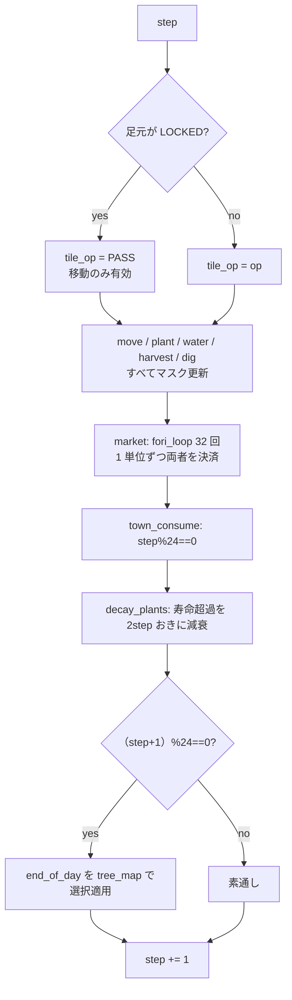

# jaxenv 実装解説

> 対象: `backend/src/simulate/jaxenv/`（参考: `backend/tests/e2e/src/simulate/test_jaxenv_equivalence.py`, `docs/plans/simulator/jax-gpu.md`）
> 規模: 5 ファイル / 1,016 行（`__init__.py` は 0 行）
> 分析日: 2026-08-11
> コミット: `133e83b`
> 読み込み深度: 全ファイル精読（等価性テストと計画ドキュメントも通読）

## 概要

`jaxenv` は Kaggriculture の公式エンジン（`kaggle-environments`）を **JAX で書き直した バッチ版シミュレータ**。公式エンジンの状態はタイルごとの Python dict の入れ子で、アクセラレータに載らない。そこで状態を「バッチ軸 `B` を先頭に持つ struct-of-arrays」に平坦化し、`B` 個の環境を 1 本の `jax.jit` 済み `step` で同時に進める。

これは**ラッパーではなく再実装**なので、公式エンジンとの一致は構造的に保証されない。だから `tests/e2e/src/simulate/test_jaxenv_equivalence.py` の等価性テストが、このモジュールを使ってよいことの唯一の根拠になっている。

外から見た入口は 2 つだけ。ベンチマーク CLI (`python -m simulate.jaxenv.benchmark`) と、テスト／実験コードから直接叩く `initial_state()` + `env.step()`。`simulate/__init__.py` の公開 API には**含まれていない**（`__init__.py` は空で、`simulate` 本体からは一切参照されていない）。つまり現時点では検証用の独立したサブパッケージである。

目的は `docs/plans/simulator/jax-gpu.md` に明記されており、「GPU バッチ化で本当に速くなるか」の検証。結論は CUDA で 42,929x、Apple Metal では逆に 0.26x（scatter 性能の差）。

## 1. ディレクトリ構成

```
backend/src/simulate/jaxenv/
├── __init__.py      空。再エクスポートなし（サブモジュールを直接 import する設計）
├── state.py   245行 EnvState（struct-of-arrays）、ゲーム定数テーブル、市場価格モデル
├── env.py     446行 @jax.jit な step 本体。全ルールを jnp.where のマスク更新で表現
├── town.py    116行 ショップ解放スケジュールの host 側再現（device には載らない）
└── benchmark.py 209行 official / fast / jax の env-steps/s 比較 CLI
```

### エントリポイント

| 入口 | 実体 | 用途 |
|---|---|---|
| `python -m simulate.jaxenv.benchmark` | `benchmark.main()` | 3 エンジンのスループット比較 |
| `initial_state(batch_size)` | `state.py:205` | バッチ状態の生成 |
| `env.step(state, op, crop_arg, market_op, market_item, market_qty)` | `env.py:406` | 1 ターン進行（jit 済み） |
| `market_price(inventory)` | `state.py:180` | 価格モデル単体（テストで直接検証されている） |
| `town.shop_demand_table(seed, days, ...)` | `town.py:98` | ショップ需要テーブル（**現状 step からは未使用**） |

### 依存方向

```
state.py  ←  env.py  ←  benchmark.py
   ↑                        │
   └──────  town.py         └──→ simulate.config / simulate.fast（比較対象として）
```

- `state.py` は自己完結（`jax` のみ）。
- `env.py` は `state.py` の定数と `EnvState` にのみ依存。
- `town.py` は `state.py` の `N_PRODUCTS` / `PRODUCT_NAMES` だけを使い、`env.py` からは**呼ばれていない**。孤立した補助モジュール。
- `benchmark.py` だけが外部（`kaggle_environments`, `simulate.fast`, `simulate.config`）を触る。しかも遅延 import なので、`env`/`state` を使うだけならエンジン本体は不要。

### ここに無いもの

- **公式エンジンとの照合ロジック**は `backend/tests/e2e/src/simulate/test_jaxenv_equivalence.py` にある。`jaxenv` 内には一切ない。
- **忠実な高速実行**が欲しい場合は `backend/src/simulate/fast.py`（エンジンの interpreter を直叩きする、ルール乖離ゼロで約 30x）。`jaxenv` はそれとは別系統の「速度優先・忠実度限定」の選択肢。
- `jax` は `pyproject.toml` に**書かれていない**。`kaggle-environments` が直接 requires しているので必ず存在する、という前提（`state.py` の docstring に明記）。

### 実装されていないゲーム要素（`env.py` docstring より）

雇用 hand、家畜、肥料、`BUY_LAND`（NW クォドラントのみ）、町ショップ、雑草の自然発生。実質「小麦ループ相当の政策」が表現できる範囲。

## 2. クラス / メソッド一覧

### コアオブジェクト: `EnvState`（`state.py:124`, `NamedTuple`）

全フィールドが JAX 配列。先頭が バッチ軸 `B`、プレイヤー軸は `2`。`NamedTuple` なので JAX の pytree としてそのまま `jit` / `fori_loop` / `tree_map` に通る。

| フィールド | shape / dtype | 意味 |
|---|---|---|
| `step` | `(B,)` int32 | 通算ターン数。`day = step // 24`, `hour = step % 24` はプロパティ |
| `money` | `(B, 2)` float32 | 所持金。エンジンの整数価格に合わせて丸めた値のみ入る |
| `kind` | `(B,2,H,W)` int32 | タイル種別。`KIND_EMPTY=0`（ゼロ盤面＝空）/ PLANT / WEED / LOCKED / COOP / PASTURE |
| `crop` | `(B,2,H,W)` int32 | 作物コード。`CROP_NONE = -1` |
| `planted_day` | 同上 | 植えた日。成熟・産出判定の基準 |
| `watered_today` | 同上 | その日水やり済みか（0/1）。日次処理でリセット |
| `consecutive_unwatered` | 同上 | 連続無水日数。**2 で雑草化** |
| `yield_units` | 同上 | 収穫可能な単位数 |
| `max_lifespan_step` | 同上 | 寿命切れ step。`-1` は無期限（ongoing 作物） |
| `farmer_x` / `farmer_y` | `(B,2)` int32 | farmer の座標。hand は未モデル化 |
| `shed` | `(B,2,9)` int32 | 納屋。容量 100（`SHED_CAPACITY`） |
| `carried` | `(B,2,9)` int32 | 手持ち。日終わりに shed へ搬入され、溢れた分は消える |
| `seeds` | `(B,2,5)` int32 | 種の保有数 |
| `market_inv` | `(B,9)` int32 | **両プレイヤー共有**の市場在庫。プレイヤー軸を持たない唯一の在庫 |

補足: 作物コード 0..4 は商品コード 0..4 と一致する設計（`crop_idx` をそのまま `one_hot(..., N_PRODUCTS)` に使える）。商品は 9 種（作物 5 + EGG/MILK/WOOL/FERTILIZER）。

### `state.py` の関数・定数

| 名前 | 種別 | 責務 | 入力 | 出力 |
|---|---|---|---|---|
| `_shape_fn` | 関数 | エンジンの `_shape`（linear/sq/sqrt/log/log10）を分岐なしで選択 | 形状コード, x | 変換値 |
| `market_price` | 関数 | 在庫から 9 商品の価格を算出。`I0` の上下で別の形状関数 | `(..., 9)` 在庫 | `(..., 9)` int32 価格 |
| `initial_state` | 関数 | 初期盤面（NW のみ解放、farmer は `(4,4)`、市場は `I0=10000`） | `batch_size` | `EnvState` |
| `tree_flatten_check` | 関数 | 全 leaf の バッチサイズ一致を検査する安全弁 | `EnvState` | なし（不一致なら `ValueError`） |
| `CROP_*` テーブル群 | 定数配列 | 種コスト / 初回収穫日 / 最大収穫日 / 間隔 / 最大収量 / 継続産出フラグ | — | crop コードで index |
| `MARKET_*` テーブル群 | 定数配列 | `MARKET_PARAMS` を転置した並列配列 | — | product コードで index |

`market_price` には**丸めの罠への明示的な対処**がある。エンジンは Python の `int(round(x))`（正値なので half-away-from-zero）だが `jnp.round` は銀行家丸めなので、`jnp.floor(price + 0.5)` で合わせている（`state.py:201`）。ここを素直に書くと 0.5 刻みで価格が 1 ずれる。

### `env.py` の関数

すべて `EnvState -> EnvState` の純関数。名前は `_apply_*` / `_process_*` だが**破壊的変更はしない**（`_replace` で新しい `EnvState` を返す）。

| 名前 | 責務 | 入力 | 出力 |
|---|---|---|---|
| `_gather_tile` | `(B,2,H,W)` から各 `(b,p)` の足元タイルを読む | plane, x, y | `(B,2)` |
| `_scatter_tile` | 足元タイルに書き込む（`.at[].set`） | plane, x, y, value | plane |
| `_apply_moves` | 4 方向移動。盤外は no-op（クランプではなく据え置き） | state, op | state |
| `_apply_plant` | 空きタイルに種 1 個を消費して植える | state, op, crop_arg, day | state |
| `_apply_water` | 水やり。ボーナス窓内なら `yield_units` +1 | state, op, day | state |
| `_apply_harvest` | 成熟した株を `carried` に収穫。非 ongoing はタイルをクリア | state, op, day | state |
| `_apply_dig` | PLANT / WEED を空きに戻す | state, op | state |
| `_process_market` | SELL / BUY_SEED を **1 単位ずつ逐次**で決済 | state, market_op/item/qty | state |
| `_town_consume` | 町中心の需要（24 step ごとに肥料以外 1 個ずつ減） | state, step | state |
| `_decay_plants` | 寿命超過の株を 2 step ごとに 1 収量ずつ減らし、0 で雑草化 | state, step | state |
| `_end_of_day` | 日次処理（無水判定・継続産出・shed 搬入・farmer 位置リセット） | state, day | state |
| `step` | `@jax.jit`。上記を規定順に合成して 1 ターン進める | state + 5 本のアクション配列 | state |

### アクション表現

`step` はアクションを 5 本の `(B, 2)` int32 配列として受ける（プレイヤーごとに 1 op / 1 市場注文）。

| 引数 | 値域 |
|---|---|
| `op` | `OP_PASS/NORTH/SOUTH/EAST/WEST/PLANT/WATER/HARVEST/DIG` (0..8) |
| `crop_arg` | 作物コード 0..4（PLANT 以外では無視） |
| `market_op` | `MARKET_NONE/SELL/BUY_SEED` (0..2) |
| `market_item` | 商品コード（BUY_SEED では 0..4 に clip される） |
| `market_qty` | 数量。**上限 32**（`_process_market` の `max_units`） |

### `town.py`

| 名前 | 責務 | 入力 | 出力 |
|---|---|---|---|
| `SHOPS` | エンジンの店舗定義。`sorted(SHOPS)` の順序が抽選結果を左右する | — | dict |
| `unlocked_shops_by_day` | エンジンの RNG 列を host 側で再生し、日ごとの有効店舗を返す | seed, days, 空きタイル数 | `list[list[str]]` |
| `shop_demand_table` | 上記を「日 × 商品」の消費量テーブルに変換 | seed, days | `(days, 9)` int32 |

### `benchmark.py`

| 名前 | 責務 | 入力 | 出力 |
|---|---|---|---|
| `BenchResult` | 1 計測結果（`env_steps` / `steps_per_sec` は派生プロパティ） | dataclass | — |
| `bench_jax` | エピソード全体を 1 本の `fori_loop` にして計測。warm-up でコンパイル時間を分離 | batch_size, steps | `BenchResult` |
| `bench_official` | `env.run(["starter","pass"])` を計測 | steps | `BenchResult` |
| `bench_fast` | `simulate.fast.run_fast_episode` を計測 | steps | `BenchResult` |
| `render` | official 比の倍率つきテーブル文字列 | results | str |
| `main` | CLI（`--steps` / `--batches` / `--json` / `--skip-cpu`） | argv | 標準出力 + 任意の JSON |

## 3. 処理ステップ

### `step()` のメインパス（1 ターン）

```
1. day = state.step // 24 を算出                                   (env.py:420)
2. 足元タイルが LOCKED なら tile_op を PASS に落とす
   （移動は許可、タイル操作だけ禁止）                                 (env.py:423)
3. _apply_moves: op の (dx,dy) を足し、盤内なら反映              (env.py:426/99)
4. _apply_plant: 空き & 種あり なら植付                          (env.py:427/110)
5. _apply_water: PLANT & 未水やり なら水やり + 窓内なら収量+1     (env.py:428/176)
6. _apply_harvest: 成熟 & 収量>0 なら carried へ                 (env.py:429/208)
7. _apply_dig: PLANT/WEED を空きに                               (env.py:430/235)
8. _process_market: fori_loop で 1 単位 32 回まで決済            (env.py:432/254)
9. _town_consume: step % 24 == 0 なら肥料以外 1 個ずつ在庫減      (env.py:433/326)
10. _decay_plants: 寿命超過株を 2 step おきに 1 収量減、0 で雑草   (env.py:434/333)
11. closes_day = (step+1) % 24 == 0 のとき _end_of_day の結果を
    tree_map + jnp.where で選択適用                              (env.py:436/351)
12. step += 1                                                     (env.py:446)
```

順序はエンジンに合わせてある（ユニット行動 → 市場 → 枯死 → 日次）。

### 「分岐」がどう表現されているか

Python の `if` は**トレース値に対して一切使われていない**。すべて `ok = 条件A & 条件B & ...` のブールマスクを作り、`jnp.where(ok, 新値, 旧値)` で書き戻す形。だから同じ命令列が `B` 個すべての環境に流れる。分岐に見える箇所は実際にはこう分解されている。

- **PLANT の成立条件**: `op == OP_PLANT` かつ `kind == EMPTY` かつ `seeds[crop] > 0`（`env.py:118`）
- **WATER の収量ボーナス窓**: `age ∈ [(max_yield_day+1)//2, max_yield_day]` かつ非 ongoing 作物のみ（`env.py:191-194`）
- **HARVEST でタイルが消えるか**: ongoing 作物（TOMATO / STRAWBERRY）は残り、それ以外は EMPTY に戻る（`env.py:224-225`）
- **形状関数の選択**: 5 種を全部計算してから `take_along_axis` でコードに応じて 1 本選ぶ。sqrt/log に負値や 0 が入らないよう、選択**前**に `jnp.maximum(x, 1e-12)` でガードしてある（`state.py:167`）。これをしないと選ばれない枝の NaN が勾配や select 経由で伝播しうる。



### 市場決済がループになっている理由（`_process_market`）

ここだけベクトル化を諦めている。エンジンは**両プレイヤーを同じ約定前在庫で見積もり、その後 1 単位ずつコミットする**。この逐次依存は本物なので、`jax.lax.fori_loop` を固定長 32 回まわして再現している。

各反復でやること:

1. 現在の `market_inv` から価格を再計算（`market_price`）
2. `remaining > 0` かつ SELL で `shed` に在庫あり → 1 個売却。`money += 価格`、`shed -= 1`
3. `remaining > 0` かつ BUY_SEED で所持金が種代以上 → `money -= 種代`、`seeds += 1`
4. 売却分だけ `market_inv` を増やす。ただし**価格が $1 の床に張り付いているときは在庫を増やさない**（`above_floor` 判定、`env.py:291`）
5. 成立したものだけ `remaining -= 1`。**成立しなかったら `remaining = 0` にして以降の試行を打ち切る**（`env.py:304`）

固定長 32 なので、`market_qty` に 33 以上を渡すと**エラーにならず静かに 32 個で打ち切られる**。

### 日次処理（`_end_of_day`）

1. その日水をやっていない株の `consecutive_unwatered` を +1。**2 以上で雑草化**（`env.py:358`）
2. ongoing 作物は `since_first = 翌日 - planted_day - first_yield_day` が 0 以上かつ `interval` の倍数のとき収量 +1。累計回数が `CROP_MAX_YIELD` を超えたら打ち止め（`env.py:364-373`）
3. `carried` を `shed` へ搬入。空き容量は `100 - shed 合計`。**商品コード順に詰めて、入り切らない分は捨てられる**（`cumsum` を使った容量配分、`env.py:382-388`）
4. `watered_today` を全 0 にリセット、`carried` を空に、farmer を `(4,4)` に戻す

このブロックは常に計算され、`closes_day` が真のバッチだけ `tree_map` + `jnp.where` で採用される（`env.py:438`）。つまり**日をまたがないターンでも end-of-day の計算コストは毎ターン払っている**。定常的なコストで、分岐を避けるための意図的なトレードオフ。

### エラー処理と「静かな失敗」

このモジュールは**例外を投げない**（`tree_flatten_check` の `ValueError` が唯一の例外で、しかもどこからも呼ばれていない）。不正入力はすべて無視される。競技本体の「不正アクションは silent no-op」という性質と揃っているが、デバッグ観点では以下に注意。

| 状況 | 挙動 |
|---|---|
| 種を持たずに PLANT | マスクが立たず何も起きない |
| 盤外への移動 | 座標が据え置かれる（PASS と同じ） |
| LOCKED タイル上でのタイル操作 | `tile_op` が PASS に落とされる |
| `market_qty > 32` | 32 個で打ち切り。警告なし |
| `market_item` が 5..8 で BUY_SEED | `clip(0,4)` されて別の種を買う |
| バッチサイズ不整合 | `jnp` のブロードキャストエラーになるか、最悪静かに壊れる |

### 副作用

- `env.py` / `state.py` / `town.py` は**副作用ゼロ**（純関数のみ、IO なし、グローバル可変状態なし）。
- `benchmark.py` のみ、標準出力への print と `--json` 指定時のファイル書き込みを行う。
- モジュール import 時に `jnp.array` の定数テーブルが作られるため、**import した時点でデフォルトデバイスが確定する**。これが `jax-metal` を同じ venv に入れてはいけない理由につながる。

## 補足

### 読み手が驚きそうな点

1. **`town.py` は誰からも呼ばれていない。** ショップ需要テーブルを作る関数は存在するが、`env.step` はそれを受け取る引数を持たない。町の需要として実装されているのは `_town_consume`（町中心のみ）だけ。ショップは「host 側で回すか、両エンジンで無効化するか」という未決着の設計判断が docstring に記録されたまま宙に浮いている。

2. **ショップ解放の RNG は盤面依存で、seed だけでは決まらない。** `_spawn_weeds` が同じ RNG ストリームを先に消費し、その回数が**空きタイル数**に等しい。実測で 1 日目 50 回 → 雑草が出ると 49 → 48。だから `unlocked_shops_by_day` は空きタイル数を引数に取る。等価性テストがショップを無効化しているのはこれが理由。

3. **`docs/competition/abstract.md` と実装が食い違っている。** abstract は町中心の需要に「11 日目以降 2 倍、21 日目以降 4 倍」と書いているが、このエンジン版は常に 1 個・間隔 24。`env.py:320-323` にその旨がコメントで残っている。abstract ではなくエンジンのコードが正。

4. **`BUY_SEED` は市場在庫を減らさない。** 種は板から引かれるのではなく「発行」される（`_process_market` のコメント）。市場在庫は SELL でしか動かない。

5. **`consecutive_unwatered` は植えた瞬間に 1 で始まる。** 植えた日はすでに「水やり未実施」としてカウントされるので、新しい株は**その日のうちに水をやらないと 2 日目で雑草になる**（`env.py:120-121`）。

6. **`jax-metal` をリポジトリの venv に入れると全テストが壊れる。** `jax.devices()` が METAL を返すようになり、しかもこのワークロードは CPU より約 100 倍遅い。`state.py` の docstring と `docs/plans/simulator/jax-gpu.md` §7 の両方で警告されている。原因は scatter で、Metal は要素演算の 9.1 倍かかる（CUDA は 0.95 倍でペナルティなし）。タイルベース環境は scatter の塊なので、そのまま性能差になる。

### 等価性の担保範囲

`backend/tests/e2e/src/simulate/test_jaxenv_equivalence.py` が検証しているのは以下のみ。

| テスト | 内容 |
|---|---|
| `test_wheat_loop_matches_official_engine` | 小麦ループ 3/8/15 日を公式エンジンと全 step 比較（money / seeds / shed / market_inv） |
| `test_market_price_matches_official_across_inventory_range` | 9 商品 × 9 在庫点（`I0` 境界含む）で価格一致 |
| `test_batched_environments_are_independent` | バッチ内の環境が干渉しない |
| `test_batching_does_not_change_dynamics` | batch 1 と batch 16 で同一結果 |

条件は `weedSpawnChance=0` かつショップ無効。hand / 家畜 / 土地 / 肥料は実装外なので検証もされていない。**この範囲を超えて使うと黙って公式と乖離する。**

### 未解決の論点

- ショップ需要を device 側に載せる方法が決まっていない（`town.py` docstring）。
- 実装範囲の拡張（hand / 家畜 / 土地 / 肥料）が最大のボトルネック。`docs/plans/simulator/jax-gpu.md` §6 は「速度はもう足りているので、次の投資先は忠実度」と結論している。
- `tree_flatten_check` は定義されているが呼び出し箇所がない。

### 関連ドキュメント

- `docs/plans/simulator/jax-gpu.md` — GPU 検証の全結果、再現手順、engine から発見した事実
- `backend/src/simulate/fast.py` — 忠実度優先の高速化（interpreter 直叩き、約 30x）。`jaxenv` の対になる選択肢
