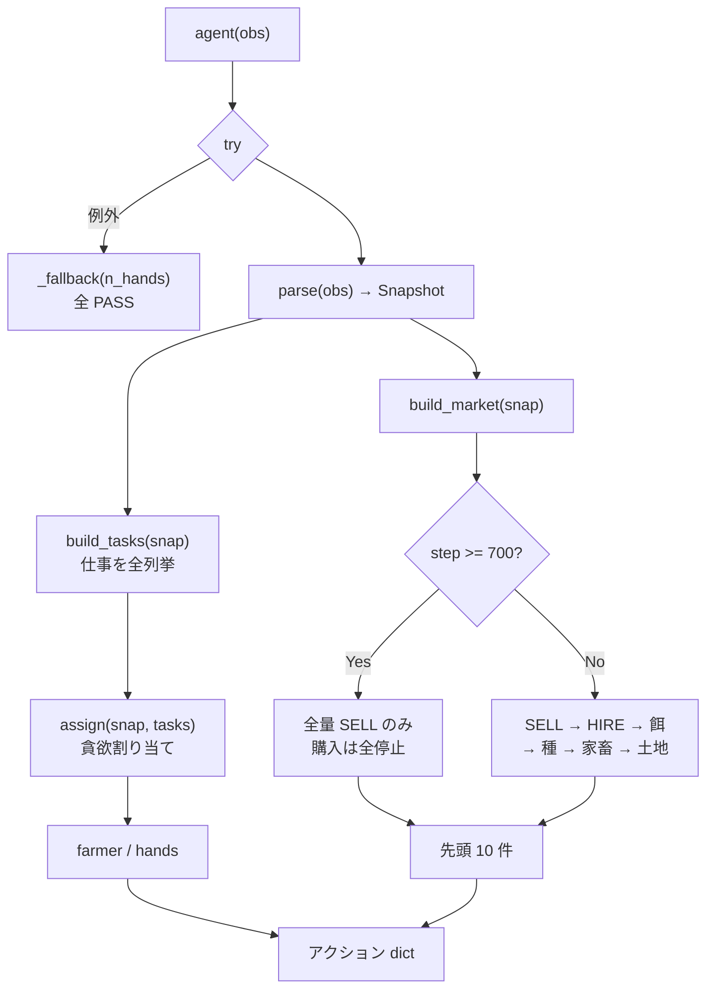

# rulebase/case7 実装解説

> 対象: `backend/pipeline/rulebase/case7/`
> 規模: 5 ファイル (Python 4 + README 1) / 1,544 行 (Python 1,434 行)
> 分析日: 2026-08-11
> コミット: `133e83b`
> 読み込み深度: 全ファイル精読

## 概要

Kaggriculture の 720 ターン (24 ターン × 30 日) を戦い抜く**ルールベース農場エージェント**。ML は一切使わず、毎ターン「観測をパースする → やるべき仕事 (Task) を全部列挙する → ユニットに 1 つずつ割り当てる → 市場注文を優先度順に組む」という 4 段のパイプラインで 1 手を決める。

入口は `main.py` の `agent(obs)` ただ 1 つ。case2 (小麦 + メロン + 酪農) をベースに、case3 から 3 つの機構をフラグ付きで移植し、A/B 測定した結果 2 つを OFF にしてある。実際に最も効いたのは移植ではなく、その過程で露見した case2 のバグ (ゾーン制約で家畜が餓死する) の修正 (`Task.zone_free`, +14,714)。

外部依存はゼロ (標準ライブラリの `math` / `collections` / `dataclasses` のみ)。numpy すら使わない。

## 1. ディレクトリ構成

```
backend/pipeline/rulebase/case7/
├── main.py      69 行   エントリポイント。agent(obs) と例外フォールバック。4 段パイプラインの接続だけ
├── observe.py  247 行   raw obs → Snapshot / Tile への防御的パース。全アクセスが .get + 型変換
├── tasks.py    478 行   本体。Task 生成 (build_tasks) と貪欲割り当て (assign)、BFS 経路、群れ規模の算定
├── market.py   282 行   市場注文の組み立て。価格曲線の自前再現、売却・種・餌・家畜・雇用・土地
├── config.py   358 行   エンジン定数 (作物/動物/価格パラメータ/店) + 3 つの feature flag + 戦略チューニング値
└── README.md   110 行   仮説・ablation 結果・ボツになった機構の記録。ここに「なぜ」が書いてある
```

### エントリポイント

- **`main.py:agent(obs)`** — Kaggle ハーネスが 1 ターンにつき 1 回呼ぶ唯一の関数。ハーネスは**モジュール内で最後に定義された callable** をエージェントとみなすので、`agent` は必ずファイル末尾に置かれている (docstring に明記)。
- ハーネスは `__name__` / `__file__` なしで `exec` するため相対 import が使えない。よって `from config import ...` のように**裸の名前で兄弟モジュールを import** している (ハーネスが自ファイルのディレクトリを `sys.path` に追加する前提)。`tar -C <case-dir> .` でアーカイブ直下に平置きされても同じ形で動く。

### 依存方向

```
config.py  (定数のみ、何も import しない)
   ↑
observe.py (config の ANIMALS / BOARD_SIZE / TURNS_PER_DAY を使う)
   ↑
tasks.py   (config + observe)
   ↑
market.py  (config + observe + tasks の crop_targets/feed_needed/herd_target/next_animal/plantable)
   ↑
main.py    (全部)
```

一方向の綺麗な層構造。循環はない。`market.py` が `tasks.py` の**計画関数**を再利用しているのがポイントで、「畑に何を植えたいか」と「種を何個買うか」が同じ `crop_targets()` から導かれるため、計画と発注がズレない。

### ここに *ない* もの

- **経路探索のコスト計算** — 障害物概念がない。`first_step_towards` は「盤内なら LOCKED タイルにも入れる」前提の BFS で、実質マンハッタン最短。
- **対戦相手のモデリング** — `Snapshot.opponent_crop_tiles()` という読み取り口はあるが、それを使う唯一の機構 (メロン作付調整) はフラグ OFF。相手の在庫や売り圧を予測する仕組みは存在しない。README が「これが次の課題」と明言している。
- **学習・状態の永続化** — ターン間で持ち越す状態は一切なし。完全に obs のみから毎ターン再計算する stateless 設計。
- **ログ出力** — 提出コードのホットパスなので `print` / `logging` ともにゼロ。

## 2. クラス / メソッド一覧

### コアオブジェクト

#### `Tile` (observe.py:17, frozen dataclass)

盤面 1 マスを平坦化したもの。エンジンの raw 表現 (文字列 `"LOCKED"` / `None` / dict) を単一の形に正規化する。

| フィールド | 型 | 意味 |
|---|---|---|
| `x`, `y` | int | 座標。`pos` プロパティで `(x, y)` タプル |
| `kind` | str | `LOCKED` / `EMPTY` / `WEED` / `PLANT` / `COOP` / `PASTURE` / `ANIMAL` |
| `crop`, `animal` | str \| None | 種類名 |
| `yield_units` | int | 収穫可能な単位数。>0 なら HARVEST 対象 |
| `planted_day` | int | 植えた日。`day - planted_day` が樹齢 |
| `watered_today` / `fed_today` / `cared_today` | bool | その日の作業済みフラグ |
| `consecutive_unwatered` / `consecutive_unfed` | int | **期限カウンタ**。2 で作物は雑草化、動物は逃亡 |
| `fertilizer_available` | bool | 動物マスから肥料を回収できるか |

> `kind` の判定順に注意 (`_parse_tile`)。raw dict に `"animal"` キーがあれば `kind` の値に関わらず `ANIMAL` 扱い。`kind` フィールドを先に見ていない。

#### `Snapshot` (observe.py:45, dataclass)

1 ターン分の全情報。ポリシーはこれ以外を見ない。

| フィールド | 型 | 補足 |
|---|---|---|
| `step`, `day`, `hour` | int | `step` 欠損時は `day * 24 + hour` で補完 |
| `player` | int | 自分の座席 |
| `money` | float | 自分の所持金 |
| `tiles` | `list[list[Tile]]` | `tiles[y][x]` (行が先) |
| `farmer` | `Pos` | 農夫の位置。欠損時のデフォルトは `(4,4)` = 倉庫タイル |
| `hands` | `list[Pos]` | 雇った日雇いの位置。**この長さがアクション dict の `hands` 長を規定する** |
| `unlocked_quadrants` | `list[str]` | `["NW", ...]`。作付・牧場数のスケール係数 |
| `hires_today` | int | 今日すでに雇った人数 (毎朝リセット) |
| `shed` | `dict[str,int]` | 倉庫在庫。SELL はここからしか引かれない |
| `seeds` | `dict[str,int]` | 種在庫 (倉庫容量 100 の対象外) |
| `inventories` | `list[dict[str,int]]` | **ユニットごとの手持ち**。index 0 = 農夫、以降 hands の順 |
| `prices` / `market_inventory` | `dict[str,int]` | 市場の現在価格と在庫 |
| `unlocked_shops` | `list[str]` | 解放済み町の店。**読むだけで、現状どこからも参照されていない** |
| `opponent_tiles` | `list[list[Tile]]` | 相手の盤面 (公開情報) |
| `opponent_money` | float | 相手の所持金。**現状未使用** |

#### `Task` (tasks.py:71, frozen dataclass)

「このマスでこの操作をしたい」1 件。

| フィールド | 意味 |
|---|---|
| `priority` | 小さいほど優先。0=FEED 〜 11=COLLECT_FERTILIZER |
| `target` | 対象マス |
| `op` | 実際に返すアクション配列 (`["WATER"]`, `["PLANT","MELON"]` など) |
| `needs_item` | そのアイテムを**手に持っている**ユニットにしか割り当てない |
| `at_shed` | 倉庫作業。4 つの倉庫隣接マスのうち最寄りへ再ターゲットされる |
| `zone_free` | **ゾーン制約を免除**。case7 の最大の改善点 |

優先度テーブル (tasks.py:57-68):

```
0  FEED           ← 期限: 2 日未給餌で家畜逃亡
1  FETCH_FEED     ← 餌を持つ者がいないと FEED タスクすら生成されない
2  RESCUE_WATER   ← 期限: 2 日未灌水で作物が雑草化
3  HARVEST
4  FETCH_ANIMAL
5  PLACE_ANIMAL
6  BUILD_PASTURE
7  WATER          (通常)
8  CARE
9  PLANT
10 DIG
11 COLLECT_FERTILIZER
```

### 関数一覧

#### main.py

| 名前 | 種別 | 責務 | 入力 | 出力 |
|---|---|---|---|---|
| `agent` | 関数 | エントリポイント。`_decide` を try/except で包む | `obs` | アクション dict |
| `_decide` | 関数 | 4 段パイプラインの接続 | `obs` | アクション dict |
| `_fallback` | 関数 | hands 長だけ正しい no-op | `n_hands` | アクション dict |

#### observe.py

| 名前 | 種別 | 責務 | 入力 | 出力 |
|---|---|---|---|---|
| `parse` | 関数 | raw obs → `Snapshot`。全アクセス防御的 | `obs` (dict/Struct 両対応) | `Snapshot` |
| `_parse_grid` | 関数 | 10×10 を必ず埋める。足りない分は `LOCKED` | raw tiles | `list[list[Tile]]` |
| `_parse_tile` | 関数 | 1 マスの正規化 | raw, x, y | `Tile` |
| `_as_int` / `_as_pos` / `_parse_counts` | 関数 | 型変換ヘルパー。例外を握って既定値 | Any | int / Pos / dict |
| `Snapshot.units` | property | 農夫 + hands をアクション dict の順で返す | — | `list[Pos]` |
| `Snapshot.opponent_crop_tiles` | メソッド | 相手が特定作物を何マス育てているか | crop 名 | int |
| `animal_product` | 関数 | 動物 → 産物名 | 動物名 | str \| None |

#### tasks.py

| 名前 | 種別 | 責務 | 入力 | 出力 |
|---|---|---|---|---|
| `build_tasks` | 関数 | **その turn にやる価値のある仕事を全列挙**。約 120 行の中核 | `Snapshot` | `list[Task]` |
| `assign` | 関数 | 貪欲割り当て。1 タスク 1 ユニット、重複なし | `Snapshot`, tasks | `list[list[str\|int]]` (ユニット順) |
| `_idle_action` | 関数 | 仕事がないユニットの行動 (倉庫へ搬入 / 餌補充) | snap, idx, pos | アクション配列 |
| `first_step_towards` | 関数 | BFS で最初の 1 歩の方角 | start, goal | `"NORTH"` 等 \| None |
| `_zone_of` | 関数 | 列バンドでマスをユニット担当に割る | pos, n_units | ユニット index |
| `crop_targets` | 関数 | 作物ごとの目標作付マス数 (象限数でスケール) | `Snapshot` | `dict[str,int]` |
| `_planting_plan` | 関数 | 目標 − 現状 = あと何マス植えるか | `Snapshot` | `dict[str,int]` |
| `melon_tiles_per_quadrant` | 関数 | 相手の作付とメロン価格から作付量を調整 (**フラグ OFF**) | `Snapshot` | int |
| `herd_target` | 関数 | 今日欲しい家畜数。日でランプ + 牧場スロット上限 | `Snapshot` | int |
| `next_animal` | 関数 | 次に買う種。`HERD_SEQUENCE` を所有数で剰余 | `Snapshot` | `"COW"` / `"SHEEP"` |
| `_pasture_targets` | 関数 | あと何個牧場を建てるか | `Snapshot` | int |
| `feed_needed` | 関数 | 家畜数 × 4 = 確保したい小麦 | `Snapshot` | int |
| `workable_tiles` | 関数 | LOCKED と倉庫 4 マスを除いたマス | `Snapshot` | `list[Tile]` |
| `plantable` | 関数 | 今植えて収穫まで間に合うか (`day + first_yield ≤ 29`) | snap, crop | bool |
| `nearest_shed_tile` | 関数 | 4 つの倉庫隣接マスの最寄り | pos | `Pos` |

#### market.py

| 名前 | 種別 | 責務 | 入力 | 出力 |
|---|---|---|---|---|
| `build_market` | 関数 | 注文リストを優先度順に組んで 10 件に切る | `Snapshot` | `list[Order]` |
| `price_at` | 関数 | **エンジンの価格曲線を自前で再現** | item, inventory | int |
| `sale_proceeds` | 関数 | n 個売った時の総額 (1 個ずつ曲線を降りる) | item, qty, inv | int |
| `_impact_score` | 関数 | 売却額 ÷ (1 + 価格下落幅)。売る順の決定基準 | item, qty, inv | float |
| `_sell_orders` | 関数 | 倉庫在庫の売却。飼料用小麦は温存 | snap, liquidating | orders |
| `_seed_orders` | 関数 | 不足種の補充 (予算内で) | `Snapshot` | orders |
| `_feed_orders` | 関数 | 飼料小麦の不足分を購入 | `Snapshot` | orders |
| `_animal_orders` | 関数 | 空き牧場の分だけ家畜購入。現金留保あり | `Snapshot` | orders |
| `_hire_orders` | 関数 | 毎朝 (hour==0) の雇用 | `Snapshot` | orders |
| `_target_hands` | 関数 | 仕事量から必要人数を算出 (6〜12) | `Snapshot` | int |
| `_land_orders` | 関数 | 日程どおりに象限購入 | `Snapshot` | orders |
| `_shape` | 関数 | linear/sq/sqrt/log/log10 の形状関数 | func, x | float |

### 名前が実態とズレている箇所

- **`market.py` は「市場」以上のことをする** — `HIRE` (雇用) と `BUY_LAND` (土地) もここで発行される。エンジンの `market` チャンネルがそれらを受け付ける仕様のため。ファイル名から想像するより広い。
- **`_sell_batch_size(item, held, inventory, liquidating)` は `inventory` を使っていない** (market.py:89)。シグネチャに残っているだけのデッドパラメータ。
- **`Task.target` が実際の移動先とは限らない** — `at_shed=True` のタスクは `target` が `SHED_TILES[0]` 固定で、実際の goal は `nearest_shed_tile(pos)` で解決される (tasks.py:411, 435)。
- **`build_tasks` の docstring は「unordered by unit」** だが、生成順自体はタイル走査順に依存する。実際の順序は `assign` 側の `sorted(tasks, key=(priority, target))` で決まる。
- **`main.py` の docstring が「rulebase/case2」と名乗っている** (case7 なのに)。case2 からのコピー時の取り残し。

## 3. 処理ステップ

### 主経路 — 1 ターン

```
1. ハーネスが agent(obs) を呼ぶ                                    (main.py:58)
2. try: _decide(obs)                                              (main.py:61)
3. parse(obs) → Snapshot
   - obs は dict でも Struct でもよく、.get の有無で分岐          (observe.py:181)
   - farms[player] が取れなければ player=0 / 空 farm に縮退       (observe.py:189)
   - 盤面は必ず 10×10 に整形、欠損は LOCKED                       (observe.py:151)
4. build_tasks(snap) → その turn の仕事を全列挙                    (tasks.py:257)
   4a. 全 workable タイルを走査
       ANIMAL: 未給餌 & 誰かが小麦所持 → FEED(0, zone_free)
               yield>0 → HARVEST(3, zone_free)
               未 CARE → CARE(8, zone_free)
               肥料あり → COLLECT_FERTILIZER(11)
       PLANT : 未灌水 → unwatered>=1 なら RESCUE_WATER(2, zone_free)
                        そうでなければ WATER(7)
               yield>0 かつ 樹齢 >= first_yield_day → HARVEST(3)
       WEED  : DIG(10)
   4b. 空腹頭数 > 持ち込み小麦 かつ 倉庫に小麦あり
       → FETCH_FEED(1, at_shed) を 1 件                            (tasks.py:306)
   4c. herd_target − 既存牧場 の分だけ BUILD_PASTURE(6)
       (倉庫 (4,4) に近い空きマスから)                             (tasks.py:313)
   4d. 空き牧場があり家畜を持っていれば PLACE_ANIMAL(5)、
       倉庫にいて誰も持っていなければ FETCH_ANIMAL(4, at_shed)     (tasks.py:324-358)
   4e. 作付計画の残数 × 種在庫 × 空きマス の min だけ PLANT(9)
       (牧場予約済みマスは除外)                                    (tasks.py:361)
5. assign(snap, tasks) → ユニットごとに 1 手                        (tasks.py:389)
   - タスクを (priority, target) でソート
   - 農夫→hands の順に貪欲に 1 件ずつ取る
   - キー = (priority + ゾーン外なら+100, マンハッタン距離, target)
   - needs_item を持っていないユニットはそのタスクを飛ばす
   - 選んだら claimed に入れ、以降のユニットには渡さない
   - 目的地に立っていれば op を実行、いなければ BFS の 1 歩
   - タスクが取れなければ _idle_action                            (tasks.py:431)
6. build_market(snap) → 注文リスト                                 (market.py:266)
   SELL → HIRE → BUY_PRODUCT(飼料) → BUY_SEED → BUY_ANIMAL → BUY_LAND
   の順に積んで先頭 10 件                                          (market.py:273-282)
7. アクション dict を組む                                          (main.py:51)
   farmer = unit_actions[0]
   hands  = unit_actions[1:1+len(snap.hands)]、足りなければ PASS で埋める
   market = build_market(snap)[:10]  ← 二重に切っている
```

### 分岐

**清算モード (step >= 700)**
`build_market` は `liquidating = snap.step >= 700` で丸ごと挙動を変える (market.py:268)。

- 売却は `SELL_BATCH` の上限を無視して**在庫全量**を 1 注文に (market.py:93)。
- 飼料用小麦の温存 (`reserve`) も 0 になる (market.py:113)。
- 雇用・種・餌・家畜・土地の**購入をすべて停止**。

最終ステップが 718 (`FINAL_EXECUTED_STEP`) — インタプリタが step 718 の後に DONE を立てるので、719 に計画した行動は実行されない。この 18 ステップ (約 0.75 日) が売り切り猶予。売れ残りは 0 円なので、ここは効かないと期末残高に直撃する。

**ゾーン制約と `zone_free`**
`assign` は各ユニットに列バンドの担当ゾーンを割り当て、**ゾーン外のタスクには優先度 +100 のペナルティ**をかける (tasks.py:419-424)。ただし以下は免除される:

- `at_shed` — 倉庫作業は中心にあり誰のゾーンでもない
- `zone_free` — FEED / RESCUE_WATER / HARVEST(動物) / CARE

この `zone_free` が case7 で最大の効果を出した変更 (README で +14,714)。case2 では家畜が数列に固まるため、8 頭が 8 ゾーン中 4 つに偏ると 4 ユニットしか給餌できず、残りは空のゾーンを歩き回って家畜が餓死していた (季節あたり 30 頭ロス → 5 頭に改善)。2 頭の頃は 1 ゾーンに収まるので露見しなかった。

**フィーチャーフラグ 3 種** (config.py:218-252)

| フラグ | 既定 | 影響先 | 測定結果 |
|---|---|---|---|
| `ENABLE_HERD_EXPANSION` | **True** | `herd_target` / `next_animal` / `_target_hands` | +3,507 |
| `ENABLE_OPPONENT_AWARE_MELON` | False | `melon_tiles_per_quadrant` | ±0 (発火しない) |
| `ENABLE_STRAWBERRY` | False | `crop_targets` | −1,919 |

`ENABLE_HERD_EXPANSION` が OFF のときは家畜 2 頭固定 (`TARGET_COWS`)・人手 6 人固定 (`TARGET_HANDS`) に退行する。ON のときは日でランプ (day<6: 2 頭 / day≥6: 8 頭 / day≥12: 14 頭)、人手は仕事量から `ceil((plants + 2*animals + weeds + min(empties,6)) / 7)` を 6〜12 にクランプ。

**季節後半の打ち切り**
- `plantable()`: `day + first_yield_day > 29` の作物はもう植えない・種も買わない。MELON (10 日) は day 20 で締切。
- `_animal_orders`: `day > 18` で家畜購入停止。
- `_land_orders`: `LAND_BUY_DAYS = (5, 9)` で NE→SW のみ。SE ($4,000) は意図的にスキップ。

### エラー処理

- **唯一の try/except は `agent` のトップレベル** (main.py:60)。ここで全例外を握り、hands 長だけ正しい PASS 群にフォールバックする。フォールバック生成自体も try で包まれていて、二段目は `{"farmer":["PASS"],"hands":[],"market":[]}`。
- **`observe.py` は例外を出さない設計**。`_as_int` が `TypeError`/`ValueError` を握り、`_parse_grid` が範囲外を LOCKED で埋め、`farms[player]` が取れなければ空 farm に落とす。パース段で落ちない限りポリシー側で `KeyError` は起きない。
- **`tasks.py` / `market.py` には防御がない**。`CROPS[t.crop]` (tasks.py:297)、`ANIMALS[a]` (tasks.py:326)、`MARKET_PARAMS` 経由の float 変換などは、エンジンが未知の作物・動物を返すと `KeyError` を投げる。それを受け止めるのは `agent` の except だけ。つまり**未知アイテムが 1 つ出た瞬間、そのターンは丸ごと PASS になる** (クラッシュはしないが手も打たない)。
- **サイレント失敗が本命のリスク**。エンジンは不正アクションを例外ではなく no-op として捨てるので、以下は無言で消える:
  - `hands` の要素数が実際の日雇い数と違う (main.py:47-49 で長さを合わせているのはこのため)
  - 11 件目以降の市場注文 (main.py:54 と market.py:282 で二重に `[:10]`)
  - `first_step_towards` が None を返して `["PASS"]` になるケース (start == goal 以外では通常起きないが、起きても無言)

### 副作用

**なし**。ファイル IO・ネットワーク・グローバル状態・キャッシュのいずれも存在しない。`agent` は `obs` だけを読む純関数で、ターン間で持ち越す情報はゼロ。モジュールレベルの可変状態もない (`config.py` の定数はすべて `Final` / 実質不変)。

### フロー図



## 補足

### 読む前に知っておくと得なこと

1. **`README.md` が実装意図の一次資料**。`config.py` のコメントも同様で、定数の隣に「なぜこの値か」が測定値付きで書いてある (例: 「初期実装は day 0 に牛 4 頭 $1,600 を $3,000 の元手から買い、20 日間現金ゼロで雇用も給餌も止まった」)。数値を触る前に必ず読むこと。
2. **OFF のフラグは失敗の記録であって未完成品ではない**。strawberry (−1,919) と opponent-aware melon (±0) はどちらも 30 エピソードで測定済み。「まだ有効化していない機能」と誤読して ON にしないこと。特に melon の方は「原理的には正しいが、このラダーには発火させられる相手がいない」という理由での保留。
3. **case7 は case2 の純粋な上位互換ではない**。builtin 相手には +28% だが、case2 との直接対決は 7/16 で**負け越し**。両者が同じ商品 (MELON/MILK) を同じ市場に投げるため価格が共倒れする (day 29 に MELON が 4、MILK が 26 まで落ちる)。README の "The joint-market problem" 節。

### 気をつけたい挙動

- **`unlocked_shops` と `opponent_money` はパースされているが誰も読んでいない**。町の店は 4 ターンごとに需要を消費し続ける (＝価格を支えてくれる) 唯一のシンクなのに、売却先の選択に一切反映されていない。改善余地の候補。
- **売却順は `_impact_score` = 売却額 ÷ (1 + 価格下落幅) で決まる** (market.py:97)。1 ターンに複数商品を売るとき、同じくらい儲かるなら自分の価格を壊さない方を先に出す設計。ただし**次ターン以降の価格回復は考慮していない**単発最適化。
- **`price_at` はエンジンの実装を手写ししたもの** (config.py の `MARKET_PARAMS` も同様、1.32.6 pin)。エンジン側が更新されると静かにズレる。提出コードがエンジン内部を import できないための複製なので、バージョン追従は手動。
- **家畜購入の現金留保は `CASH_RESERVE(400) + 120 × 所有頭数`** (market.py:211)。頭数に比例させているのは、餌切れで逃げられると $400-500 が丸損だから。「1 頭買わない」方が常に「既存を飢えさせる」より安い、という判断。
- **`_seed_orders` の `want` 計算がやや読みにくい** (market.py:154): `min(deficit, SEED_BATCH, empty_tiles) - snap.seeds.get(crop, 0)`。「今回買いたい上限」から「既に持っている種」を引く形なので、種を貯め込んでいると 0 以下になって発注が止まる。
- **`_hire_orders` は `["HIRE"]` を人数分並べる** (market.py:249)。1 件 1 人なので、12 人雇う朝は市場注文枠 10 件のうち大半を雇用が占める。SELL がその前に積まれるため売却は守られるが、種や家畜の注文が押し出されうる。雇用が多い日ほど購入が遅れる構造。

### 未解決の疑問

- `Tile.kind == "COOP"` はパースされるが、`build_tasks` に COOP / GOOSE を扱う分岐がない。`config.ANIMALS` に GOOSE の定義はあるので、鶏の飼育は意図的に未実装 (`pasture_species` が `("COW","SHEEP")` に絞られている)。
- `animal_product()` (observe.py:243) と `animal_cost()` (tasks.py:477) はどこからも呼ばれていない。case2 からの残骸と思われる。

### 関連ドキュメント

- `backend/pipeline/rulebase/case7/README.md` — ablation 結果とボツ機構の詳細
- `docs/experiment/rulebase/20260811_case7_mechanism_transfer/` — 実験計画と各 iteration の結果
- `docs/experiment/rulebase/20260810_case2_baseline/` — ベースとなった case2
- `docs/competition/abstract.md` — obs スキーマとエンジン仕様
