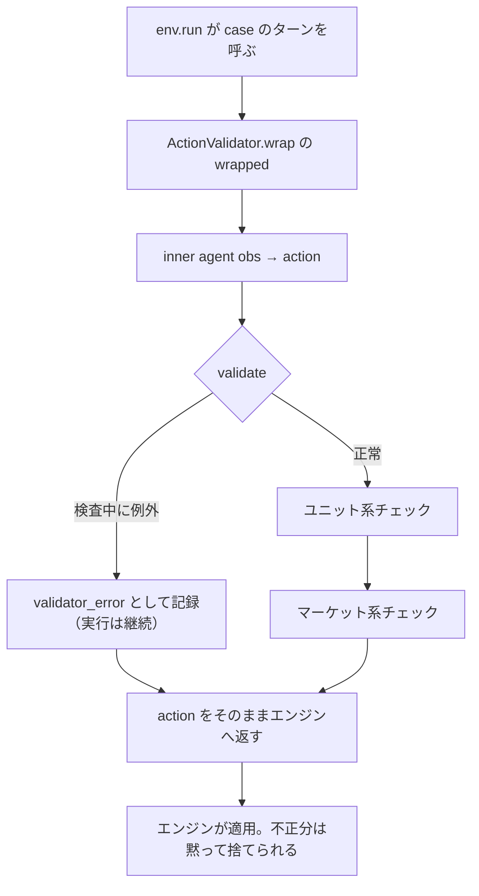

# simulate 実装解説

> 対象: `backend/src/simulate/`
> 規模: 15 ファイル / 2,962 行
> 分析日: 2026-08-11
> コミット: `133e83b`
> 読み込み深度: `simulate/*.py`（10 ファイル / 2,046 行）は全文精読。`simulate/jaxenv/`（5 ファイル / 916 行）はモジュール docstring と役割のみ概観

## 概要

`backend/src/simulate/` は、`kaggle-environments` の `kaggriculture` 環境を使ってエージェントをローカル評価するための開発専用パッケージ（提出物には含まれない）。

このパッケージが存在する理由は一点に尽きる。**エンジンはエージェントの故障を隠す**からである。エージェントが例外を投げても、`actTimeout` を超えても、エピソードは `status == "DONE"` で終わる。不正アクションは黙って no-op になる。つまり `status` と最終スコアだけを見ると、「壊れているエージェント」と「単に弱いエージェント」が区別できない。そこでこのパッケージは crash / timeout / invalid-action を**エンジンとは独立した 3 系統**で検出し、勝率の横に並べて報告する。

外から見た入口は 2 つ。CLI が `python -m simulate --case rulebase/case1 --opponent starter`、ライブラリ API が `from simulate import SimConfig, run_matrix, build_report`。

## 1. ディレクトリ構成

```
backend/src/simulate/
├── __init__.py       公開 API の再エクスポート。__all__ がライブラリ利用の入口
├── __main__.py       Typer CLI。引数 → SimConfig → run_matrix → render → sys.exit
├── config.py         MatchSpec / SimConfig / Engine / ReplayMode。実行前に凍結される全パラメータ
├── agents.py         エージェント指定文字列（builtin 名 / パス / case 名）の解決
├── episode.py        【中核】1 エピソードを env.run で実行し、crash/timeout を独立検出
├── fast.py           【中核】env.run を迂回し interpreter を直接ループ。約 30x 高速、リプレイ不可
├── validate.py       エージェント出力をエンジンに渡す前に検査し、黙殺されるアクションを記録
├── matrix.py         SimConfig を MatchSpec 群に展開し、逐次 / プロセス並列で実行
├── runner.py         旧 API (run_episode/run_match) の後方互換ファサード。新規コードは不使用
├── report.py         EpisodeOutcome 群を対戦相手別に集約し、health ブロック付きで整形・exit code 決定
└── jaxenv/           GPU バッチ実行の実験的移植（本流のエピソード実行とは別系統）
    ├── state.py      盤面を (B,H,W) の flat JAX 配列（struct-of-arrays）で表現
    ├── env.py        jit 対応の batched step。作物 / 市場のみのサブセット実装
    ├── town.py       町ショップ解禁スケジュールをホスト側で事前生成
    ├── benchmark.py  official / fast / jax の env-steps/sec 比較
    └── __init__.py   空
```

### エントリポイント

| 入口 | 用途 |
|---|---|
| `python -m simulate` (`__main__.py:65 main`) | CLI。CI や `dev/*` から呼ばれる主経路 |
| `simulate.run_matrix(config)` | ライブラリ利用の主経路。評価マトリクス全体を実行 |
| `simulate.run_single_episode(spec)` | 単一エピソード（`episode.run_episode`） |
| `simulate.run_fast_episode(spec)` | 単一エピソードの高速版 |
| `simulate.run_episode` / `run_match` | **旧 API**。`runner.py` のファサードで、名前が `episode.run_episode` と衝突している（後述） |
| `python -m simulate.jaxenv.benchmark` | jaxenv のベンチマーク。本流とは独立 |

### 依存方向

きれいな一方向の層構造になっている（上が下に依存する）。

```
__main__.py  (CLI)
     │
   matrix.py ──────────────┐
     │                     │
 episode.py            fast.py         report.py
     │  └──────┬──────────┘               │
 agents.py  validate.py                config.py
     └───────────┴──────────────────────────┘
                    config.py（葉。何にも依存しない）

runner.py → episode.py, config.py, agents.py  （他からは呼ばれない旧 API）
jaxenv/   → 独立（simulate.fast をベンチマークで参照するのみ）
```

`config.py` は葉で、他の `simulate` モジュールを一切 import しない。`episode.py` と `fast.py` は同じ `EpisodeOutcome` を返すので、`matrix.py` から見ると 2 つのエンジンは完全に差し替え可能。`fast.py` が `episode.py` から `ENV_NAME` / `EpisodeOutcome` / `TurnCost` を借りている点だけが例外的な横方向の依存。

### ここに無いもの

- **ゲームルール本体**は無い。`kaggle_environments.envs.kaggriculture` にあり、このパッケージはそれを呼ぶだけ（`jaxenv/` のみ例外的に再実装）。
- **エージェントの実装**は無い。`backend/pipeline/<family>/case<N>/main.py` にある。
- **リプレイの解析・学習データ化**は無い。`backend/src/dataset/` の担当。ここはリプレイ JSON を書き出すところまで。

## 2. クラス / メソッド一覧

### 中核データ構造

これらの形を掴めば、残りのコードはほぼ予測可能になる。

#### `MatchSpec` (config.py:53, frozen dataclass) — 評価マトリクスの 1 セル

| フィールド | 型 | 意味 |
|---|---|---|
| `case` | `str` | 評価対象のエージェント指定 |
| `opponent` | `str` | 相手のエージェント指定 |
| `seed` | `int` | エピソードのシード |
| `steps` | `int` | 既定 720（= `FULL_SEASON_STEPS`） |
| `swap_sides` | `bool` | True なら case が player 1 に座る |

派生プロパティ: `case_player` / `opponent_player`（座席インデックス）、`agent_order()`（`env.run` に渡す順のタプル）、`label`。
**seat が重要な理由**: player 0 が先に共有マーケットへ注文を出すため席順が有利不利を生む。公平な評価には両席で回す必要がある。

#### `SimConfig` (config.py:89, frozen dataclass) — 実行全体のノブ

`case` / `opponents`（タプル）/ `episodes` / `steps` / `seed_base` / `swap_sides` / `workers` / `engine` / `replay_mode` / `output_dir` / `validate_actions` / `strict` / `act_timeout` / `extra_config`。

- `iter_specs()` が `opponents × episodes`（`swap_sides` 時は ×2）に展開する。シードは `seed_base + i` なので、`seed_base` と `episodes` の 2 値だけで再現できる。
- `__post_init__` で `engine=FAST` かつ `replay_mode != NONE` を **例外で拒否**する（fast エンジンは step 履歴を持たないためリプレイを作れない）。

#### `EpisodeOutcome` (episode.py:53, frozen dataclass) — 1 エピソードの結果

**常に case 視点**（player 0 視点ではない）で記録される点に注意。

| フィールド | 型 | 意味 |
|---|---|---|
| `spec` | `MatchSpec` | 実行元の仕様 |
| `case_money` / `opponent_money` | `float` | 最終所持金 |
| `statuses` | `tuple[str, ...]` | エンジンの最終 status |
| `steps` | `int` | 実行ステップ数 |
| `crashed` / `crash_repr` | `bool` / `str \| None` | 例外の有無と traceback |
| `timeouts` | `tuple[TurnCost, ...]` | `act_timeout` 超過ターン |
| `slow_turns` | `tuple[TurnCost, ...]` | 閾値（既定 timeout の 50%）超過ターン。失敗ではなく前兆 |
| `max_duration` | `float` | 最遅ターンの秒数 |
| `issues` | `tuple[ValidationIssue, ...]` | 黙殺されるアクションの記録 |
| `replay_path` | `Path \| None` | 書き出したリプレイ |
| `stderr` | `str` | case 側の stderr 連結 |

派生: `margin` / `winner_is_case` / `is_tie` / `bad_status` / `invalid_actions` / `failed`。
`failed` の定義が明確 — **「負けている」ではなく「壊れている」**（crash / timeout / bad status のいずれか）。`invalid_actions` は `failed` に含まれない。

#### その他の型

| Name | Kind | 責務 | 入力 | 出力 |
|---|---|---|---|---|
| `TurnCost` | frozen dataclass | 1 ターンの実測時間 | step, player, duration | — |
| `Engine` | StrEnum | `OFFICIAL` / `FAST` | — | — |
| `ReplayMode` | StrEnum | `NONE` / `FAILED` / `ALL`（1 エピソード ≈ 5 MB） | — | — |
| `ValidationIssue` | frozen dataclass | 黙殺される 1 アクション | step, kind, detail | — |
| `ExitCode` | IntEnum | `OK=0` / `FAILED=1` / `INVALID_ACTIONS=2` | — | — |

### 関数 / クラス責務表

| Name | Kind | 責務 | 入力 | 出力 |
|---|---|---|---|---|
| `resolve_agent` | function (agents.py:28) | builtin 名 → パス → `pipeline/<case>/main.py` の順で解決。解決不能なら **例外** | `str` | builtin 名 or 絶対パス |
| `available_cases` | function (agents.py:57) | `pipeline/*/*/main.py` の列挙 | — | `list[str]` |
| `run_episode` | function (episode.py:206) | **中核**。1 エピソード実行 + 3 系統の故障検出 + リプレイ書き出し | `MatchSpec`, act_timeout, validate_actions, replay_path, keep_replay, extra_config | `EpisodeOutcome` |
| `_execute` | function (episode.py:174) | `make(..., debug=True)` + `env.run`。例外を捕まえて `_RunArtifacts` 化。stderr を StringIO に退避 | agents, steps, seed, extra_config | `(_RunArtifacts, stderr)` |
| `_harvest` | function (episode.py:159) | 完走した env から reward / status / logs / `toJSON()` を抽出 | `env` | `_RunArtifacts` |
| `_turn_costs` | function (episode.py:97) | `env.logs[step][player]["duration"]` を走査し timeout / slow を分類 | logs, act_timeout, slow_threshold | `(timeouts, slow, max)` |
| `_collect_stderr` | function (episode.py:133) | 1 プレイヤーの stderr をエピソード全体で連結 | logs, player | `str` |
| `run_fast_episode` | function (fast.py:91) | interpreter 直呼びループ。約 30x 高速。同じ `EpisodeOutcome` を返す | `MatchSpec`, act_timeout, validate_actions | `EpisodeOutcome` |
| `_AgentSlot.take_turn` | method (fast.py:67) | 1 ターン実行 + 計時 + 例外を PASS にフォールバックして記録 | obs | `(action, duration)` |
| `ActionValidator` | class (validate.py:144) | エージェントをラップし、エンジンが黙殺するアクションを記録。上限 200 件 | player, max_issues | `.issues` |
| `ActionValidator.wrap` | method (validate.py:165) | 検査を挟んだ callable を返す。**検査自体の例外も飲み込む**（実行を壊さない） | agent (callable or path) | `Callable[[obs], action]` |
| `ActionValidator.validate` | method (validate.py:187) | 1 ターン分をユニット系 + マーケット系に分けて検査 | obs, action | None（副作用で記録） |
| `_check_plant_budget` | method (validate.py:311) | 作物ごとに PLANT 要求数 > 種数を検出。**超過時はその作物の PLANT が全部落ちる**ため高コスト | obs, unit_actions | None |
| `as_callable` | function (validate.py:425) | パス指定を `build_agent` 経由で callable 化。arity を見て `(obs)` / `(obs, config)` を判定 | agent | callable |
| `run_matrix` | function (matrix.py:108) | ジョブ展開 → 逐次 or プロセス並列で実行 → outcome 収集 | `SimConfig`, on_result | `list[EpisodeOutcome]` |
| `build_jobs` / `_Job.run` | (matrix.py:81 / 43) | spec + 実行に必要な全設定を 1 個の picklable な値に閉じ込め、engine で分岐 | `SimConfig` | `list[_Job]` |
| `default_workers` | function (matrix.py:27) | `cpu_count() - 1`（OS に 1 コア残す） | — | `int` |
| `build_health` | function (report.py:156) | crash / timeout / slow / bad status / invalid を横断集計 | outcomes, act_timeout | `HealthReport` |
| `build_report` | function (report.py:179) | 対戦相手ごとにグルーピング（設定順を保持） | config, outcomes, elapsed | `MatrixReport` |
| `render` | function (report.py:217) | 勝敗表 + health ブロック + crash サンプルを文字列化 | report, config | `str` |
| `MatrixReport.exit_code` | property (report.py:136) | health が汚れていれば 1、`strict` かつ invalid があれば 2 | — | `ExitCode` |

### 名前が紛らわしい箇所

- **`run_episode` が 2 つある**。`simulate.episode.run_episode`（`MatchSpec` を取る新 API）と `simulate.runner.run_episode`（agents リストを取る旧 API）。`__init__.py` は前者を `run_single_episode`、後者を `run_episode` としてエクスポートしているので、`from simulate import run_episode` で来るのは**旧 API のほう**。
- `runner.run_episode(debug=...)` の `debug` 引数は**受け取って捨てられる**（`del debug`）。常に `debug=True` で走る。
- `EpisodeOutcome` は「player 0 視点」ではなく「case 視点」。`runner._to_result` はここを player index に戻すためだけに存在する。
- `ActionValidator.wrap` の返り値は副作用（`self._issues` への追記と `self._step` の進行）を持つ。純粋なラッパではない。

## 3. 処理ステップ

### 主経路（CLI → レポート）

```
 1. CLI 引数を Typer が受ける                                    (__main__.py:65)
 2. --opponent をカンマ分割                                       (__main__.py:35)
 3. case と全 opponent を resolve_agent で事前解決。
    typo は BadParameter で即エラー（後述の理由で必須）             (__main__.py:42)
 4. fast + replay の組み合わせを CLI 層でも拒否                    (__main__.py:99)
 5. SimConfig を構築（workers 未指定なら default_workers()）       (__main__.py:104)
 6. run_matrix(config)                                            (matrix.py:108)
 7.   build_jobs: config.specs() を展開し、1 spec = 1 _Job に      (matrix.py:81)
       - iter_specs が opponents × episodes（swap_sides なら ×2）  (config.py:120)
       - replay_path は ep{i}_{opponent}_seed{n}_{p0|p1}.json      (matrix.py:70)
 8.   workers <= 1 なら in-process 逐次、それ以外は
      ProcessPoolExecutor + as_completed                          (matrix.py:96/101)
 9.   _Job.run が engine で分岐                                    (matrix.py:43)
10.     [OFFICIAL] run_episode(spec)                               (episode.py:206)
          a. agent_order() で座席を決め、両者を resolve_agent       (episode.py:225)
          b. validate_actions なら case 側だけ ActionValidator で
             ラップ（相手は素通し）                                 (episode.py:230)
          c. _execute: make(debug=True) → env.run。
             stderr は redirect_stderr で StringIO に退避           (episode.py:191)
          d. 完走なら _harvest で reward/status/logs/toJSON        (episode.py:159)
          e. _turn_costs で logs を走査し timeout / slow を分類     (episode.py:237)
          f. case 視点に並べ替えて EpisodeOutcome を組み立て        (episode.py:248)
          g. replay_path があり keep_replay を通れば JSON 書き出し  (episode.py:263)
10'.    [FAST] run_fast_episode(spec)                              (fast.py:91)
          a. make(debug=False) して env.state だけ借りる            (fast.py:108)
          b. steps-1 回ループ。各 player の act を直接呼んで計時     (fast.py:123)
          c. engine.interpreter(state, env) を直接呼ぶ              (fast.py:133)
          d. state[0].observation.step = n+1 を手で進める           (fast.py:137)
          e. 最終 farms から money を読み、statuses は ("DONE","DONE")
             を固定で埋める                                         (fast.py:143)
11.   on_result コールバックがあれば都度呼ぶ                        (matrix.py:129)
12. build_report: opponent 別にグルーピング + build_health          (report.py:179)
13. render で表 + health ブロックを整形して echo                    (report.py:217)
14. --json 指定があれば report.as_dict() を書き出し                 (__main__.py:129)
15. sys.exit(report.exit_code)                                     (__main__.py:137)
```

### 1 ターン内で起きること（validate 有効時）



検査は「エンジンに渡す前に見るだけ」で、**アクションを修正しない**。あくまで観測であり矯正ではない。

### 分岐

| 条件 | 挙動 |
|---|---|
| `engine=official` vs `fast` | 前者は `env.run`（リプレイ・フレームワーク計時あり）。後者は interpreter 直呼び（約 30x、履歴なし） |
| `workers <= 1` | in-process 逐次。traceback とデバッガが使える |
| `workers > 1` | `ProcessPoolExecutor`。**完了順に返る**ので順序が必要なら呼び出し側でソートが必要 |
| `swap_sides` | 各シードを両席で 2 回実行 |
| `replay_mode=NONE / FAILED / ALL` | FAILED は `outcome.failed` が真のときだけ書き出す（`keep_replay` ラムダ、matrix.py:53） |
| `validate_actions=False` | `issues` は空タプル。fast 側も同様 |
| `strict` | health がクリーンでも invalid があれば exit code 2 |
| `_is_animal_placement` | `PLACE <animal>` は対応する空き構造物の上なら**盤面のどこからでも合法**。エンジンが shed-drop 経路より先に動物配置を解決するため（validate.py:112） |

### エラーハンドリング

- **crash**: `env.run` を `debug=True` で走らせ、再送出される例外を `_execute` が捕捉。traceback 文字列を `crash_repr` に格納し、`EpisodeOutcome` として**正常に返す**。クラッシュは呼び出し側が処理すべきエラーではなく、case についてのデータだから。
- **fast エンジンの crash**: フレームワークが無いので `_AgentSlot.take_turn` が自前で捕捉し、そのターンを PASS に差し替えて続行。**最初の 1 件のみ** `crash_repr` に記録される。official 経路がその時点でエピソードを打ち切るのに対し、fast は最後まで走る点が挙動差。
- **timeout**: どちらの経路でも例外にならない。official は `env.logs` の `duration`、fast は `perf_counter` の実測。検出しても**エピソードは止まらず**、レポートに載るだけ。
- **invalid action**: `ActionValidator` が記録するだけで、エンジンには元のアクションがそのまま渡る。1 エピソードあたり 200 件で打ち切り（壊れたエージェントが 720 ターン分の同一 issue でレポートを埋めるのを防ぐ）。
- **agent 解決失敗**: ここだけは例外を投げる（`AgentResolutionError`）。CLI は起動時に全 spec を先に解決する。理由が重要で、**typo した case 名をエンジンに渡すと、エンジンは黙って no-op エージェントに差し替える**。すると評価全体が「正当な負け」に見えてしまう。
- **validator 自身の例外**: `wrap` 内で握り潰し、`validator_error` として記録する。検証器がランを壊してはならないため。
- **fast + replay**: `SimConfig.__post_init__` と CLI の両方で拒否。黙って何も書かない代わりに落とす方針。

### 副作用

| 何 | どこ |
|---|---|
| リプレイ JSON 書き出し（約 5 MB/エピソード） | `episode.py:265`。既定の出力先は `data/output/simulate/{UTC タイムスタンプ}/replays/` |
| サマリ JSON 書き出し | `__main__.py:131`（`--json` 指定時） |
| stdout への表出力 | `__main__.py:127`（`--quiet` でなければ） |
| プロセス生成 | `matrix.py:102`、`workers > 1` のとき |
| `kaggle_environments.make` の呼び出し | `episode.py:192` / `fast.py:108`、加えて `validate.as_callable` が**パス指定エージェントごとにもう 1 つ env を作る**（agent loader を借りるためだけ） |
| 非ゼロ終了 | `__main__.py:137` |

## 補足

### 押さえておくと得なこと

1. **`env.logs[step][player]["duration"]` が timeout 検出の唯一の証拠。** status は決して timeout を反映しない。official 経路の計時はフレームワーク由来なので、`as_callable` があえて `Agent` クラスを経由せず `build_agent` を直接使っている（二重計時を避けるため、validate.py:438）。

2. **fast エンジンは `state[0].observation.step` を手で進めなければならない。** これはフレームワークの責務であって interpreter の責務ではない（`core.py:626`）。忘れると `day`/`hour` が凍りつき、水やり判定・雑草湧き・家畜生産・町需要といった**日次処理が丸ごと走らなくなる**のに、エピソードは完走してそれらしいスコアを出す。この静かな乖離を捕まえるために `tests/e2e/src/simulate/test_fast_equivalence.py` がある。

3. **fast が速い理由は「ルールを再実装したから」ではない。** プロファイルではゲームロジックは実行時間の 1.7% しかなく、残りは `structify`(30.5%) / `deepcopy`(25.7%) / `jsonschema` 検証(11.9%) といったフレームワーク機構。fast はルールを公式のまま呼び、機構だけを剥がしている（fast.py の docstring に表がある）。

4. **PLANT の種不足はアトミックに全滅する。** ある作物の PLANT 要求数が所持種数を超えると、エンジンはその作物の PLANT を**全部**捨てる。1 個の過剰要求でその turn にその作物を植えようとした全ユニットが無駄になる（validate.py:311）。

5. **`from simulate import run_episode` は旧 API を掴む。** 新 API は `run_single_episode`。`runner.py` は後方互換のためだけに残っており、crash/timeout/invalid の詳細を表現できない痩せた形（`EpisodeResult`）を返す。新規コードでは `episode` / `matrix` を使う。

6. **`jaxenv/` は本流ではない。** 「GPU バッチ化が割に合うか」を測るための実験的移植で、作物と市場のコアだけを実装している（雇用ハンド・家畜・肥料・町ショップ・`BUY_LAND`・雑草湧きは未実装、NW クアドラントのみ）。`fast` がルールを公式のまま使うのに対し、こちらは**再実装なので乖離リスクを持つ**。使えるのは等価性テストが担保している範囲だけ。なお `jax-metal` を venv に入れるのは有害（`jax.devices()` を乗っ取り、CPU より約 100x 遅い）と docstring が明示している。

7. **町ショップの解禁は盤面依存の RNG 消費に乗っている。** `_spawn_weeds` が同じ RNG ストリームを空きタイルごとに消費してから `rng.choice` が走るため、引き数が盤面で変わる（jaxenv/town.py の docstring）。事前タブレート化できるのはスクリプト化された方策のときだけ。

### 未確認 / 深追いしていない点

- `jaxenv/env.py`・`state.py` の各ルール実装は docstring レベルの確認に留めた。等価性がどこまでテストされているかは `backend/tests/` 側を読む必要がある。
- `extra_config` は `SimConfig` から `_Job` へ渡されておらず、`run_matrix` 経路では使われていない（`episode.run_episode` を直接呼ぶときのみ有効）。意図的か漏れかは未確認。

### 関連

- 競技仕様: `docs/competition/abstract.md`
- fast エンジンの等価性テスト: `backend/tests/e2e/src/simulate/test_fast_equivalence.py`
- jaxenv の背景: `docs/plans/simulator/jax-gpu.md`
