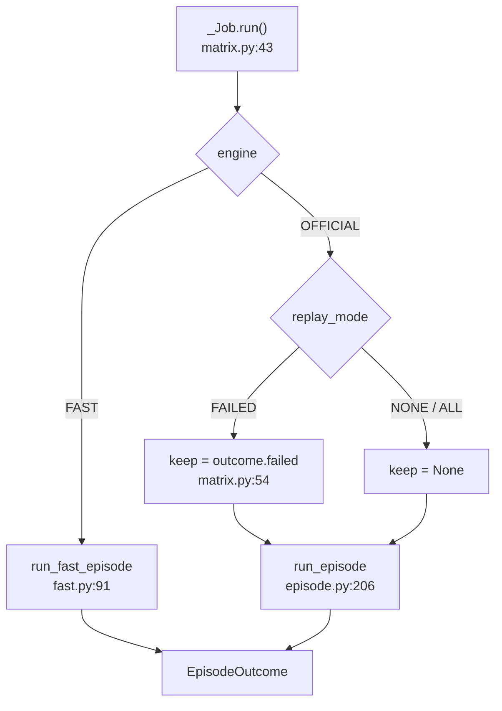
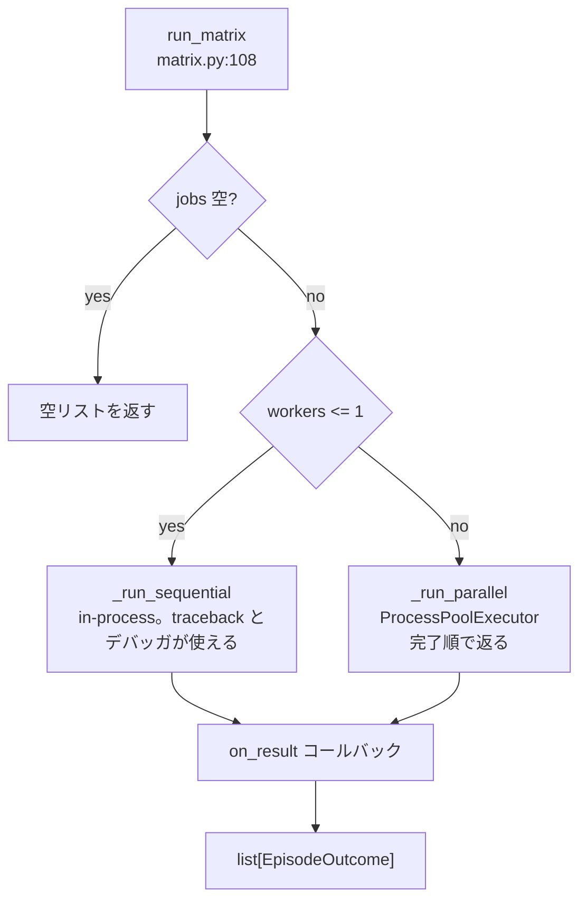

# simulate 実装解説

> 対象: `backend/src/simulate/`
> 規模: 15 ファイル / 2,962 行（うち `jaxenv/` が 4 ファイル / 1,016 行）
> 分析日: 2026-08-11
> コミット: `133e83b`
> 読み込み深度: 全 15 ファイル精読。テストコード（`backend/tests/**/src/simulate/`）はファイル名のみ確認し、中身は未読

## 概要

Kaggriculture のエージェントを**ローカルで対戦させ、勝率と「壊れているか」を同時に測る**ための開発専用パッケージ。存在理由は 1 つで、`kaggle-environments` エンジンがエージェントの失敗を隠すこと — 例外を投げても、1 ターンの制限時間を超えても、エピソードは `status == "DONE"` で正常終了し、不正な行動は無言で捨てられる。つまり素の勝率だけ見ていると「バグって何もしていないエージェント」と「弱いエージェント」が区別できない。そこで crash / timeout / invalid-action を**エンジンとは独立した 3 つの経路**で検出し、勝率の隣に並べて出す。

外から見た入口は 2 つ。CLI が `dev/simulate`（= `python -m simulate`）、ライブラリとしては `from simulate import SimConfig, run_matrix, build_report`。

## 用語

| 用語 | 意味 |
|---|---|
| case | 評価対象のエージェント実装。`backend/pipeline/<family>/case<N>/` の 1 ディレクトリを `"rulebase/case1"` のように指す |
| opponent | 対戦相手のエージェント。case と同じ形式か、エンジン組み込みの `pass` / `random` / `starter` |
| builtin agent | エンジンが名前だけで提供するエージェント。`pass`（常に何もしない）/ `random` / `starter`（決定論的ベースライン） |
| `MatchSpec` | 評価行列の 1 マス。case・opponent・seed・steps・座席の frozen dataclass（`config.py:53`） |
| `SimConfig` | 実行全体のつまみ。`iter_specs()` で `MatchSpec` のリストに展開される（`config.py:89`） |
| `EpisodeOutcome` | 1 エピソードの結果。**常に case 視点**で、金額に加え crash / timeout / 不正行動を保持（`episode.py:53`） |
| `_RunArtifacts` | `env.run` が完走 or クラッシュ後に残したものを集めた入れ物。reward / status / logs / replay / traceback（`episode.py:148`） |
| op | エージェントが 1 ユニットに命じる 1 動作。`"PLANT"` `"WATER"` `"NORTH"` など。行動は `[op, *args]` のリスト |
| unit | 行動主体。農夫 (`farmer`) 1 体と、その日雇った farm hand (`hands`) 群 |
| farm hand | `HIRE` で雇う日雇い労働者。その日の終わりに消える |
| reward | エンジンがエピソード終了時に返す値。このゲームでは最終所持金そのもの |
| 評価行列 (matrix) | (opponent × episode × 座席) の全組み合わせ。`SimConfig` が展開し `run_matrix` が回す |
| seat / swap_sides | プレイヤー 0 / 1 のどちらの座席に case を置くか。player 0 が先に市場へ注文を出すため座席は有利不利を生む。`swap_sides` で両座席を等回数プレイする |
| silent no-op | エンジンが不正な行動を例外にも警告にもせず黙って捨てること。バグが「低スコア」としてしか現れない |
| `actTimeout` | Kaggle harness が 1 ターンに課す実時間予算。既定 1.0 秒（`config.py:19`） |
| slow turn | `actTimeout` の 50% を超えたが超過はしていないターン。失敗ではないが限界に近づいている唯一の早期警告（`config.py:24`） |
| official engine | `env.run()` を通す本番と同じ実行経路。リプレイが取れる唯一の経路 |
| fast engine | エンジンの `interpreter` を直接 Python ループで呼ぶ経路。約 30 倍速いがステップ履歴を持たない（`fast.py`） |
| jaxenv | エンジンを JAX で書き直したバッチ実行環境。`simulate` 本体の実行経路には**組み込まれていない**独立した実験用 |
| interpreter | `kaggle-environments` 側のゲームルール本体。state と action を受け取って state を進める関数 |
| replay | エピソード全ステップの JSON ダンプ。1 本およそ 5 MB |
| health block | crash / timeout / slow / bad status / invalid action の集計。レポートに常時表示される（`report.py:89`） |
| shed | 農場中央の倉庫。容量 100。隣接とは `(4,4)/(5,4)/(4,5)/(5,5)` のいずれかに立つこと |
| quadrant | 盤面 10×10 を四分割した 5×5 の区画。開始時は NW のみ解放 |
| ongoing crop | 収穫しても株が残り、一定間隔で再生産する作物（TOMATO / STRAWBERRY）。対して WHEAT / CARROT / MELON は収穫でタイルが空く |

## 1. ディレクトリ構成

```
backend/src/simulate/
├── __init__.py        公開 API の再エクスポート。他パッケージが触る唯一の面（71 行）
├── __main__.py        typer CLI。引数 → SimConfig → run_matrix → render → exit code（141 行）
├── config.py          MatchSpec / SimConfig / Engine / ReplayMode。「何を評価するか」の宣言（147 行）
├── agents.py          エージェント指定文字列の解決（builtin 名 / ファイルパス / case パス）（65 行）
├── episode.py         official engine で 1 エピソード実行。crash / timeout を独立検出（269 行）
├── fast.py            interpreter 直呼びで 1 エピソード実行。約 30 倍速・リプレイ不可（157 行）
├── validate.py        エージェント出力を包み、エンジンが黙殺する行動を記録（522 行）
├── matrix.py          行列を展開し、逐次 or ProcessPoolExecutor で実行（131 行）
├── report.py          EpisodeOutcome を対戦相手ごとに集計し、health 付きで整形（256 行）
├── runner.py          旧 API（run_episode / run_match）の後方互換ファサード（187 行）
└── jaxenv/            JAX バッチ環境（本体の実行経路からは独立した実験）
    ├── __init__.py    空
    ├── state.py       EnvState（struct-of-arrays）と market_price（245 行）
    ├── env.py         jit 済み step 関数。ルールを全部マスク付き配列更新で表現（446 行）
    ├── town.py        町ショップ解禁スケジュールを host 側で RNG 再現（116 行）
    └── benchmark.py   official / fast / jax の env-steps/sec 比較 CLI（209 行）
```

### 入口

| 入口 | 実体 | 用途 |
|---|---|---|
| `dev/simulate --case ... --opponent ...` | `python -m simulate` → `__main__.main` (`__main__.py:65`) | 通常の評価。プロセス終了コードで CI ゲートできる |
| `from simulate import SimConfig, run_matrix, build_report` | `__init__.py:43` の `__all__` | スクリプトから行列を回す |
| `run_single_episode(spec)` | `episode.run_episode` (`episode.py:206`) | 1 本だけ精査したいとき |
| `run_episode(agents) / run_match(agents)` | `runner.py:133` / `runner.py:161` | 旧 API。新規コードでは使わない |
| `python -m simulate.jaxenv.benchmark` | `jaxenv/benchmark.py:179` | GPU バッチ化が割に合うかの計測。評価とは無関係 |

### 依存の向き

```
                       agents ──────┐
                          ↑         │
   config ──→ validate ──→ episode ─┴──→ matrix ──→ __main__
      │           │           ↑             ↑           │
      │           └──────→ fast ────────────┘           │
      └──────────────────→ report ──────────────────────┘
                              ↑
                           episode

   runner ──→ episode           (旧 API ファサード。誰からも呼ばれない側)
   jaxenv/ ──→ (state → env → benchmark)   ※ benchmark のみ fast / config を参照
```

矢印は「左が右に import される」方向。`config` と `agents` が葉、`__main__` が根。`jaxenv` は `benchmark.py` が計測比較のために `..config` / `..fast` を遅延 import する以外、本体と繋がっていない（`jaxenv/benchmark.py:145`）。

### ここに無いもの

| 責務 | どこにある |
|---|---|
| ゲームルール本体（作物の成長、市場の価格式、町の需要） | `kaggle-environments` 側の `kaggriculture.py`。このパッケージは呼ぶだけ（`jaxenv/` だけが例外で、部分的に再実装している） |
| 提出物のパッケージング・検証・クォータ | `backend/src/submit/` |
| リプレイ → 学習データ変換 | `backend/src/dataset/` |
| エージェントの実装そのもの | `backend/pipeline/<family>/case<N>/` |
| リプレイの可視化・分析 | このパッケージには無い。JSON を書き出すところまで |

`backend/src/**` は提出 tarball に入らない開発専用ライブラリなので、`validate.py` の検証ロジックが本番のエージェントを守ることは**ない**（`validate.py:10`）。

## 2. クラス / メソッド一覧

### コアオブジェクト

#### `MatchSpec` — 1 エピソードの仕様（`config.py:53`, frozen dataclass）

| フィールド | 型 | 意味 |
|---|---|---|
| `case` | `str` | 評価対象の指定文字列 |
| `opponent` | `str` | 対戦相手の指定文字列 |
| `seed` | `int` | エンジンに渡す乱数シード |
| `steps` | `int` | エピソード長。既定 720（24 ターン × 30 日） |
| `swap_sides` | `bool` | True なら case が player 1 に座る |

| 導出プロパティ | 返り値 |
|---|---|
| `case_player` | case の座席インデックス（`swap_sides` なら 1、でなければ 0） |
| `opponent_player` | 相手の座席インデックス |
| `agent_order()` | `env.run` に渡す順に並べた `(agent0, agent1)` タプル |
| `label` | `"rulebase/case1 vs starter seed=3 p0"` 形式の表示名 |

#### `SimConfig` — 実行全体のつまみ（`config.py:89`, frozen dataclass）

| フィールド | 既定 | 意味 |
|---|---|---|
| `case` / `opponents` | — | 評価対象と相手（相手は複数可のタプル） |
| `episodes` | 1 | 相手 1 体あたりのエピソード数 |
| `steps` | 720 | エピソード長 |
| `seed_base` | 0 | エピソード i は `seed_base + i` を使う |
| `swap_sides` | False | True なら各シードを両座席でプレイ（エピソード数が 2 倍になる） |
| `workers` | 1 | 並列プロセス数。1 なら in-process 実行 |
| `engine` | `OFFICIAL` | `OFFICIAL` / `FAST` |
| `replay_mode` | `NONE` | `NONE` / `FAILED`（失敗回のみ保存）/ `ALL` |
| `output_dir` | `None` | リプレイの出力先 |
| `validate_actions` | True | silent no-op 検出を行うか |
| `strict` | False | 不正行動が 1 件でもあれば終了コードを 2 にする |
| `act_timeout` | 1.0 | timeout 判定の閾値（秒） |
| `extra_config` | `{}` | エンジン設定への追加上書き |

- `__post_init__` (`config.py:107`): `engine=FAST` かつ `replay_mode != NONE` は `ValueError`。fast engine はステップ履歴を持たないのでリプレイを作れない。
- `slow_turn_threshold` (`config.py:116`): `act_timeout × 0.5`。
- `iter_specs()` (`config.py:120`): opponent → episode の二重ループで `MatchSpec` を生成。`swap_sides` のときは同じシードを p0 / p1 の 2 本ずつ出す。

#### `EpisodeOutcome` — 1 エピソードの結果（`episode.py:53`, frozen dataclass）

**常に case 視点**である点が重要。座席の入れ替えは `run_episode` 内で吸収済みで、この dataclass を見る側は座席を意識しなくてよい。

| フィールド | 型 | 意味 |
|---|---|---|
| `spec` | `MatchSpec` | 由来の仕様 |
| `case_money` / `opponent_money` | `float` | 最終所持金。エンジンの `reward` |
| `statuses` | `tuple[str, ...]` | 両プレイヤーの最終 status |
| `steps` | `int` | 実際に進んだステップ数 |
| `crashed` / `crash_repr` | `bool` / `str \| None` | 例外の有無と traceback 文字列 |
| `timeouts` | `tuple[TurnCost, ...]` | `act_timeout` を超えたターン |
| `slow_turns` | `tuple[TurnCost, ...]` | 閾値超だが timeout 未満のターン |
| `max_duration` | `float` | 全ターン中の最大所要秒 |
| `issues` | `tuple[ValidationIssue, ...]` | エンジンが黙殺したはずの行動 |
| `replay_path` | `Path \| None` | リプレイを書いた場合のパス |
| `stderr` | `str` | case 側の stderr（無ければエンジン全体の stderr） |

| 導出プロパティ | 定義 |
|---|---|
| `margin` | `case_money - opponent_money` |
| `winner_is_case` / `is_tie` | 金額の大小比較 |
| `bad_status` | `statuses` に `"DONE"` 以外があるか |
| `invalid_actions` | `len(issues)` |
| `failed` | `crashed or timeouts or bad_status` — **「壊れている」であって「負けている」ではない**。`issues` は含まれない |

#### `TurnCost`（`episode.py:44`）: `step` / `player` / `duration` の 3 つ組。

#### `ValidationIssue`（`validate.py:82`）: `step` / `kind`（`"locked_quadrant"` などの分類名）/ `detail`（人向け説明）。

### 関数・クラスの責務

| 名前 | 種別 | 責務 | 入力 | 出力 |
|---|---|---|---|---|
| `resolve_agent` (`agents.py:28`) | 関数 | 指定文字列を builtin 名か絶対 `main.py` パスに解決 | `str` | `str`（解決失敗は `AgentResolutionError`） |
| `available_cases` (`agents.py:57`) | 関数 | `pipeline/*/*/main.py` を走査して case 名一覧 | — | `list[str]` |
| `run_episode` (`episode.py:206`) | 関数 | official engine で 1 本実行。crash / timeout / 不正行動を検出 | `MatchSpec` + オプション | `EpisodeOutcome` |
| `_execute` (`episode.py:174`) | 関数 | `debug=True` で `env.run`。例外を握って traceback を持ち帰る | agents, steps, seed | `(_RunArtifacts, stderr)` |
| `_harvest` (`episode.py:159`) | 関数 | 完走した env から reward / status / logs / replay を取り出す | `env` | `_RunArtifacts` |
| `_turn_costs` (`episode.py:97`) | 関数 | `env.logs[step][player]["duration"]` から timeout / slow を抽出 | logs, 閾値 | `(timeouts, slow, max)` |
| `run_fast_episode` (`fast.py:91`) | 関数 | interpreter 直呼びで 1 本実行。`EpisodeOutcome` を返すので official と差し替え可能 | `MatchSpec` | `EpisodeOutcome` |
| `_AgentSlot` (`fast.py:60`) | dataclass | 1 プレイヤーの callable + 例外・計時の帳簿（framework がやる仕事の肩代わり） | obs | `(action, duration)` |
| `ActionValidator` (`validate.py:144`) | クラス | エージェント出力をエンジンの受理規則と照合して記録 | obs, action | `issues` に蓄積（副作用） |
| `ActionValidator.wrap` (`validate.py:165`) | メソッド | エージェントを包んだ callable を返す。**検証は行動を書き換えない** | agent | `Callable[[obs], action]` |
| `as_callable` (`validate.py:425`) | 関数 | パス文字列をエンジンの `build_agent` 経由で callable 化 | `str \| Callable` | `Callable` |
| `_Job` (`matrix.py:32`) | frozen dataclass | 1 エピソードをワーカー単体で実行できる自己完結パッケージ | — | `run()` → `EpisodeOutcome` |
| `build_jobs` (`matrix.py:81`) | 関数 | `SimConfig` → `_Job` のリスト（リプレイパスもここで決まる） | `SimConfig` | `list[_Job]` |
| `run_matrix` (`matrix.py:108`) | 関数 | 全ジョブを逐次 or プロセス並列で実行 | `SimConfig` | `list[EpisodeOutcome]` |
| `default_workers` (`matrix.py:27`) | 関数 | `cpu_count() - 1`（最低 1）。OS に 1 コア残す | — | `int` |
| `OpponentReport` (`report.py:30`) | frozen dataclass | 相手 1 体分の勝敗・平均金額・最悪マージン | `outcomes` | 集計プロパティ |
| `HealthReport` (`report.py:89`) | frozen dataclass | 「壊れている」側の指標一式 | 集計値 | `clean` プロパティほか |
| `MatrixReport` (`report.py:120`) | frozen dataclass | 実行 1 回分の全結果 + `exit_code` | — | `as_dict()` |
| `build_report` (`report.py:179`) | 関数 | outcomes を相手ごとにグループ化して `MatrixReport` に | config, outcomes | `MatrixReport` |
| `render` (`report.py:217`) | 関数 | 人間向けテキスト整形。health block は常に出す | report, config | `str` |
| `EnvState` (`jaxenv/state.py:124`) | NamedTuple | バッチ化された盤面。タイル属性ごとに `(B,2,H,W)` 平面 | — | — |
| `market_price` (`jaxenv/state.py:180`) | 関数 | 在庫から全商品の価格。丸めと下限までエンジン準拠 | `(..., N_PRODUCTS)` | 同 shape の int32 |
| `step` (`jaxenv/env.py:407`) | jit 関数 | 全環境を 1 ターン進める | state, op, crop, market×3 | `EnvState` |
| `unlocked_shops_by_day` (`jaxenv/town.py:52`) | 関数 | エンジンの RNG ストリームを host 側で再現して解禁店舗を出す | seed, days, 空きタイル数 | `list[list[str]]` |

### 名前と実態がズレているところ

| 箇所 | 注意点 |
|---|---|
| `simulate.run_episode` が 2 つある | `__init__.py` は `runner.run_episode` を `run_episode`、`episode.run_episode` を `run_single_episode` としてエクスポートしている（`__init__.py:29`, `__init__.py:40`）。**旧 API の方が短い名前を持っている**ので、`from simulate import run_episode` は旧ファサードを掴む |
| `runner.run_episode(debug=...)` | 引数は受け取るが `del debug` で捨てられる（`runner.py:147`）。常に `debug=True` で走る |
| `runner.run_episode` は検証を切る | 内部で `validate_actions=False` 固定（`runner.py:157`）。旧 API 経由では silent no-op 検出が効かない |
| `ActionValidator.wrap` | 「検証」だが**行動は一切変更しない**。記録するだけで、エージェントの出力はそのままエンジンへ渡る（`validate.py:174`） |
| `ActionValidator.validate` | 引数 `obs` から `step` を読んで内部カウンタを書き換える（`validate.py:189`）。純粋な検査関数ではない |
| `EpisodeOutcome.failed` | 不正行動は含まない。silent no-op だらけでも `failed` は False |
| `report.render` の `worst` 列 | 「最悪の負け幅」ではなく `margin` の最小値。全勝なら正の数が出る（`report.py:69`） |
| `jaxenv/town.py` の `board_size` 引数 | 受け取るが `del board_size` で未使用（`jaxenv/town.py:80`）。呼び出し側の可読性のためだけに残されている |

## 3. 処理ステップ

### 主経路（CLI 実行）

```
1.  dev/simulate → `python -m simulate` → typer が `main()` を呼ぶ        (__main__.py:65)
2.  `--opponent` をカンマ分割                                             (__main__.py:36)
3.  case と全 opponent を `resolve_agent` で先に解決。
    ここで落とさないとタイプミスがエンジンで無言 no-op に化け、
    行列全体が「正当な敗北」として報告される                              (__main__.py:42)
4.  fast engine × replay の組み合わせを弾く                               (__main__.py:99)
5.  `SimConfig` を組む。workers 未指定なら cpu_count-1                     (__main__.py:104)
6.  `run_matrix(config)`                                                  (matrix.py:108)
7.    `config.specs()` が (opponent × episode × 座席) を展開               (config.py:120)
8.    各 spec を `_Job` に包む。リプレイの出力パスもここで確定             (matrix.py:81)
9.    workers <= 1 なら in-process、そうでなければ ProcessPoolExecutor     (matrix.py:124)
10.   各 job が engine に応じて `run_fast_episode` か `run_episode` を呼ぶ  (matrix.py:43)
11. official 経路: 両エージェントを解決し、case 側だけ Validator で包む    (episode.py:225)
12.   `make(..., debug=True)` して `env.run(agents)`。stderr は buffer へ  (episode.py:191)
13.   完走なら `_harvest` が reward / status / logs / replay を回収        (episode.py:159)
14.   `env.logs` を走査して timeout / slow turn / 最大所要時間を算出       (episode.py:97)
15.   座席に応じて reward を case / opponent に振り分ける                  (episode.py:241)
16.   `EpisodeOutcome` を構築（validator の issues もここで合流）          (episode.py:248)
17.   replay_mode に応じてリプレイ JSON を書き出す                         (episode.py:263)
18. outcomes を相手ごとにグループ化し `MatrixReport` に集計                (report.py:179)
19. health block（crash / timeout / slow / status / invalid）を作る        (report.py:156)
20. `render` でテキスト化して stdout へ                                    (__main__.py:127)
21. `--json` があれば `as_dict()` を書き出す                               (__main__.py:129)
22. `sys.exit(int(report.exit_code))`                                      (__main__.py:137)
```

### エピソード実行の 2 経路

`_Job.run()` (`matrix.py:43`) が engine を見て分岐する。どちらも同じ `EpisodeOutcome` を返すので、行列ランナーから見れば差し替え可能。



| 観点 | official (`episode.py`) | fast (`fast.py`) |
|---|---|---|
| 実行方法 | `env.run(agents)` | `engine.interpreter(state, env)` を素の for ループで |
| 速度 | 基準 | 約 30 倍（`fast.py:20`） |
| リプレイ | 取れる | 取れない（ステップ履歴を持たないのが速さの源） |
| crash 検出 | `debug=True` の再送出を catch | slot が例外を捕まえて `PASS` に差し替え、traceback を記録 |
| 計時 | `env.logs` の framework 計測 | `time.perf_counter()` で自前計測 |
| status | エンジンの実値 | `("DONE","DONE")` 固定（`fast.py:149`） |
| 追随責任 | エンジン更新に自動追従 | `kaggle-environments` の更新を自分で追う必要がある |

fast 経路が framework の代わりに自分でやっている仕事（`fast.py:26`〜）:

| framework の仕事 | fast での対応 | 落とすとどうなる |
|---|---|---|
| `observation.step` の前進 | `state[0].observation.step = n + 1` (`fast.py:137`) | day/hour が凍り、水やり判定・雑草・動物生産・町需要が**全部止まる**。それでもエピソードは完走しもっともらしいスコアを出す |
| `DONE` への遷移 | `("DONE","DONE")` を決め打ち | `bad_status` の意味が両エンジンでズレる |
| エージェント例外の捕捉 | `_AgentSlot.take_turn` が `PASS_TURN` に差し替え (`fast.py:67`) | エピソードごと落ちる |
| ステップ履歴の保持 | 意図的にやらない | — |

この 2 経路の一致は `tests/e2e/src/simulate/test_fast_equivalence.py` で最終所持金のビット一致として担保されている（`fast.py:20` の記述による。テスト本体は未読）。

### 失敗検出の 3 経路

エンジンの `status` は 3 種類の失敗を全部 `DONE` に潰してしまう。そのため検出経路が分かれている（`episode.py:1`〜）。

| 失敗 | `debug=False` での見え方 | このパッケージの検出方法 | 記録先 |
|---|---|---|---|
| 例外を投げた | `status=DONE` | `debug=True` で走らせ `env.run` の再送出を catch (`episode.py:197`) | `crashed` / `crash_repr` |
| `actTimeout` 超過 | `status=DONE`（`debug=True` でも同じ） | `env.logs[step][player]["duration"]` を全走査 (`episode.py:113`) | `timeouts` / `slow_turns` |
| 不正な行動 | 何も起きない（無言で破棄） | エンジンに渡る前にエージェント出力を検査 (`validate.py:187`) | `issues` |

### 不正行動の検出内容（`validate.py`）

`ActionValidator.wrap` が返すクロージャは「内側のエージェントを呼ぶ → 出力を検査 → **そのまま返す**」（`validate.py:174`）。検査自体の例外も `validator_error` として記録するだけで握り潰す — 検証器が評価を壊してはいけないため。記録は `max_issues=200` で打ち止め（`validate.py:160`）。系統的に壊れたエージェントが 720 ターン分の同一 issue でレポートを埋めるのを防ぐ。

| 検査 | `kind` | エンジン側の挙動 |
|---|---|---|
| 戻り値が dict でない | `action_not_dict` | PASS 扱い |
| `farmer` キーが無い | `missing_farmer` | PASS 扱い |
| `hands` の件数が雇用数と不一致 | `hand_count_mismatch` | 過不足分が黙って落ちる |
| 未知の unit op | `unknown_unit_op` | 無視 |
| `PLANT` の作物引数欠落 / 未知 | `plant_missing_crop` / `unknown_crop` | 無視 |
| 盤外への移動 | `move_off_board` | 移動しない |
| shed op を非隣接タイルで | `shed_not_adjacent` | 無視（動物設置だけ例外、後述） |
| 未解放 quadrant でのタイル op | `locked_quadrant` | 無視 |
| 種の数を超える `PLANT` 要求 | `plant_over_seeds` | **その作物の PLANT が全部落ちる**（作物単位でアトミック） |
| 市場注文が上限超過 | `market_orders_truncated` | 超過分を末尾から破棄 |
| 注文の形・数量・商品が不正 | `order_malformed` / `order_bad_quantity` / `order_bad_item` | 該当注文を破棄 |

エンジン挙動をなぞった細かい分岐が 2 つある。

- **動物設置の例外** (`validate.py:112`, `validate.py:293`): `PLACE <animal>` は、エンジンが shed への drop 経路より**先に**「対応する空き構造物への設置」を解決するため、盤面のどこからでも合法。したがって shed 隣接チェックの対象外にしている。`PLACE <item>` が shed drop に落ちる場合だけ隣接が要る。
- **PLANT のアトミック性** (`validate.py:311`): 種 1 個しか無いのに 2 ユニットが同じ作物を植えようとすると、エンジンは 1 つ通すのではなく**両方捨てる**。1 回の要求過多がそのターンの全ユニットを無駄にする、高くつく silent failure。

### 分岐



- `workers` は `min(config.workers, len(jobs))` に丸められる（`matrix.py:123`）。
- 並列時は**完了順**で返る。順序が要るなら呼び出し側でソートする（`matrix.py:113` の docstring）。
- ワーカーが返すのは `EpisodeOutcome` だけで `env` は返さない。env は約 5 MB あり、pickle のコストがエピソードの実行コストを上回る（`matrix.py:3`）。

終了コードの決定（`report.py:136`）:

| 条件 | 終了コード |
|---|---|
| crash / timeout / bad status のいずれか | `1` (`FAILED`) |
| 上記なし かつ `--strict` かつ 不正行動あり | `2` (`INVALID_ACTIONS`) |
| それ以外 | `0` (`OK`) |

負けても終了コードは 0。CI が見ているのは「壊れているか」であって「勝ったか」ではない。

### エラー処理

| 事象 | 挙動 |
|---|---|
| エージェント指定の解決失敗 | `AgentResolutionError`。CLI では `typer.BadParameter` に変換して即終了（`__main__.py:51`）。**`run_episode` が投げる唯一の例外** |
| エージェントが例外を投げた | official: catch して `crash_repr` に traceback（`episode.py:197`）。fast: `PASS` に差し替えてエピソード継続（`fast.py:73`） |
| ターンが `actTimeout` 超過 | 記録のみ。エピソードは止まらない |
| 検証器自身が例外 | `validator_error` として記録して握り潰す（`validate.py:178`） |
| `engine=FAST` + replay 指定 | `SimConfig.__post_init__` が `ValueError`（`config.py:111`）。CLI では手前で `BadParameter`（`__main__.py:99`） |
| ワーカープロセスの例外 | `future.result()` で親に再送出（`matrix.py:105`）。**握り潰されない** |
| `agents` が 2 体でない（旧 API） | `ValueError`（`runner.py:148`） |

**黙って進む挙動** — 読み流すと気づかないもの:

- 不正な行動は記録されるだけで、エージェントの出力は**修正されずそのままエンジンへ**渡る。`--strict` を付けない限り終了コードにも影響しない。
- `crash` が起きた場合、`_execute` は `_RunArtifacts(crash_repr=...)` だけを埋めて返すので `rewards` は既定の `(0.0, 0.0)`、`statuses` は空タプルのまま（`episode.py:198`）。`episode.py:241` の `if artifacts.statuses` がそれを受けて金額を両者 0 にする。結果として**クラッシュ回は 0 対 0 の引き分けとして集計に混ざる**（`EpisodeOutcome.is_tie` が True、`episode.py:80`）。`OpponentReport.ties` はこれをそのまま数える（`report.py:45`）ので、health block を見ないと勝率表からは判別できない。
- `--no-validate` を付けると `issues` は空になるが、レポートの `invalid actions : 0` は「検証していない」ではなく「0 件」と読めてしまう。
- `report.build_report` は `grouped.setdefault` で未知の opponent も受け入れる（`report.py:185`）。設定に無い相手の outcome が紛れ込んでも落ちない。

### 副作用

| 種類 | 内容 |
|---|---|
| ファイル書き込み | リプレイ JSON（`--replay` 指定時のみ。既定は `data/output/simulate/{YYYYmmdd_HHMMSS}/replays/ep0000_*.json`）と `--json` のサマリ。1 本およそ 5 MB |
| プロセス生成 | `workers > 1` のとき `ProcessPoolExecutor`。既定は `cpu_count-1` 個 |
| stdout / stderr | `render` の出力と `--json` の通知。エンジンが吐く stderr は `contextlib.redirect_stderr` で buffer に捕まえ、進捗表示を汚さない（`episode.py:195`）。捕まえた内容は `EpisodeOutcome.stderr` に入る |
| プロセス終了コード | CLI は常に `sys.exit` する |
| ネットワーク | 無し |
| グローバル / キャッシュ状態 | 無し。`ActionValidator` はインスタンス単位の可変状態（`_issues` / `_step`）を持つが、エピソードごとに作り直される |

なお `as_callable` (`validate.py:425`) はパス文字列を callable 化するために `make("kaggriculture", debug=True)` で**捨てる env を 1 つ作る**。エージェントごと・エピソードごとに発生する隠れたコスト。

## 補足

### 驚く挙動

1. **クラッシュ回は 0 対 0 の引き分けとして勝率表に載る**（前述）。勝率だけ見ていると、全滅したエージェントが「引き分け率 100%」に見える。health block が常時表示なのはこのため。
2. **`from simulate import run_episode` は旧 API を掴む**。新しい方は `run_single_episode` という長い名前になっている（`__init__.py:29`）。しかも旧 API は検証を無効化して走る。
3. **`fast` エンジンで `observation.step` の前進を忘れると、エピソードは完走してもっともらしいスコアを出す**（`fast.py:26`）。day/hour が凍って end-of-day 処理が一切走らなくなるという致命的な差が、クラッシュではなく「ちょっと違う数字」として現れる。等価性テストが存在する理由がこれ。
4. **`PLANT` は作物単位でアトミック**。種 1 個に対して 2 ユニットが要求すると 1 つも植わらない（`validate.py:311`）。
5. **`jaxenv/` は評価パイプラインに繋がっていない**。`Engine` enum は `OFFICIAL` / `FAST` の 2 値のみで（`config.py:48`）、`--engine jax` という選択肢は存在しない。`benchmark.py` からしか動かない。`env.py:15` が明記する通り、作物と市場のコアだけの部分実装（雇用・動物・土地購入・雑草発生なし）で、GPU バッチ化が割に合うかを測るための実験。
6. **`jax-metal` を venv に入れてはいけない**。`jax.devices()` を全テストで乗っ取り、この処理を CPU の約 100 倍**遅く**する（`jaxenv/state.py:27`）。
7. **町ショップの解禁は盤面依存**（`jaxenv/town.py:11`）。`_spawn_weeds` が同じ RNG ストリームを共有し、空きタイル 1 枚につき 1 回抽選するため、作物や雑草の数が変わると `rng.choice` が別の店を引く。JAX 側で事前計算できるのは空きタイル数が既知の場合だけ。

### 未解決の疑問

- `fast.py:139` は `state[0].observation.farms` から両プレイヤーの所持金を読んでいる。`farms` は両者公開情報なので player 0 の観測で足りる、という前提に見える — **ただしこれは筆者の推測**で、コード上に根拠コメントは無い（エンジン側の観測構造を確認していない）。
- official 経路で `swap_sides` を使ったとき、`_collect_stderr` は case 側の stderr のみを集める（`episode.py:246`）。相手側が出した stderr は捨てられる。意図的な設計か見落としかは、コードからは判断できなかった。
- `jaxenv` の市場決済は 1 ターンあたり最大 32 ユニットの `fori_loop` で固定されている（`jaxenv/env.py:268`）。トレース形状を静的に保つための上限だが、これを超える数量を要求するポリシーが黙って切り捨てられることになる。テストで担保されているかは未確認。

### 関連ドキュメント

| ファイル | 内容 |
|---|---|
| `docs/plans/simulator/design.md` | シミュレータ全体の設計方針 |
| `docs/plans/simulator/fast-sim.md` | fast エンジンの設計とプロファイル結果 |
| `docs/plans/simulator/jax-gpu.md` | JAX 移植と GPU 検討の経緯（`jax-metal` の件を含む） |
| `docs/competition/abstract.md` | ゲームルールの要約。ただし `jaxenv/env.py:320` が指摘する通り、町センターの消費量については実エンジンとズレがある |
| `backend/tests/e2e/src/simulate/test_fast_equivalence.py` | official と fast の最終所持金一致 |
| `backend/tests/e2e/src/simulate/test_jaxenv_equivalence.py` | JAX 移植の等価性 |
| `.claude/rules/python.md` | `backend/src/**` のモジュール構成規約 |
