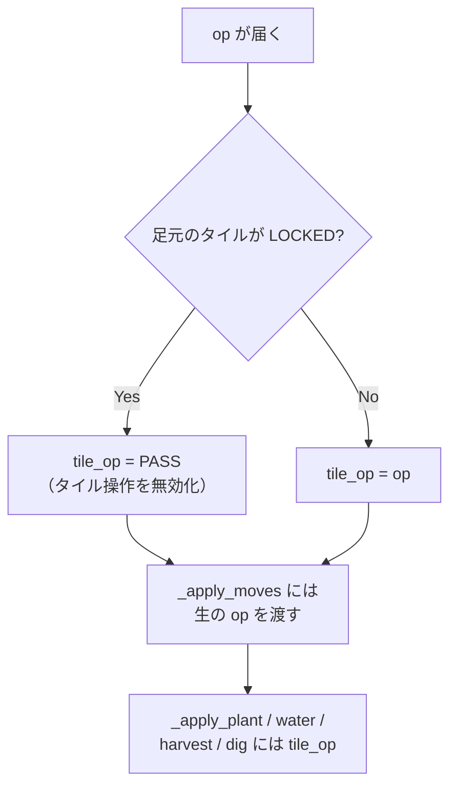

# jaxenv 実装解説

> 対象: `backend/src/simulate/jaxenv/`（参考: `backend/tests/e2e/src/simulate/test_jaxenv_equivalence.py`, `docs/plans/simulator/jax-gpu.md`）
> 規模: 5 ファイル / 1,016 行（`__init__.py` は 0 行）
> 分析日: 2026-08-11
> コミット: `133e83b`
> 読み込み深度: `jaxenv/` 全 5 ファイルを精読。等価性テストと `docs/plans/simulator/jax-gpu.md` も全読。`simulate/fast.py` と `simulate/__init__.py` は関係箇所のみ確認

## 概要

`jaxenv` は Kaggriculture の公式エンジン（`kaggle-environments` の Python 実装）を **JAX で書き直した並列環境**である。公式エンジンは 1 タイルを Python の `dict` で持つため GPU に載らない。そこで盤面を「タイルごとのオブジェクト」ではなく「フィールドごとの密な配列」に置き換え、`B` 個の環境を 1 本の `jax.jit` 済み `step` で同時に進める。

目的は RL 学習ループに耐える環境スループットの確保で、`docs/plans/simulator/jax-gpu.md` の計測では CUDA (RTX 4090) / batch 65536 で公式比 **42,929 倍**に達した一方、Apple Metal では公式より **遅い**（0.26 倍）。

外から見た入口は 3 つ。`state.initial_state(B)` で初期状態を作り、`env.step(...)` で 1 ターン進め、`python -m simulate.jaxenv.benchmark` でスループットを計測する。**`simulate` パッケージの `__init__.py` からは一切 re-export されていない**ので、利用側は `from simulate.jaxenv import env` のようにサブモジュールを直接 import する。

**これは wrapper ではなく再実装**であり、実装範囲は小麦ループ相当のサブセットに限られる（hand / 家畜 / 肥料 / `BUY_LAND` / 雑草自然発生は未実装）。

## 用語

| 用語 | 意味 |
|---|---|
| `B` | バッチ軸のサイズ。同時に進める環境（対戦）の本数。全配列の先頭次元 |
| struct-of-arrays (SoA) | 「タイルごとに構造体を持つ」代わりに「フィールドごとに全タイル分の配列を持つ」データ配置。GPU 向けの標準形 |
| plane（プレーン） | 盤面 1 枚分の 2 次元配列。ここでは `(B, 2, 10, 10)`（バッチ × プレイヤー 2 人 × 縦 × 横）の 1 フィールド分を指す |
| pytree | JAX が「配列を含む入れ子構造」を自動で辿るための概念。`NamedTuple` / `dict` / `list` は自動的に pytree として扱われ、`jit` や `tree_map` に丸ごと渡せる |
| `EnvState` | バッチ化された全状態を保持する `NamedTuple`。pytree なのでそのまま `jit` / `fori_loop` を通せる |
| マスク更新 | `if` で分岐せず `jnp.where(条件, 新値, 旧値)` で書き換えること。全環境が同じ命令列を走るので GPU で並列化できる |
| scatter | `array.at[index].set(value)` のような「特定要素だけ書き換える」操作。タイル環境の中核だが Metal では極端に遅い（本文 §補足） |
| `jit` | `jax.jit`。Python 関数を XLA でコンパイルして高速化する。形状ごとに 1 回コンパイルが走る |
| トレース値 (traced value) | `jit` コンパイル中の「まだ値が確定していない」配列。Python の `if` で分岐できないため、全ルールがマスク更新になる |
| `fori_loop` | `jax.lax.fori_loop`。ループ回数を固定してデバイス側で回すループ。Python の `for` と違いコンパイル時に展開されない |
| `I0` | 市場の均衡在庫。全商品 10,000。ここで価格が `base` に一致する（`state.py:115`） |
| `T` | アンカースループット。「`T` 個だけ `I0` からずらすと価格が `target × base` だけ動く」という基準量 |
| shape function | 価格が在庫のズレに対してどう曲がるかを決める関数。`linear` / `sq` / `sqrt` / `log` / `log10` の 5 種で、`I0` の上下で別のものが使われる |
| ongoing crop | 収穫しても株が残り、日次で再産出する作物（TOMATO / STRAWBERRY）。対して WHEAT / CARROT / MELON は収穫でタイルが空く |
| carried / shed | `carried` は農夫が手に持つ在庫、`shed` は納屋の在庫。日末に carried が shed へ搬入され、容量 100 を超えた分は消滅 |
| silent no-op | 不正な行動をエラーにせず黙って無視すること。本実装でも同じ挙動（マスクが `False` になるだけ） |
| `fast` | 別実装 `backend/src/simulate/fast.py`。公式エンジンの `interpreter` を直接呼ぶ高速ループで、**ルール再実装ではない**ため乖離リスクがない |
| town centre（町中心） | 常設の需要主体。一定間隔で市場在庫を減らす。ランダム解放される「町ショップ」とは別物 |

## 1. ディレクトリ構成

```
backend/src/simulate/jaxenv/
├── __init__.py     空（0 行）。re-export は一切ない。利用側はサブモジュールを直接 import する
├── state.py        EnvState 定義、ゲーム定数テーブル、市場価格モデル、初期状態生成 (245 行)
├── env.py          jit 済み step 本体。全ルールをマスク更新で実装 (446 行)
├── town.py         町ショップ解放スケジュールを host 側（NumPy/Python）で再現する補助 (116 行)
└── benchmark.py    official / fast / jax のスループット比較 CLI (209 行)
```

### エントリポイント

| 入口 | 呼び出し方 | 用途 |
|---|---|---|
| `state.initial_state(batch_size)` | 関数 | `B` 本ぶんの初期 `EnvState` を作る |
| `env.step(state, op, crop_arg, market_op, market_item, market_qty)` | `@jax.jit` 済み関数 | 全環境を 1 ターン進める。**このモジュールの中心** |
| `state.market_price(inventory)` | 関数 | 在庫 → 価格。`step` の外からも使える（テストが直接叩いている） |
| `benchmark.main()` | CLI | `python -m simulate.jaxenv.benchmark --steps 720 --batches 1 64 1024` |
| `town.shop_demand_table(seed, days)` | 関数 | ショップ需要テーブル生成。**現状 `env.py` からは呼ばれていない**（後述） |

### 依存方向

```
        state.py  (定数 / EnvState / market_price)
         ↑    ↑    ↑
      env.py  |    town.py
         ↑    |
   benchmark.py ──┘  (state と env の両方を import。fast / official も比較のため import)
```

`state.py` が最下層で他モジュールに依存しない。`env.py` は `state.py` のみに依存。`town.py` も `state.py` のみ（`N_PRODUCTS` / `PRODUCT_NAMES`）。`benchmark.py` だけが上位で、比較のため `..config` / `..fast` / `kaggle_environments` を**関数内 import** で引く（重い import を CLI 実行時のみに遅延させるため、`benchmark.py:122,145`）。

**`town.py` は現時点でどこからも呼ばれていない孤立モジュール**である（リポジトリ全体を grep しても参照は docstring 内の言及のみ）。理由は下の「ここに無いもの」を参照。

### ここに無いもの

| 無いもの | 実際の在処 / 理由 |
|---|---|
| エージェント（方策） | ここには無い。`step` は行動コードを引数で受け取るだけ。方策は `backend/pipeline/` 側 |
| 公式エンジン互換の高速実行 | `backend/src/simulate/fast.py`。公式 `interpreter` を直呼びするので**ルール乖離ゼロ**。jaxenv は再実装なので乖離しうる |
| 等価性テスト | `backend/tests/e2e/src/simulate/test_jaxenv_equivalence.py`（6 ケース） |
| 雇用 hand / 家畜 / 肥料 / `BUY_LAND` / 雑草の自然発生 | **未実装**。`env.py` の docstring が範囲を明示している（`env.py:15-21`） |
| ショップ需要の device 側適用 | `town.py` に host 側の生成だけあり、`env.py` の `step` は町中心 (`_town_consume`) しか処理しない |
| `pyproject.toml` の `jax` 依存宣言 | **意図的に無い**。`kaggle-environments` が `jax` を直接 requires するため、エンジンがある環境には必ず存在する（`state.py:25-29`） |

## 2. クラス / メソッド一覧

### コアオブジェクト: `EnvState` (`state.py:124`)

全状態を持つ `NamedTuple`。`NamedTuple` なので JAX の pytree として自動的に扱われ、`jit` / `fori_loop` / `tree_map` にそのまま渡せる。先頭が必ずバッチ軸 `B`、プレイヤー別フィールドはその直後に `2` 軸が付く。

| フィールド | 形状 | dtype | 意味 |
|---|---|---|---|
| `step` | `(B,)` | int32 | 経過ターン数。0 始まり。1 シーズン 720 |
| `money` | `(B, 2)` | float32 | 所持金。初期 3,000 |
| `kind` | `(B, 2, 10, 10)` | int32 | タイル種別。`EMPTY=0 / PLANT=1 / WEED=2 / LOCKED=3 / COOP=4 / PASTURE=5`。**`EMPTY` が 0 なのは意図的**でゼロ配列がそのまま空盤面になる |
| `crop` | 同上 | int32 | 作物コード。無しは `-1`。0..4 が WHEAT/CARROT/TOMATO/STRAWBERRY/MELON |
| `planted_day` | 同上 | int32 | 植えた日。成熟判定と産出間隔の基準 |
| `watered_today` | 同上 | int32 | 今日水をやったか（0/1）。日末にゼロクリア |
| `consecutive_unwatered` | 同上 | int32 | 連続無水日数。**2 で雑草化** |
| `yield_units` | 同上 | int32 | そのタイルに溜まっている収穫可能量 |
| `max_lifespan_step` | 同上 | int32 | 枯れ始めるターン。ongoing crop は `-1`（無期限） |
| `farmer_x` / `farmer_y` | `(B, 2)` | int32 | 農夫の座標。**hand は未実装なので 1 人ぶんだけ** |
| `shed` | `(B, 2, 9)` | int32 | 納屋在庫（商品 9 種） |
| `carried` | `(B, 2, 9)` | int32 | 手持ち在庫。日末に shed へ移る |
| `seeds` | `(B, 2, 5)` | int32 | 種の在庫（作物 5 種） |
| `market_inv` | `(B, 9)` | int32 | **共有**市場在庫。プレイヤー軸が無いのは両者が同じ板に売るため |

プロパティ 3 つ: `batch_size`（`B` を Python int で返す）、`day`（`step // 24`）、`hour`（`step % 24`）。

### 定数テーブル (`state.py:39-121`)

すべて `jnp.array` の並列配列で、**作物コード / 商品コードでそのまま添字引き**できるよう並び順が揃えられている。「作物コード 0..4 が商品コード 0..4 と一致する」設計により、収穫物を商品在庫に足す処理が `one_hot(crop_idx, N_PRODUCTS)` の 1 行で済む（`env.py:222`）。

| テーブル | 内容 |
|---|---|
| `CROP_SEED_COST / FIRST_YIELD_DAY / MAX_YIELD_DAY / INTERVAL / MAX_YIELD / ONGOING` | 作物別パラメータ 6 本。エンジンの `CROPS` を転置したもの |
| `MARKET_BASE / T / BELOW_FUNC / BELOW_TARGET / ABOVE_FUNC / ABOVE_TARGET` | 商品別 6 本。`_RAW_MARKET` タプルから生成 |
| `MARKET_I0 = 10_000` / `PRICE_FLOOR = 1` | 均衡在庫と価格下限 |
| `BOARD_SIZE = 10` / `STARTING_MONEY = 3000` / `SHED_CAPACITY = 100` / `TURNS_PER_DAY = 24` | 盤面・経済の基本定数 |

### `state.py` の関数

| 名前 | 種別 | 責務 | 入力 | 出力 |
|---|---|---|---|---|
| `_shape_fn` | private 関数 | 5 種の shape function をコード選択で適用（分岐しない） | `code (...)`, `x (...)` | 同形状 float |
| `market_price` | 関数 | 在庫から価格を算出。エンジンの丸めと下限まで一致 | `inventory (..., 9)` | `(..., 9)` int32 |
| `initial_state` | 関数 | 初期盤面生成。NW 象限のみ解放、市場は均衡 | `batch_size: int` | `EnvState` |
| `tree_flatten_check` | 関数 | 全 leaf のバッチ幅が揃っているかの健全性チェック | `EnvState` | `None`（不一致で `ValueError`） |

`_shape_fn` の実装で注意すべき点（`state.py:163-177`）: 5 つの候補を**全部計算してから選ぶ**。トレース値では分岐できないので、選ばれない枝も走る。そのため `sqrt`/`log` の入力を `jnp.maximum(x, 1e-12)` でクランプしてある — さもないと**選ばれない枝が NaN を作り、それが選択結果まで汚染しうる**。

### `env.py` の関数

`step` 以外はすべて private ヘルパーで、`EnvState` を受けて `EnvState` を返す純関数（`NamedTuple._replace` で新インスタンスを作る）。

| 名前 | 種別 | 責務 | 入力 | 出力 |
|---|---|---|---|---|
| `_gather_tile` | 関数 | `plane[b, p, y, x]` を全 (b,p) について読む | `(B,2,H,W)`, `x`, `y` | `(B,2)` |
| `_scatter_tile` | 関数 | 同位置へ書き込む（`.at[].set`） | plane, x, y, value | plane |
| `_apply_moves` | 関数 | 移動。盤外は no-op（クランプではなく据え置き） | state, op | state |
| `_apply_plant` | 関数 | 空きタイルへ植付、種を 1 消費 | state, op, crop_arg, day | state |
| `_apply_water` | 関数 | 水やり。ボーナス期間内なら収量 +1 | state, op, day | state |
| `_apply_harvest` | 関数 | 成熟株を `carried` へ収穫。非 ongoing はタイルを空に | state, op, day | state |
| `_apply_dig` | 関数 | 植物 / 雑草を除去して空タイルに | state, op | state |
| `_process_market` | 関数 | 売買を **1 単位ずつ** 逐次決済（`fori_loop`） | state, market_op/item/qty | state |
| `_town_consume` | 関数 | 町中心の需要で市場在庫を減らす | state, step | state |
| `_decay_plants` | 関数 | 寿命超過株の収量を 1 ステップおきに減らす | state, step | state |
| `_end_of_day` | 関数 | 日次処理（水やり判定・雑草化・継続産出・shed 搬入・農夫リセット） | state, day | state |
| `step` | **`@jax.jit` 関数** | 1 ターン進める公開 API | state + 行動 5 本 | state |

#### `step` の行動エンコーディング

行動は `EnvState` と別に、**5 本の `(B, 2)` int32 配列**として渡す。

| 引数 | 値域 | 意味 |
|---|---|---|
| `op` | 0..8 | `PASS / NORTH / SOUTH / EAST / WEST / PLANT / WATER / HARVEST / DIG` |
| `crop_arg` | 0..4 | `PLANT` 時の作物コード。他の op では無視される |
| `market_op` | 0..2 | `NONE / SELL / BUY_SEED`。**1 ターン 1 注文のみ**（公式は最大 10） |
| `market_item` | 0..8 | 注文対象の商品コード |
| `market_qty` | 0..32 | 注文数量。**32 が上限**（`_process_market` の `max_units`） |

#### 名前と実態がズレている / 見落としやすい箇所

| 箇所 | 内容 |
|---|---|
| `_apply_moves` の「クランプ」 | docstring は "clamping at the board edge" と書くが、実装は盤外なら**元の位置に据え置く**（`env.py:103-106`）。端に張り付くのではなく移動そのものが無効化される。1 マス移動しかないため観測される結果は同じだが、読み違えやすい |
| `_town_consume` の名前 | 町「ショップ」ではなく町**中心**のみ。ランダム解放されるショップは処理しない |
| `town.py` 全体 | モジュールとして完成しているが `env.py` から呼ばれていない。実質「将来のための部品 + 調査記録」 |
| `_process_market` の `BUY_SEED` | **種は市場在庫を減らさない**（`env.py:295-301`）。板から引くのではなく発行される。エンジン準拠 |
| `market_qty` の上限 32 | `max_units = 32` はハードコードで、超過分は**黙って捨てられる**。トレース形状を固定するための制約 |
| `_gather_tile` の返り値 | `(B, 2)` であって `(B,)` ではない。プレイヤー 2 人ぶんが同時に返る |

### `town.py`

| 名前 | 種別 | 責務 | 入力 | 出力 |
|---|---|---|---|---|
| `SHOPS` | dict 定数 | 8 店舗名 → 需要商品タプル。`sorted(SHOPS)` の順が抽選に効く | — | — |
| `unlocked_shops_by_day` | 関数 | エンジンの RNG を host 側で再生し、日ごとの有効店舗リストを返す | seed, days, `empty_tiles_per_day` | `list[list[str]]` |
| `shop_demand_table` | 関数 | 上記を「日 × 商品」の消費量テーブルに畳む | seed, days, `empty_tiles_per_day` | `(days, 9)` int32 |

`unlocked_shops_by_day` の核心は **RNG ストリームの位置合わせ**である（`town.py:86-88`）。エンジンでは `_spawn_weeds` が同じ `random.Random` を先に消費し、その回数は「プレイヤーごとの**空きタイル数**」に等しい。つまり抽選結果は seed だけでは決まらず盤面に依存する。デフォルト値 25（NW 象限の全タイル）は「日をまたいで作物を残さない方策」でのみ正確で、それ以外では乖離する。

### `benchmark.py`

| 名前 | 種別 | 責務 | 入力 | 出力 |
|---|---|---|---|---|
| `BenchResult` | dataclass | 1 計測結果。`env_steps` / `steps_per_sec` を派生プロパティで持つ | engine, device, batch, steps, wall, compile | — |
| `bench_jax` | 関数 | エピソード全体を 1 本の `fori_loop` に畳んで計測 | batch_size, steps | `BenchResult` |
| `bench_official` | 関数 | `kaggle_environments` の `env.run` を計測 | steps | `BenchResult` |
| `bench_fast` | 関数 | `simulate.fast.run_fast_episode` を計測 | steps | `BenchResult` |
| `render` | 関数 | 結果を固定幅テーブル文字列に整形（official 比も算出） | `list[BenchResult]` | `str` |
| `main` | 関数 | CLI エントリ。`--steps / --batches / --json / --skip-cpu` | argv | 標準出力 + 任意で JSON |

`bench_jax` の測定手法で 2 点重要（`benchmark.py:96-108`）:

1. **エピソード全体をデバイス側 `fori_loop` に入れる。** Python 側で 720 回 `step` を呼ぶと Python ディスパッチが支配的になり、デバイス環境である意味が消える。
2. **`n_steps` をトレース値のまま渡す。** Python の int で渡すと XLA がステップ数ごとに特殊化し、Metal では 0.3 秒のコンパイルが数分になった。

1 回目の呼び出しをコンパイル時間として捨て、2 回目を実測にしている。

## 3. 処理ステップ

### メインパス: `step` 1 回の流れ

```
1. day = state.step // 24 を計算                                   (env.py:420)
2. 農夫が立つタイルが LOCKED なら op を PASS に潰す
   → 「タイル操作は不可だが移動は可能」を表現するマスク            (env.py:423-424)
3. _apply_moves      : 移動（盤外は据え置き）。マスクなしの生 op を使う  (env.py:426)
4. _apply_plant      : 植付。空タイル & 種あり のときのみ            (env.py:427)
5. _apply_water      : 水やり。PLANT & 未散水 のときのみ             (env.py:428)
6. _apply_harvest    : 収穫。PLANT & 収量>0 & 成熟 のときのみ        (env.py:429)
7. _apply_dig        : 除去。PLANT または WEED のときのみ            (env.py:430)
8. _process_market   : 売買を 1 単位ずつ最大 32 回の fori_loop で決済 (env.py:432)
9. _town_consume     : 24 ターンごとに肥料以外を 1 個ずつ市場から除去 (env.py:433)
10. _decay_plants    : 寿命超過株の収量を 1 ステップおきに 1 減らす   (env.py:434)
11. 日が閉じるターンなら _end_of_day の結果を tree_map で選択採用    (env.py:436-444)
12. step += 1                                                       (env.py:446)
```

3〜7 が**すべて順に実行される**点に注意。「op に応じて 1 つだけ実行」ではなく、5 つ全部を走らせて各々が自分のマスクで自分の担当 op 以外を弾く。これがトレース値で分岐できないことの直接的な帰結であり、GPU で全環境が同じ命令列を走れる理由でもある。

### ステップ 2 のマスク: 移動だけ生の op を使う



つまり **未解放の象限に立っていても移動はできるが、そこで植えたり掘ったりはできない**。

### 市場決済 (`_process_market`, `env.py:254-314`)

エンジンは「両プレイヤーを同じ売買前在庫で見積もり、1 単位ずつコミットする」という逐次処理をしている。この直列依存は本物なので、ベクトル化で潰さず固定長ループで再現している。

```
1. remaining = (market_op が NONE なら 0、そうでなければ market_qty)   (env.py:307)
2. fori_loop を 32 回（max_units）回す:                                (env.py:308)
   2a. 現在の market_inv から全商品の価格を算出                       (env.py:273)
   2b. active = remaining > 0。売り / 買いを op で振り分け             (env.py:276-278)
   2c. 売り: shed に在庫があるときのみ成立 (can_sell)                  (env.py:280-281)
       買い: 所持金が種代以上のときのみ成立 (can_buy)                  (env.py:283-284)
   2d. 売り成立 → shed -1、money += 価格、
       価格が下限 1 を超えていれば market_inv +1                       (env.py:288-293)
   2e. 買い成立 → money -= 種代、seeds +1（market_inv は不変）         (env.py:297-301)
   2f. 成立したら remaining -1、不成立なら remaining = 0（打ち切り）   (env.py:303-304)
```

ここに 3 つ、読み落としやすい挙動がある。

| 挙動 | 詳細 |
|---|---|
| **価格下限での売却は在庫を増やさない** | `above_floor = item_price > 1` のときだけ `market_inv` に加算（`env.py:291-293`）。$1 まで潰れた商品を投げ売りしても板はそれ以上重くならない |
| **1 単位でも失敗したら残数は捨てられる** | `remaining = jnp.where(committed, remaining - 1, 0)`。在庫切れや資金切れで 1 回失敗すると、残りの注文は減衰ではなく**即座に 0**になる |
| **ループは常に 32 回まわる** | 数量が 1 でも 32 回分の計算コストがかかる。トレース形状を静的に保つための固定コスト |

### 日末処理 (`_end_of_day`, `env.py:351-403`)

日が閉じるターンでのみ採用される。実装上は**常に計算してから `tree_map` + `jnp.where` で選択する**（`env.py:437-444`）ので、日中のターンでも計算コストは払っている。

```
1. 水やり状況の更新: 水をやった → 0、やらなかった → +1              (env.py:356)
2. 連続無水が 2 以上の PLANT は WEED 化（crop=NONE, yield=0）        (env.py:358, 394-396)
3. ongoing crop の継続産出:
   next_day - planted_day - FIRST_YIELD_DAY が 0 以上かつ
   INTERVAL の倍数、かつ累計産出回数が MAX_YIELD 以内なら yield +1   (env.py:360-379)
4. carried → shed 搬入。空き = 100 - shed 合計。
   商品コード順に積み、容量を超えた分は消滅                          (env.py:382-388)
5. watered_today をゼロクリア、carried をゼロクリア                  (env.py:398, 400)
6. 農夫を初期スポーン位置 (4, 4) に戻す
   （`BOARD_SIZE//2 - 1`。initial_state と同じ値）                   (env.py:390-402)
```

ステップ 4 の搬入は `cumsum` を使ったスマートな実装で、`deposit = clip(空き容量 - 自分より前の商品の累計, 0, carried)` により「商品コードの若い順に空きが尽きるまで入れる」を分岐なしで実現している。**超過分は静かに消える** — これはエンジン準拠の仕様だが、ログも例外も出ない。

### 分岐と特殊ケースのまとめ

| 条件 | 挙動 |
|---|---|
| `PLANT` で足元が空きでない、または種がない | 何も起きない（silent no-op）。種も消費されない |
| `PLANT` 直後の `consecutive_unwatered` | **1 から始まる**（`env.py:156`）。植えた日は既に無水日として数えられるので、その日のうちに水をやらないと翌々日に雑草化する |
| `WATER` のボーナス窓 | `age` が `(MAX_YIELD_DAY+1)//2` 以上 `MAX_YIELD_DAY` 以下の期間だけ収量 +1。**ongoing crop は水やりで収量が増えない**（`env.py:191-194`） |
| `HARVEST` が ongoing crop | 収量だけ 0 になり、タイルは PLANT のまま残る（`env.py:224-229`） |
| 寿命超過 | `max_lifespan_step >= 0` かつ `step >= mls` かつ `(step - mls) % 2 == 0` のとき収量 -1。0 以下になると WEED 化（`env.py:337-346`） |
| 移動が盤外 | 位置を変えない。エラーにはならない |
| 町中心の需要 | `step % 24 == 0` で肥料以外の 8 商品を 1 個ずつ市場在庫から減らす（`env.py:328-330`） |

### エラー処理

**例外を投げる箇所は `state.tree_flatten_check` の `ValueError` ただ 1 つ**（`state.py:244-245`）。そしてこの関数はモジュール内のどこからも呼ばれていない — 呼び出し側が任意で使う健全性チェックである。

`step` の中に検証は一切なく、不正な行動はマスクが `False` になるだけで**黙って捨てられる**。これは公式エンジンの silent no-op 仕様に合わせた意図的な設計だが、影響は 2 つある。

- **範囲外の行動コードは検出されない。** `op` が 0..8 の外なら `_DX[op]`（`env.py:101`）の添字が範囲外になるが、JAX は例外を出さずインデックスをクランプする仕様なので `op=9` は `op=8` として扱われる。`crop_arg` / `market_item` も同様（**JAX の一般的な out-of-bounds 仕様からの推測。本リポジトリでこの挙動を検証したテストは無い**）。いずれにせよコード上に値域チェックが 1 つも無いことは確かで、呼び出し側が値域を保証する責任を負う。
- **数量 32 超えの注文は 32 で切られる。** 警告もない。

`_shape_fn` の `1e-12` クランプ（`state.py:167`）も広義のエラー処理で、選ばれない枝が NaN を生んで結果を汚染するのを防いでいる。

### 副作用

| モジュール | 副作用 |
|---|---|
| `state.py` | **なし**。純関数のみ。ただしモジュール読み込み時に定数 `jnp.array` を作るので JAX の初期化が走る |
| `env.py` | **なし**。すべて純関数で `EnvState` を返す。`step` は `@jax.jit` なのでコンパイルキャッシュ（JAX 内部の形状別キャッシュ）が育つ |
| `town.py` | **なし**。`random.Random` はローカルインスタンスなのでグローバル RNG を汚さない |
| `benchmark.py` | **あり**。標準出力への `print`、`--json` 指定時のファイル書き込み、`kaggle_environments` のエピソード実行 |

`env.py` / `state.py` にファイル IO もネットワークもグローバル状態もない点は、この環境を並列ワーカーやデバイス上で安心して回せる根拠になっている。

## 補足

### 驚く挙動

1. **`__init__.py` が完全に空。** `simulate/__init__.py` の `__all__` にも jaxenv は 1 つも載っていない。公開 API を意図的に定義せず、実験用途としてサブモジュール直 import を前提にしている。
2. **`town.py` は書かれたが使われていない。** ショップ解放の RNG が盤面依存であるという調査結果（`town.py:9-21`）そのものが成果物で、「事前テーブル化はできない」という結論に至ったため device 側に組み込まれていない。等価性テストはショップを無効化して比較している（`test_jaxenv_equivalence.py:33`）。
3. **`abstract.md` と実装が食い違う箇所がある。** 町中心の需要について `docs/competition/abstract.md` は「11 日目以降 2 倍、21 日目以降 4 倍」と書くが、このエンジン版のコードは常に 1 個・間隔 24 である。`env.py:320-323` がその旨をコメントで明記している。**エンジンのコードが正、abstract が誤り。**
4. **丸め方式を明示的に補正している。** エンジンは Python の `int(round(x))` で「.5 は 0 から遠ざける」丸め、`jnp.round` は銀行家丸め。そこで `jnp.floor(price + 0.5)` に置き換えてある（`state.py:199-202`）。ここを揃えないと価格が 1 ずれる商品が出る。
5. **Metal GPU では公式エンジンより遅い。** 原因は scatter（`.at[].set`）で、`docs/plans/simulator/jax-gpu.md` §2 の計測では要素演算比が CUDA 0.95 倍に対し Metal 9.1 倍。タイル環境は scatter の塊なので性能がそのまま出る。`state.py:26-29` は **`jax-metal` をリポジトリの venv に入れるな**と警告している（`jax.devices()` を乗っ取り既存テスト全部がその上で走ってしまう）。
6. **`fast` との棲み分け。** `fast` は公式 `interpreter` を直接呼ぶので構造的に等価、jaxenv は再実装なので**実測でしか等価性を保証できない**。用途別の推奨は `docs/plans/simulator/jax-gpu.md` §6 の表にまとまっている（提出前検証 → official、ローカル大量対戦 → fast、RL 学習 → JAX/CUDA）。

### 等価性の検証状況（`test_jaxenv_equivalence.py`）

| テスト | 内容 |
|---|---|
| `test_wheat_loop_matches_official_engine` | 小麦ループを 3 / 8 / 15 日走らせ、money / seeds / shed / market_inv を**全ステップ**照合 |
| `test_market_price_matches_official_across_inventory_range` | 9 商品 × 9 在庫点（`I0` 境界の 9,999 / 10,000 / 10,001 を含む）を照合 |
| `test_batched_environments_are_independent` | バッチ内の環境が互いに干渉しないことを確認 |
| `test_batching_does_not_change_dynamics` | batch 1 と batch 16 で結果が一致することを確認 |

比較は `weedSpawnChance=0`、`townShopUnlockInterval=10**6`（実質ショップ無効）で行う。**この条件外の等価性は保証されていない。**

### 未解決の疑問

- `town.py` を実際に使うには「host 側でバッチと歩調を合わせて RNG を回す」必要があり、これはデバイス側ループ (`fori_loop`) と両立しない。現状の設計では未解決。
- `_process_market` の `max_units = 32` は公式の `maxMarketOrdersPerTurn`（既定 10、ただし 1 注文の数量は無制限）と対応関係が明示されていない。1 ターン 1 注文・最大 32 単位という制約は、ベンチマークの小麦ループが必要とする範囲から逆算されたものと読める（**推測。コード上に根拠となる記述はない**）。

### 関連ドキュメント

| パス | 内容 |
|---|---|
| `docs/plans/simulator/jax-gpu.md` | 本モジュールの設計・計測・GPU 検証の一次記録。CUDA / Metal のベンチ結果と再現手順 |
| `backend/tests/e2e/src/simulate/test_jaxenv_equivalence.py` | 等価性テスト。何が保証され何が保証されないかの実体 |
| `backend/src/simulate/fast.py` | 対になる高速実装。なぜ再実装ではなく interpreter 直呼びなのかの説明を含む |
| `docs/competition/abstract.md` | 競技仕様の要約。ただし町中心の需要については実装と食い違う（上記） |
