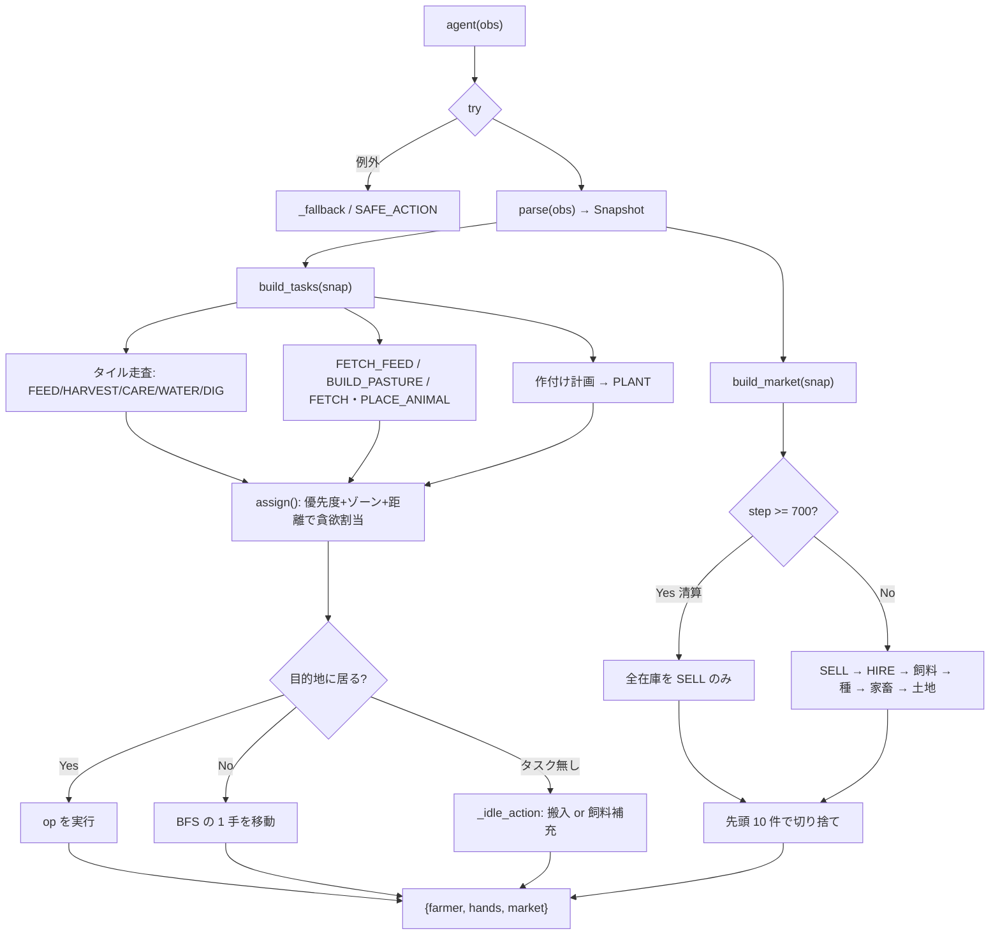

# rulebase/case7 実装解説

> 対象: `backend/pipeline/rulebase/case7/`
> 規模: 5 ファイル / 1,434 行 (Python のみ。ほかに README.md)
> 分析日: 2026-08-11
> コミット: `133e83b`
> 読み込み深度: 全ファイル精読

## 概要

Kaggriculture の 720 ターン 1 シーズンを戦う、手書きヒューリスティックのルールベースエージェント。Kaggle ハーネスが毎ターン 1 回だけ呼ぶ `agent(obs) -> dict` が唯一の入口で、内部状態を一切持たない **純粋な毎ターン再計算型** である。「観測をパースする → 盤面全体からやるべき仕事 (Task) を列挙する → ユニットに割り当てる → 市場注文を組み立てる」の 4 段を毎ターン頭から実行する。

戦略の骨格は「小麦 + メロン + 家畜 (牛・羊)」で、小麦は家畜の飼料と店需要を兼ね、メロンが主力換金作物。case2 をベースに case3 から 3 つの機構を **フラグ付きで** 移植し、実測で 2 つを OFF に戻したという経緯を持つ (`config.py` の Feature flags 節)。最大の利得はそれらの移植そのものではなく、移植の過程で露見した case2 のゾーン制バグの修正 (`Task.zone_free`) だった。

## 1. ディレクトリ構成

```
backend/pipeline/rulebase/case7/
├── main.py      69行   エントリポイント。agent(obs) の例外ガードと action dict 組み立て
├── observe.py  247行   生 obs → 型付き Snapshot への防御的パース。Tile / Snapshot 定義
├── config.py   358行   エンジン定数のミラー + 戦略チューニング値 + 3 つの feature flag
├── tasks.py    478行   Task 生成 (build_tasks) とユニットへの貪欲割り当て (assign)。BFS 移動
├── market.py   282行   市場注文の組み立て。価格曲線の再現、売却/種/飼料/家畜/雇用/土地
└── README.md           case2 からの差分、アブレーション結果、既知の負け筋
```

### エントリポイント

- **`main.py:agent(obs)`** が唯一の外部入口。ハーネスは「モジュール内で **最後に定義された callable**」をエージェントとして拾うため、`agent` はファイル末尾に置かれている (`main.py` の docstring)。
- ハーネスはこのファイルを `__name__` も `__file__` も無い状態で `exec` するため **相対 import が使えない**。`from config import ...` のように裸名で兄弟モジュールを import しており、これは in-place でも `tar -C <case-dir> .` で平置きにした後でも動く。
  - 注: リポジトリの `.claude/rules/backend/pipeline.md` は「case 内モジュールは相対 import」と書いているが、本 case は裸名 import を採用しており規約と食い違う。docstring にその理由が明記されている。

### 依存方向

```
config.py  (定数のみ。何も import しない)
    ↑
observe.py (config を参照)
    ↑
tasks.py   (config + observe)
    ↑
market.py  (config + observe + tasks)
    ↑
main.py    (全部)
```

きれいな一方向レイヤーで循環はない。`market.py` が `tasks.py` から `crop_targets` / `feed_needed` / `herd_target` / `next_animal` / `plantable` を借りている点が要注意 — **「何を買うか」の判断が「何を作るか」の計画と同じ関数を共有している**ので、作付け計画を変えると購買も自動的に追随する。

### ここに無いもの

- **状態の永続化が無い**。ターン間で持ち越す変数もキャッシュもグローバルもなく、毎ターン `obs` だけから全てを再導出する。したがって「前ターンこのユニットに何をさせたか」は一切覚えていない。
- **numpy を使っていない**。10×10 盤面を素の Python ループで何度も走査する (`all_tiles()` の呼び出しが 1 ターンに 10 回以上)。盤面が 100 セルなので実用上問題にならない範囲。
- **ログ出力が無い**。提出コードの規約通り、ホットパスに print も logging も一切ない。
- 学習済み重みや外部データファイルも無い。純粋なルールベース。

## 2. クラス / メソッド一覧

### 中核オブジェクト

#### `Tile` (frozen dataclass, `observe.py:17`)

盤面 1 マスを平坦化したもの。作物用フィールドと家畜用フィールドが同じクラスに同居しており、`kind` で使い分ける。

| フィールド | 型 | 意味 |
|---|---|---|
| `x`, `y` | int | 座標。`pos` プロパティで `(x, y)` タプル |
| `kind` | str | `LOCKED` / `EMPTY` / `WEED` / `PLANT` / `COOP` / `PASTURE` / `ANIMAL` |
| `crop` | str \| None | PLANT のときの作物名 |
| `animal` | str \| None | ANIMAL のときの家畜種 |
| `yield_units` | int | 収穫可能な units。>0 なら HARVEST 対象 |
| `planted_day` | int | 植えた日。`day - planted_day` が樹齢 |
| `watered_today` | bool | 今日水をやったか |
| `consecutive_unwatered` | int | **1 以上で今日水をやらないと雑草化** — 救出水やりの判定に使う |
| `fed_today` / `cared_today` | bool | 家畜の給餌 / 世話の済否 |
| `consecutive_unfed` | int | 2 で家畜が逃走 (パース済みだが **後段のロジックでは未使用**、`fed_today` だけで判断) |
| `fertilizer_available` | bool | 肥料が回収可能か |

#### `Snapshot` (dataclass, `observe.py:45`)

1 ターン分の全情報。ポリシーはこれ以外を参照しない。

| フィールド | 型 | 意味 |
|---|---|---|
| `step` / `day` / `hour` | int | `step` が欠けていれば `day*24+hour` で補完 |
| `player` | int | 自分の座席 |
| `money` | float | 所持金 |
| `tiles` | `list[list[Tile]]` | 自分の盤面 `[y][x]` (**行が先**) |
| `farmer` | `Pos` | 農夫の位置 |
| `hands` | `list[Pos]` | 雇った日雇いの位置。**この順序が action dict の `hands` の順序と一致** |
| `unlocked_quadrants` | `list[str]` | 解放済み象限。作付け・家畜目標のスケール係数 |
| `hires_today` | int | 今日すでに雇った人数 |
| `shed` / `seeds` | `dict[str, int]` | 倉庫在庫 / 種在庫 |
| `inventories` | `list[dict[str,int]]` | **ユニットごとの携行品**。index は `units` と同じ順 |
| `prices` / `market_inventory` | `dict[str, int]` | 市場の現在価格 / 在庫 |
| `unlocked_shops` | `list[str]` | 解放済みの町の店 (**パースされるが未使用**) |
| `opponent_tiles` | `list[list[Tile]]` | 相手の盤面 (農場は公開情報) |
| `opponent_money` | float | 相手の所持金 (**パースされるが未使用**) |

主なメソッド: `units` (農夫 → 各ハンドの順で位置を返す。action dict の順序と一致させるための単一の真実源)、`tile_at(pos)`、`inventory_of(idx)`、`all_tiles()` (フラット化)、`opponent_crop_tiles(crop)` (相手が特定作物を何マス育てているか)。

#### `Task` (frozen dataclass, `tasks.py:71`)

「あるマスでやるべき仕事 1 件」。

| フィールド | 型 | 意味 |
|---|---|---|
| `priority` | int | **小さいほど緊急**。`P_FEED=0` 〜 `P_COLLECT_FERT=11` |
| `target` | `Pos` | 作業対象マス |
| `op` | `list[str\|int]` | エンジンに渡す op 本体 (`["WATER"]`, `["PLANT","MELON"]` 等) |
| `needs_item` | str \| None | 携行が必須のアイテム。持っていないユニットには割り当て不可 |
| `at_shed` | bool | 倉庫作業。4 つのアクセスマスのうち **最寄り** に再ターゲットされる |
| `zone_free` | bool | **ゾーン制の対象外**。締切系の仕事だけが盤面全域から取れる |

優先度の並びは、エンジンが日終わりに課す 2 つの締切 (`consecutive_unwatered >= 2` で雑草化、`consecutive_unfed >= 2` で逃走) を反映している。

```
0 FEED  1 FETCH_FEED  2 RESCUE_WATER  3 HARVEST  4 FETCH_ANIMAL  5 PLACE_ANIMAL
6 BUILD_PASTURE  7 WATER  8 CARE  9 PLANT  10 DIG  11 COLLECT_FERT
```

### 関数一覧

#### `main.py`

| 名前 | 種別 | 責務 | 入力 | 出力 |
|---|---|---|---|---|
| `agent` | function | 唯一の入口。**二重の例外ガード** | `obs` | action dict |
| `_decide` | function | 1 ターン分の action を組み立てる。例外は投げてよい | `obs` | action dict |
| `_fallback` | function | ハンド数だけ揃えた no-op | `n_hands` | action dict |

#### `observe.py`

| 名前 | 種別 | 責務 | 入力 | 出力 |
|---|---|---|---|---|
| `parse` | function | 生 obs → `Snapshot`。全アクセスが防御的 | `obs` (dict or Struct) | `Snapshot` |
| `_parse_tile` | function | 1 マスのパース。`"LOCKED"` / `None` / 非 dict は全て安全側へ | raw, x, y | `Tile` |
| `_parse_grid` | function | 10×10 に正規化。**足りない行/列は `LOCKED` で埋める** | raw list | `list[list[Tile]]` |
| `_as_int` / `_as_pos` / `_parse_counts` | function | 型強制ヘルパ。失敗時はデフォルト | Any | int / Pos / dict |
| `animal_product` | function | 家畜 → 産物名 | animal | str \| None |

#### `tasks.py`

| 名前 | 種別 | 責務 | 入力 | 出力 |
|---|---|---|---|---|
| `build_tasks` | function | **盤面全体から今ターンやる価値のある仕事を全列挙** | `Snapshot` | `list[Task]` |
| `assign` | function | 各ユニットに 1 アクションを貪欲割り当て | `Snapshot`, tasks | `list[list[str\|int]]` |
| `_idle_action` | function | 仕事の無いユニットの行動 (倉庫への搬入 / 飼料の補充) | snap, idx, pos | op |
| `first_step_towards` | function | BFS で最初の 1 手を返す | start, goal | 方角 str \| None |
| `nearest_shed_tile` | function | 最寄りの倉庫アクセスマス | pos | `Pos` |
| `workable_tiles` | function | 解放済み かつ 倉庫 4 マス以外 | snap | `list[Tile]` |
| `_zone_of` | function | 列バンドでユニットのゾーンを決める | pos, n_units | int |
| `crop_targets` | function | 作物ごとの目標マス数 (象限数でスケール) | snap | `dict[str,int]` |
| `melon_tiles_per_quadrant` | function | メロンの作付け量。**フラグ OFF なので現状は定数を返すだけ** | snap | int |
| `_planting_plan` | function | あと何マス植えたいか | snap | `dict[str,int]` |
| `plantable` | function | まだ収穫が間に合うか (`day + first_yield_day <= 29`) | snap, crop | bool |
| `herd_target` | function | 今欲しい家畜頭数 (日で段階的にランプ) | snap | int |
| `next_animal` | function | 次に買う種 (`COW,COW,COW,SHEEP` の巡回) | snap | str |
| `_pasture_targets` | function | あと何個牧場を建てるか | snap | int |
| `feed_needed` | function | 家畜数 × 4 の小麦確保量 | snap | int |

#### `market.py`

| 名前 | 種別 | 責務 | 入力 | 出力 |
|---|---|---|---|---|
| `build_market` | function | 今ターンの注文を **優先順に** 組み立て、10 件で打ち切る | snap | `list[Order]` |
| `price_at` | function | エンジンの価格曲線を再現 | item, inventory | int |
| `sale_proceeds` | function | n 個売った時の合計額 (1 個ずつ曲線を降りる) | item, qty, inv | int |
| `_impact_score` | function | 「収益 ÷ 価格ダメージ」で売却順位付け | item, qty, inv | float |
| `_sell_orders` | function | 倉庫在庫の売却。飼料用小麦は残す | snap, liquidating | orders |
| `_seed_orders` | function | 種の補充 | snap | orders |
| `_feed_orders` | function | 飼料小麦の購入 | snap | orders |
| `_animal_orders` | function | 家畜の購入 | snap | orders |
| `_hire_orders` | function | 朝 1 回だけの雇用 | snap | orders |
| `_target_hands` | function | 仕事量からハンド数を算出 | snap | int |
| `_land_orders` | function | 予定日に象限を購入 | snap | orders |
| `_shape` | function | 曲線形状 (`linear`/`sq`/`sqrt`/`log`/`log10`) | func, x | float |

### 名前が実態とずれている / 隠れた挙動があるもの

- **`melon_tiles_per_quadrant(snap)`** — 名前も本体も「価格と相手の作付けから動的に決める」ように見えるが、`ENABLE_OPPONENT_AWARE_MELON = False` なので **1 行目で定数 10 を返して終わる**。この関数の残り 10 行は現在デッドコード。
- **`_sell_batch_size(item, held, inventory, liquidating)`** — 引数 `inventory` を受け取るのに **本体で一切使っていない**。売却量は在庫水準に反応しない。
- **`_impact_score`** — 「売却の順序付け」だけに使われ、売却の **可否や量** には影響しない。スコアが低くても結局は売る。
- **`Tile.consecutive_unfed`** — パースされるが後段で参照されない。給餌判定は `fed_today` のみで、「あと 1 日で逃げる家畜」の優先度を上げる仕組みは無い (FEED がそもそも最優先なので実害は小さい)。
- **`Snapshot.unlocked_shops` / `opponent_money`** — パースされるが未使用。町の店の需要は戦略に組み込まれていない。
- **`config.SHOPS` / `PRODUCTS` / `EPISODE_STEPS` / `SHED_CAPACITY` / `BOARD_SIZE` 以外の一部定数** — `SHOPS` と `PRODUCTS` はどのモジュールからも import されていない。
- **`main.py` の docstring** が「rulebase/case2 --」で始まっており、`config.py` の docstring も「case2 strategy tuning」のまま。**コピー元の case 名が残っている**。
- **`build_tasks` は 1 マスに複数 Task を出す**。例えば収穫可能で未給餌で未世話の家畜には FEED / HARVEST / CARE の 3 つが立つ。`assign` は `claimed` セットで **マス単位** に排他するので、1 ターンにそのマスで実行されるのは 1 つだけ。

## 3. 処理ステップ

### メインパス (毎ターンこれが 720 回走る)

```
 1. ハーネスが agent(obs) を呼ぶ                                  (main.py:58)
 2. try: _decide(obs)                                            (main.py:61)
 3. parse(obs) で Snapshot を構築                                 (observe.py:175)
      - obs は dict か Struct なので .get 経由に統一               (observe.py:181)
      - farms[player] が取れなければ player=0 / 空農場に退避       (observe.py:189)
      - 盤面は必ず 10×10 に正規化、欠損は LOCKED                    (observe.py:151)
 4. build_tasks(snap) で今ターンの仕事を全列挙                     (tasks.py:257)
      4a. 倉庫 4 マスを除いた解放済みタイルを走査                   (tasks.py:144)
      4b. ANIMAL: 未給餌かつ誰かが小麦携行中なら FEED(P0)          (tasks.py:271)
          収穫可なら HARVEST(P3) / 未世話なら CARE(P8)
          肥料あれば COLLECT_FERTILIZER(P11)
      4c. PLANT: 未灌水なら WATER。consecutive_unwatered>=1 の
          ときだけ RESCUE_WATER(P2) に昇格 + zone_free 化          (tasks.py:291)
          樹齢 >= first_yield_day かつ yield>0 なら HARVEST(P3)
      4d. WEED: DIG(P10)                                          (tasks.py:301)
      4e. 空腹頭数 > 携行小麦 かつ倉庫に小麦あり → FETCH_FEED(P1)  (tasks.py:306)
      4f. 牧場が目標に足りなければ、倉庫に近い空きマスから
          BUILD_PASTURE(P6) を必要数                               (tasks.py:313)
      4g. 空き牧場があり誰かが家畜携行中 → PLACE_ANIMAL(P5)        (tasks.py:329)
          倉庫に家畜が居て誰も運んでいない → FETCH_ANIMAL(P4)      (tasks.py:341)
      4h. 作付け計画の不足分だけ、牧場予約を除いた空きマスに
          PLANT(P9)。種の在庫数が上限                              (tasks.py:361)
 5. assign(snap, tasks) で 1 ユニット 1 アクション                 (tasks.py:389)
      - タスクを (priority, target) でソート
      - 農夫 → ハンド の順に、各ユニットが
        key = (priority + (ゾーン外なら +100), 距離, target)
        の最小を貪欲に取る                                          (tasks.py:419)
      - needs_item を持たないユニットはそのタスクを取れない
      - 取れたら claimed に入れ、以降のユニットからは見えない
      - 目的地に居れば op を実行、居なければ BFS の 1 手を移動      (tasks.py:436)
      - 何も取れなければ _idle_action                              (tasks.py:445)
 6. build_market(snap) で市場注文を組み立て                        (market.py:266)
      - step >= 700 なら清算モード
      - SELL を先頭に、HIRE → 飼料 → 種 → 家畜 → 土地 の順        (market.py:273)
      - 先頭 10 件で切り捨て
 7. action dict を組み立てて返す                                   (main.py:51)
      - hands は len(snap.hands) に合わせて PASS で埋める/切る
      - market は改めて MAX_MARKET_ORDERS で切る (二重の保険)
```

### 分岐

#### ゾーン制と `zone_free` (このケースの最重要分岐)

`_zone_of` は盤面の列を `n_units` 本の縦バンドに分け、ユニット *i* はバンド *i* を担当する。ゾーン外のタスクは優先度に **+100** されるので事実上「他に何も無いときの保険」になる。

ただし `zone_free=True` のタスク (FEED / RESCUE_WATER / HARVEST / CARE) と `at_shed=True` のタスクはこのペナルティを免除される。README によれば、これが無かった case2 では **家畜が数列に固まるせいで、そのゾーンを持つ 4 ユニットしか給餌できず、シーズンあたり 30 頭が餓死していた**。この 1 点だけでアブレーション +14,714 (最大の寄与)。

#### 3 つの feature flag (`config.py:218-252`)

| フラグ | 既定 | 効果 |
|---|---|---|
| `ENABLE_HERD_EXPANSION` | **True** | 家畜と労働力を農場規模に応じて拡大。OFF だと 2 頭 / 6 人固定 |
| `ENABLE_OPPONENT_AWARE_MELON` | False | メロン作付けを価格と相手の作付けから決める。実測 ±0 (一度も発火しない) |
| `ENABLE_STRAWBERRY` | False | イチゴを育てる。実測 −1,919 |

`ENABLE_HERD_EXPANSION` は 2 か所に効く。`herd_target` (家畜頭数) と `_target_hands` (雇用数) の両方が、この 1 つのフラグで固定値モードと動的モードを切り替える。

#### 家畜ランプ (`herd_target`, `tasks.py:210`)

```
day <  6            → 2 頭  (CORE_HERD)
day >= 6            → 8 頭  (MID_HERD)
day >= 12           → 14 頭 (TARGET_HERD)
```
ただし常に `min(target, 5 * 解放象限数)` で頭打ち。段階的にした理由はコメントに明記 — 初日に 4 頭 ($1,600) を $3,000 の初期資金から買うと 20 日間ほぼ無一文になり、雇用も飼料も回らず約 29 頭を餓死で失って最終資金が case2 を下回った。

種の選択は `next_animal` が `("COW","COW","COW","SHEEP")` を所有数で剰余巡回する。MILK と WOOL を別々の価格曲線に乗せて、一方の暴落がもう一方を巻き込まないようにする狙い。

#### 雇用数 (`_target_hands`, `market.py:217`)

```
workload = 作物数 + 2*家畜数 + 雑草数 + min(空きマス, 6)
wanted   = ceil(workload / 7)
結果      = max(6, min(12, wanted))
```
雇用費は当日 n 人目が `fib(n)` なので、6 人で 20/日、12 人で 376/日と急増する。ここを固定値でなく仕事量に連動させるのが `ENABLE_HERD_EXPANSION` の後半部分。

#### 清算モード (`build_market`, `market.py:268`)

`step >= 700` (`LIQUIDATION_START_STEP`) で切り替わる。以降は:
- 売却量が `SELL_BATCH` の上限を無視して **在庫全量** になる
- 飼料用小麦の取り置き (`reserve`) が 0 になり、小麦も全部売る
- HIRE / 飼料 / 種 / 家畜 / 土地の **購買が全て止まる**

シーズン終了時の未売却在庫は 0 点なので、最後の 20 ターンは在庫を現金に変えることだけをする。`config.py` のコメントによれば、インタプリタが step 718 の後に DONE を打つため step 719 の行動は実行されない (`FINAL_EXECUTED_STEP = 718`)。

#### 作付け停止 (`plantable`, `tasks.py:190`)

`day + CROPS[crop]["first_yield_day"] <= 29` を満たす作物だけ植える。メロンは初収穫まで 10 日なので day 19 で打ち切り、小麦は 2 日なので day 27 まで。同じ判定が `_seed_orders` にも入っていて、植えられない作物の種は買わない。

#### 家畜購入の締切 (`_animal_orders`, `market.py:187`)

`day > 18` で購入を完全停止。COW は初産が day 8、SHEEP は day 6 なので、それ以降に買っても飼料代を回収できない。

#### 土地購入 (`_land_orders`, `market.py:252`)

day 5 に NE ($1,000)、day 9 に SW ($2,000) を、`money >= cost + 500` のときだけ買う。SE ($4,000) は `LAND_BUY_DAYS` が 2 要素しかないので **意図的に買わない** (上位リプレイでの購入率がほぼゼロという理由がコメントに記載)。

#### 遊休ユニットの行動 (`_idle_action`, `tasks.py:445`)

```
倉庫マスに居る   → 小麦以外の携行品があれば PLACE (SELL は倉庫在庫からしか引けない)
                 → 無ければ、飼料が不足していれば PICKUP WHEAT
                 → それも要らなければ PASS
倉庫マスに居ない → 何か持っている or 飼料が要る なら最寄り倉庫へ 1 歩
                 → そうでなければ PASS
```
「収穫物を倉庫に置く」導線がタスクではなく idle 行動側に置かれている点に注意。**収穫した produce は、そのユニットが暇になるまで倉庫に入らない**。

### エラーハンドリング

- **`agent` は二重ガード** (`main.py:58-69)。内側の `_decide` が投げたら、`obs` からハンド数だけ読んで `_fallback` を返す。その読み取りすら失敗したら `{"farmer":["PASS"],"hands":[],"market":[]}`。ここが唯一の `except` で、下位モジュールに `try` は無い。
- **パースは例外を投げない設計**。`_as_int` は `TypeError`/`ValueError` を握って既定値を返し、`_parse_tile` は未知の入力を全部 `EMPTY` に落とす。型が想定外でも黙って通る。
- **静かに失敗するもの (要注意)**:
  - `_parse_grid` は行や列が足りない場合に **`LOCKED` で埋める**。obs の形が変わって盤面が短く来たら、エージェントは「土地が無い」と解釈して何もしなくなる — 例外は出ない。
  - `_parse_tile` は認識できない `kind` を `EMPTY` にする。新しいタイル種が追加されたら「空き地」として上書き作付けの対象になる。
  - 不正な op や範囲外座標はエンジン側で **静かな no-op**。`first_step_towards` が `None` を返したときは `["PASS"]` に落ちる。
  - 市場注文が 11 件目以降なら **末尾から黙って捨てられる**。だから `build_market` は SELL を先頭に置いている (売却代金が同一ターンの後続注文の原資になる)。
  - `hands` の長さが実際の雇用数とずれると黙って取りこぼす。`_decide` が `while len(hands) < len(snap.hands)` で必ず埋めている。

### 副作用

**外部副作用は一切無い**。ファイル IO なし、ネットワークなし、グローバル状態なし、キャッシュなし、乱数なし。`agent` は `obs` の純関数であり、同じ `obs` に対して常に同じ dict を返す (完全に決定的)。唯一の「状態」はエンジン側の盤面そのもの。

### 全体フロー図



## 補足

### 読む前に知っておくと得なこと

1. **毎ターン全部を再計算する**。「このユニットは倉庫に向かっている途中」といった継続状態は存在せず、毎ターン `assign` が改めて全ユニットに割り当て直す。ユニットが目的地に着く前に、より優先度の高いタスクが発生すれば **途中で引き返す**。これは仕様であってバグではないが、リプレイを見ると迷走しているように見えることがある。

2. **`zone_free` がこの case の存在意義**。README のアブレーションでは、3 つの移植機構の合計より、この 1 つの修正 (+14,714) のほうが大きい。case2 では 2 頭の牛が 1 ゾーンに収まっていたので問題が見えず、頭数を増やして初めて欠陥として露見した。

3. **「無効なアクションは例外ではなく静かな no-op」**。この case のバグは全てスコアの低下として現れ、クラッシュとしては現れない。読むときは「例外が出ていないから正しい」とは絶対に考えないこと。

4. **`config.py` の Feature flags 節にコメントとして実験結果が埋め込まれている**。負の結果 (イチゴ −1,919、相手対応メロン ±0) が「なぜ OFF なのか」の根拠付きで残されており、コード中で最も情報量の多い箇所。消さないこと。

5. **`price_at` / `sale_proceeds` はエンジンの価格曲線をローカルに再現したもの**。`config.MARKET_PARAMS` はエンジン (kaggle_environments 1.32.6) からの手動ミラーで、**エンジンが更新されると黙ってずれる**。import せず複製している理由は「提出コードがエンジン内部の import 可能性に依存すべきでない」から (`config.py` docstring)。

### 既知の弱点 (README より、コードから読み取れない文脈)

case7 は builtin 相手に 45k 稼ぐが、case2 との直接対戦では 7/16 で **負け越す**。両者が同じ商品 (MELON / MILK) を同じ市場に投げるため価格が共倒れし (day 29 に MELON が 4、MILK が 26 まで落ちる)、case7 の大きな群れは飼料と購入費を払うだけで追加の売上を生まない。**生産能力は売り先が無ければ価値がない** という、この競技の核心的な難しさがそのまま出ている。

コード上の帰結として、`ENABLE_OPPONENT_AWARE_MELON` (相手の作付けを見て自分の作付けを減らす、唯一の相手認識機構) が OFF のままなのは、閾値 (相手のメロン 12 マス以上) を踏む対戦相手がこのラダーに存在しないため。「原理的には正しいが未検証のコード」として温存されている。

### 未解決の疑問

- `Snapshot.unlocked_shops` と `config.SHOPS` が両方存在するのに、町の店の需要が戦略に一切反映されていない。店は 4 ターンごとに需要商品を消費し続けるので、市場在庫を減らす唯一の外部要因のはずだが、売却の判断には入っていない。
- `_sell_batch_size` が受け取った `inventory` を使っていないのは、意図的な簡略化か書きかけかが判別できない。
- 相対 import 規約 (`.claude/rules/backend/pipeline.md`) と実装 (裸名 import) の食い違いは、docstring を見る限り実装側が正しくルール側が古い可能性が高い。

### 関連ドキュメント

- `backend/pipeline/rulebase/case7/README.md` — アブレーション結果と対戦成績の一次情報
- `docs/experiment/rulebase/20260811_case7_mechanism_transfer/result.md` — 実験記録
- `docs/competition/abstract.md` — 観測の形と競技ルールの要約
