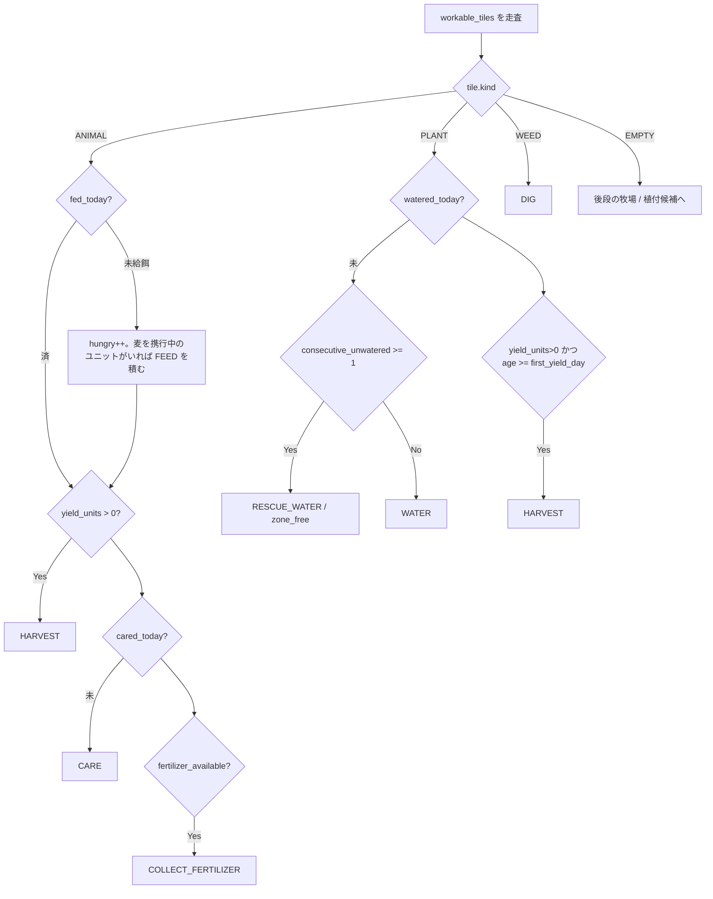

# rulebase/case7 実装解説

> 対象: `backend/pipeline/rulebase/case7/`
> 規模: 5 ファイル / 1,434 行 (Python のみ。ほかに `README.md`)
> 分析日: 2026-08-11
> コミット: `133e83b`
> 読み込み深度: 全 5 ファイル精読（`config.py` の定数表は値まで確認、`README.md` と `docs/experiment/rulebase/20260811_case7_mechanism_transfer/` を背景として参照）

## 概要

Kaggriculture（2 人対戦の農場経営シム）に提出する **ルールベースエージェント**。エンジンは 720 ターン（24 ターン × 30 日）のあいだ毎ターン `agent(obs) -> dict` を 1 回呼び、エージェントは「農夫 1 人 + 雇った日雇い全員の行動」と「市場注文リスト」を返す。学習モデルは一切持たず、毎ターン観測をゼロから解析して優先度つきタスクを生成し、ユニットに割り当て直す**完全ステートレス**な設計。

case2（麦 + メロン + 酪農）をベースに、case3 から 3 つの機構をフラグ付きで移植したもの。3 つのうち 2 つは計測の結果 **OFF のまま出荷**されており、実際に効いたのは移植ではなく、この作業で露見した case2 のゾーン割り当てバグの修正（`Task.zone_free`）だった。

外から見た入口は `main.py` の `agent(obs)` ただ 1 つ。

## 用語

| 用語 | 意味 |
|---|---|
| `obs` | エンジンが毎ターン渡す観測。dict 風だが `Struct` の場合もあるため `.get` 経由でのみ触る |
| ターン / step | 1 回の `agent()` 呼び出し。1 日 = 24 ターン、1 シーズン = 720 step |
| ユニット (unit) | 盤面上を動く作業者。**農夫 (farmer) 1 人 + 日雇い (hand) 0〜12 人**。行動 dict の順序と一対一で対応する |
| hand（日雇い） | `HIRE` で雇う作業者。n 人目の当日コストは `fib(n)`、日の終わりに全員消滅し翌朝また雇い直す |
| quadrant（象限） | 10×10 盤面の 5×5 区画 4 つ。NW のみ最初から解放、NE/SW/SE は `BUY_LAND` で購入 |
| shed（納屋） | 中央の共有倉庫。**タイルではなく**、`(4,4)/(5,4)/(4,5)/(5,5)` のいずれかに立つと `PICKUP` / `PLACE` が可能になる |
| zone（ゾーン） | ユニット数で盤面の列を等分した縦帯。ユニット *i* は帯 *i* のタスクを優先する（`tasks.py:376`） |
| `zone_free` | そのタスクをゾーン制約から免除するフラグ。締切のある仕事（FEED / 救出 WATER / HARVEST / CARE）に付く |
| `Task` | 「どこで何をするか」を表す frozen dataclass。優先度・対象座標・op・必要携行品を持つ |
| `Snapshot` | 生 `obs` を型付きに正規化した 1 ターン分の状態。ポリシーはこれしか見ない |
| `Tile` | 盤面 1 マス。`LOCKED` / `EMPTY` / `WEED` / `PLANT` / `COOP` / `PASTURE` / `ANIMAL` のいずれか |
| 締切 (deadline) | エンジンが日終わりに強制する 2 つの罰。`consecutive_unwatered >= 2` で作物が雑草化、`consecutive_unfed >= 2` で家畜が逃走 |
| `pending care bonus` | `CARE` で貯めた収量ボーナス。次の給餌済み生産日にまとめて支払われる |
| `I0` | 市場の均衡在庫 = 10,000。ここで価格が `base` に一致する |
| `T` | アンカー・スループット。「`I0` から `T` だけ在庫が動いたとき価格が `target × base` 変化する」の基準量 |
| silent no-op | 不正な行動をエンジンが例外にせず黙って捨てる挙動。バグは低スコアとしてのみ表面化する |
| liquidation（清算） | シーズン終盤に在庫を全部売り切るモード。step 700 以降。売れ残りは 0 点 |
| `starter` | エンジン内蔵の決定論的ベースライン。新 case が超えるべき基準線 |
| `Pos` | 座標の型別名 `tuple[int, int]` = `(x, y)`（`observe.py:14`） |
| `Order` | 市場注文 1 件の型別名 `list[str \| int]`。例 `["SELL", "MELON", 12]`（`market.py:37`） |
| `op` | ユニット 1 人分の行動 1 件。`["FEED"]` や `["PLANT", "MELON"]` のようなリスト |
| ablation（アブレーション） | 機構を 1 つだけ切って再計測し、その寄与を差分で測る手法 |

## 1. ディレクトリ構成

```
backend/pipeline/rulebase/case7/
├── main.py      69 行   エントリポイント。agent(obs) を定義し、例外を握りつぶして安全行動へ落とす
├── observe.py  247 行   生 obs → Snapshot / Tile への防御的パース。相手農場の作物数も読む
├── config.py   358 行   エンジン定数（作物・家畜・市場曲線・店）+ case7 の 3 フラグ + 戦略チューニング値
├── tasks.py    478 行   タスク生成（build_tasks）とユニットへの割り当て（assign）。BFS 経路も持つ
├── market.py   282 行   市場注文の組み立て。売却・雇用・餌・種・家畜・土地を優先度順に並べる
└── README.md            case2 からの差分、アブレーション結果、negative result の記録
```

### エントリポイント

外部から呼ばれるのは **`main.py` の `agent(obs)` だけ**。Kaggle ハーネスは以下の 2 つの制約を課しており、`main.py` の docstring に明記されている（`main.py:1-15`）。

| 制約 | 実装上の帰結 |
|---|---|
| ハーネスは `__name__` / `__file__` なしでこのファイルを `exec` する | 相対 import が使えない。`from config import ...` のように**素の名前で** sibling を import する（ハーネスがディレクトリを `sys.path` に足す） |
| ハーネスはモジュール内で**最後に定義された callable** をエージェントとみなす | `agent` は必ずファイル末尾の定義でなければならない |

> 補足: リポジトリ規約（`.claude/rules/backend/pipeline.md`）は case 内モジュールに**相対 import** を求めているが、case7 は上記ハーネス制約を理由に素名 import を採っている。規約とのズレは意図的で、docstring に根拠が書かれている。

### 依存方向

```
config  ←  observe  ←  tasks  ←  market
   ↑          ↑          ↑         ↑
   └──────────┴──── main ─┴─────────┘
```

一方向で循環はない。`market.py` は `tasks.py` から `crop_targets` / `feed_needed` / `herd_target` / `next_animal` / `plantable` を借りており、「何を植えたいか / 何頭飼いたいか」の判断が**タスク側と購買側で必ず一致する**ようになっている（`market.py:35`）。

### ここに無いもの

| 無いもの | 実際の所在 |
|---|---|
| 対戦の実行・リプレイ収集 | `backend/src/simulate/`（提出物には含まれない） |
| 提出パッケージング・検証 | `backend/src/submit/` |
| 学習・モデル重み | case7 には存在しない（`imitation` / `reinforce` ファミリの担当） |
| 実験の経緯と数値 | `docs/experiment/rulebase/20260811_case7_mechanism_transfer/result.md`、および case7 の `README.md` |
| エンジン本体の定数 | `kaggle_environments`（1.32.6）。提出コードは import できないので `config.py` に**手写しで複製**されている（`config.py:1-7`） |

## 2. クラス / メソッド一覧

### 中核オブジェクト

#### `Snapshot`（`observe.py:45`）— 1 ターン分の全状態

ポリシー層はこれ以外を見ない。`obs` の生の形は `parse()` の中だけに閉じている。

| フィールド | 型 | 意味 |
|---|---|---|
| `step` / `day` / `hour` | `int` | 現在時刻。`step` 欠落時は `day * 24 + hour` で復元 |
| `player` | `int` | 自分の座席番号（0 or 1） |
| `money` | `float` | 自分の所持金 |
| `tiles` | `list[list[Tile]]` | 自農場 10×10。`tiles[y][x]` の**行優先**である点に注意 |
| `farmer` | `Pos` | 農夫の座標 `(x, y)` |
| `hands` | `list[Pos]` | 日雇いの座標。**この順序が行動 dict の順序** |
| `unlocked_quadrants` | `list[str]` | 解放済み象限。作付け目標・厩舎数のスケール基準 |
| `hires_today` | `int` | 本日すでに雇った人数。朝の追加雇用数の計算に使う |
| `shed` | `dict[str, int]` | 納屋の中身。**SELL はここからしか出せない** |
| `seeds` | `dict[str, int]` | 保有種。植付タスク数の上限になる |
| `inventories` | `list[dict[str, int]]` | ユニットごとの携行品。index はユニット順（0 = 農夫） |
| `prices` / `market_inventory` | `dict[str, int]` | 市場の現在価格と在庫 |
| `unlocked_shops` | `list[str]` | 解放済みの町の店。**現状どこからも参照されていない**（下記「名前と実態のズレ」参照） |
| `opponent_tiles` | `list[list[Tile]]` | 相手農場の盤面。農場は公開情報 |
| `opponent_money` | `float` | 相手の所持金。**現状どこからも参照されていない** |

派生アクセサ: `units`（農夫を先頭にした全ユニット座標）、`tile_at(pos)`（範囲外は `None`）、`inventory_of(idx)`、`all_tiles()`、`opponent_crop_tiles(crop)`。

#### `Tile`（`observe.py:17`）— 盤面 1 マス

作物用フィールドと家畜用フィールドが 1 つの frozen dataclass に**同居**している。`kind` によってどちらが有効か決まる。

| フィールド | 有効な `kind` | 意味 |
|---|---|---|
| `crop` / `planted_day` / `watered_today` / `consecutive_unwatered` | `PLANT` | 作物の種類・植えた日・本日の水やり済みか・連続未給水日数 |
| `animal` / `fed_today` / `cared_today` / `consecutive_unfed` / `fertilizer_available` | `ANIMAL` | 家畜の種類・本日給餌済みか・世話済みか・連続未給餌日数・肥料回収可能か |
| `yield_units` | 両方 | 収穫できる単位数 |

#### `Task`（`tasks.py:71`）— 1 件の作業

| フィールド | 型 | 意味 |
|---|---|---|
| `priority` | `int` | **小さいほど緊急**。0〜11 の定数（下表） |
| `target` | `Pos` | 作業対象タイル。同一 `target` は 1 ユニットしか claim できない |
| `op` | `list[str \| int]` | エンジンに渡す行動そのもの（例 `["PLANT", "MELON"]`） |
| `needs_item` | `str \| None` | 携行が必要な品目。持っていないユニットには割り当て不可 |
| `at_shed` | `bool` | 納屋作業。4 つのアクセスタイルのうち**そのユニットに最も近い方**へ再ターゲットされる |
| `zone_free` | `bool` | ゾーン制約の免除。case7 の最大の改善点 |

#### 優先度テーブル（`tasks.py:57-68`）

| 値 | 定数 | 作業 | `zone_free` |
|---|---|---|---|
| 0 | `P_FEED` | 家畜に給餌 | ✅ |
| 1 | `P_FETCH_FEED` | 納屋から麦を取る | （`at_shed` により実質免除） |
| 2 | `P_RESCUE_WATER` | 雑草化寸前の作物に水 | ✅ |
| 3 | `P_HARVEST` | 収穫 | 家畜のみ ✅ / 作物は ❌ |
| 4 | `P_FETCH_ANIMAL` | 納屋から家畜を取る | （`at_shed`） |
| 5 | `P_PLACE_ANIMAL` | 牧場に家畜を配置 | ❌ |
| 6 | `P_BUILD_PASTURE` | 牧場を建てる | ❌ |
| 7 | `P_WATER` | 通常の水やり | ❌ |
| 8 | `P_CARE` | 世話（次回生産にボーナス） | ✅ |
| 9 | `P_PLANT` | 植える | ❌ |
| 10 | `P_DIG` | 雑草を除去 | ❌ |
| 11 | `P_COLLECT_FERT` | 肥料回収 | ❌ |

上位 3 つが「その日を逃すと損失が確定する」仕事で占められている。エンジンの締切（未給水 2 日で雑草化、未給餌 2 日で逃走）が優先度そのものに刻まれている。

### 関数一覧

#### `main.py`

| 名前 | 種別 | 責務 | 入力 | 出力 |
|---|---|---|---|---|
| `agent` | function | エントリポイント。例外を絶対に外に出さない | `obs` | 行動 dict |
| `_decide` | function | 1 ターン分の行動を組み立てる（**例外を投げうる**） | `obs` | 行動 dict |
| `_fallback` | function | hand 数だけ合わせた無害な PASS 行動 | `n_hands` | 行動 dict |

#### `observe.py`

| 名前 | 種別 | 責務 | 入力 | 出力 |
|---|---|---|---|---|
| `parse` | function | 生 `obs` → `Snapshot`。全アクセスが防御的 | `obs` | `Snapshot` |
| `_parse_grid` | function | タイル配列を必ず 10×10 に正規化。欠けは `LOCKED` 扱い | raw tiles | `list[list[Tile]]` |
| `_parse_tile` | function | 1 マスの正規化。`"LOCKED"` 文字列 / `None` / dict を吸収 | raw, x, y | `Tile` |
| `_as_int` / `_as_pos` / `_parse_counts` | function | 型強制ヘルパ。失敗時はデフォルト値 | 任意 | `int` / `Pos` / `dict[str,int]` |
| `Snapshot.opponent_crop_tiles` | method | 相手が指定作物を育てているタイル数 | crop 名 | `int` |
| `animal_product` | function | 家畜 → 産物名（未知なら `None`） | animal 名 | `str \| None` |

#### `tasks.py`

| 名前 | 種別 | 責務 | 入力 | 出力 |
|---|---|---|---|---|
| `build_tasks` | function | このターンやる価値のある作業を**全部**列挙する | `Snapshot` | `list[Task]` |
| `assign` | function | 優先度と距離でユニットに 1 つずつ割り当て、行動に変換 | `Snapshot`, tasks | `list[list[str\|int]]` |
| `_idle_action` | function | タスクが無いユニットの行動（納屋への納品 / 餌の補給） | snap, idx, pos | 行動 1 件 |
| `first_step_towards` | function | BFS で最初の 1 手を返す。`LOCKED` タイルも通行可 | start, goal | `"NORTH"` 等 or `None` |
| `_zone_of` | function | 座標 → 担当ユニット index（列の等分帯） | pos, n_units | `int` |
| `nearest_shed_tile` | function | 最も近い納屋アクセスタイル | pos | `Pos` |
| `workable_tiles` | function | 解放済み かつ 納屋 4 マスを除いたタイル | `Snapshot` | `list[Tile]` |
| `crop_targets` | function | 作物ごとの目標タイル数（象限数でスケール） | `Snapshot` | `dict[str,int]` |
| `melon_tiles_per_quadrant` | function | 価格と相手の作付けからメロン面積を決める（**既定 OFF**） | `Snapshot` | `int` |
| `_planting_plan` | function | 目標 − 現状 = あと何タイル植えたいか | `Snapshot` | `dict[str,int]` |
| `plantable` | function | 今植えて初収穫に間に合うか | snap, crop | `bool` |
| `herd_target` | function | 今の日数と土地で目標頭数を決める（ramp） | `Snapshot` | `int` |
| `next_animal` | function | 次に買う種（`HERD_SEQUENCE` の循環） | `Snapshot` | `"COW"` / `"SHEEP"` |
| `_pasture_targets` | function | あと何棟の牧場を建てるか | `Snapshot` | `int` |
| `feed_needed` | function | 手元に持っておきたい麦の量（頭数 × 4） | `Snapshot` | `int` |
| `animal_cost` | function | 家畜の購入価格（未使用） | animal 名 | `int` |

#### `market.py`

| 名前 | 種別 | 責務 | 入力 | 出力 |
|---|---|---|---|---|
| `build_market` | function | 注文リストを優先度順に組み立て、10 件で切る | `Snapshot` | `list[Order]` |
| `price_at` | function | エンジンの価格曲線を再現（仮定在庫での単価） | item, inventory | `int` |
| `sale_proceeds` | function | n 個売ったときの総額。1 個ずつ曲線を降りる | item, qty, inv | `int` |
| `_impact_score` | function | 「実入り ÷ 価格を痛めた量」で売り順を決める | item, qty, inv | `float` |
| `_sell_orders` | function | 納屋の在庫を売る。餌用の麦は残す | snap, liquidating | `list[Order]` |
| `_hire_orders` | function | 朝一に当日の日雇いを雇う | `Snapshot` | `list[Order]` |
| `_target_hands` | function | 作業量から必要人数を逆算（6〜12 人） | `Snapshot` | `int` |
| `_feed_orders` | function | 麦が足りなければ市場で買う | `Snapshot` | `list[Order]` |
| `_seed_orders` | function | 不足分の種を予算内で買う | `Snapshot` | `list[Order]` |
| `_animal_orders` | function | 空き牧場ぶんだけ家畜を買う（現金留保あり） | `Snapshot` | `list[Order]` |
| `_land_orders` | function | 予定日に象限を買う | `Snapshot` | `list[Order]` |
| `_shape` | function | 価格曲線の形状関数（linear/sq/sqrt/log/log10） | func, x | `float` |
| `_sell_batch_size` | function | 1 回の売却上限。清算中は全量 | item, held, inv, liq | `int` |

### 名前と実態のズレ、注意点

| 箇所 | 内容 |
|---|---|
| `main.py:1` docstring | 「rulebase/case2 --」で始まっており、**case7 ではなく case2 を名乗っている**。case2 からのコピー時に更新されていない |
| `config.py:1` docstring | 同様に「case2 strategy tuning」。中身は case7 のフラグを含む |
| `Snapshot.unlocked_shops` / `opponent_money` | パースされるが**どの判断にも使われていない**。町の店の需要は価格に効くが、case7 は価格そのものしか見ない |
| `tasks.py:477` `animal_cost` | 定義されているが**呼び出し元がない**。`market.py` は `ANIMALS[species]["cost"]` を直接引いている |
| `observe.py:243` `animal_product` | 同じく**未使用** |
| `tasks.py:100` `first_step_towards` | 「BFS」だが障害物が無い（`LOCKED` も通れる）ので実質マンハッタン最短 + 決定論的なタイブレーク。docstring もそう認めている |
| `market.py:73` `sale_proceeds` | `price_at` を数量ぶんループするので O(qty)。1 注文最大 12 個なので実害はない |
| `tasks.py:281` 家畜の HARVEST | 家畜の収穫には `age >= first_yield_day` チェックが**無い**（作物側にはある）。`yield_units > 0` がエンジン側の保証になっている前提 |

## 3. 処理ステップ

### 毎ターンのメインパス

```
1. エンジンが agent(obs) を呼ぶ                                       (main.py:58)
2. try で全体を包み、_decide(obs) に委譲                              (main.py:60)
3. parse(obs) が生観測を Snapshot に正規化する
   - farms[player] / farms[1-player] を分離、10x10 に強制整形          (observe.py:175)
4. build_tasks(snap) がこのターンの作業を全列挙する（順不同）          (tasks.py:257)
5. assign(snap, tasks) が (優先度, 距離) でユニット 1 人 1 件に配る    (tasks.py:389)
   - 対象に到達済みなら op を実行、未到達なら 1 マス移動する行動を返す (tasks.py:436)
6. build_market(snap) が SELL → HIRE → 餌 → 種 → 家畜 → 土地 の順に
   注文を並べ、先頭 10 件で切る                                       (market.py:266)
7. {"farmer":…, "hands":[…], "market":[…]} を返す                     (main.py:51)
```

`hands` の長さは `snap.hands` の人数ちょうどに揃えられる（不足分は `PASS` で埋める）。多くても少なくても行動が黙って捨てられるため（`main.py:46-49`）。

### ステップ 4 の内訳: `build_tasks` は何を積むか

`workable_tiles`（解放済み かつ 納屋 4 マス以外）を 1 周し、`kind` で分岐する。



タイル走査のあと、盤面全体を見る 4 つのブロックが続く。

| 段階 | 発火条件 | 積むタスク | 参照 |
|---|---|---|---|
| 餌の取り出し | 空腹頭数 > 携行麦 かつ 納屋に麦がある | `PICKUP WHEAT n`（`at_shed`） | `tasks.py:306` |
| 牧場建設 | `herd_target` − 既存(PASTURE+ANIMAL) > 0 | 中央 `(4,4)` に近い空きタイルから `BUILD_PASTURE` | `tasks.py:313` |
| 家畜の配置 / 取り出し | 空き牧場がある | 携行中なら `PLACE`、納屋にしか無ければ `PICKUP`（`at_shed`） | `tasks.py:324-358` |
| 植付 | `_planting_plan` の不足分 | 種の保有数と空きタイル数で頭打ちにして `PLANT crop` | `tasks.py:361` |

牧場用に確保した座標は `reserved` として植付候補から除外される（`tasks.py:362`）。同じ空きマスに `BUILD_PASTURE` と `PLANT` の両方が積まれるのを防いでいる。

### ステップ 5 の内訳: `assign` の claim ルール

ユニットは**農夫から順に**、貪欲にタスクを 1 つ取る。評価キーは以下（`tasks.py:422`）。

```python
key = (
    task.priority + (0 if own_zone else 100),   # 自ゾーン外は +100 のペナルティ
    _manhattan(pos, target),                    # 同点なら近い方
    target,                                     # さらに同点なら座標順（決定論的）
)
own_zone = task.at_shed or task.zone_free or _zone_of(target, n_units) == idx
```

除外条件は 2 つだけ。

1. `task.target` が既に他ユニットに claim 済み → スキップ（衝突しない保証はこれだけ）
2. `task.needs_item` を携行していない → スキップ（麦を持たない者に FEED は回らない）

取れるタスクが無ければ `_idle_action` に落ちる。遊んでいるユニットは納屋へ向かい、**携行品（麦以外）を `PLACE` で納屋に降ろす**か、餌用の麦を `PICKUP` する（`tasks.py:445`）。SELL は納屋の在庫からしか出せないので、この納品が売却の前提になっている。

#### `zone_free` が効く理由

| 状況 | `zone_free` 無し（case2） | `zone_free` 有り（case7） |
|---|---|---|
| 家畜 2 頭 | 1 ゾーンに収まるので問題なし | 同じ |
| 家畜 8〜10 頭 | 家畜は数列に固まるため、8 ゾーン中 4 つにしか存在しない。**残り 4 ユニットは空ゾーンに立ったまま**給餌できず、脇で家畜が餓死する | 締切仕事は農場全体から claim 可能。育成系だけがゾーン拘束のまま |

README の計測では家畜損失が **30 頭 → 5 頭**、アブレーションで **+14,714**。case7 で最も効いた変更でありながら、移植した機構ではなく case2 に潜んでいた欠陥の修正だった。

### ステップ 6 の内訳: 市場注文の並び

注文は**先頭から 10 件だけ**が有効で、超過分は黙って末尾から捨てられる。したがって並び順が戦略そのもの（`market.py:1-7`）。

```
1. SELL          — 同一ターン内で後続の購入資金になるため必ず先頭   (market.py:273)
   ↓ 以下は清算モード（step >= 700）では丸ごとスキップ
2. HIRE          — hour == 0 のときだけ、必要人数 − hires_today 回   (market.py:276)
3. BUY_PRODUCT WHEAT — 餌の不足分                                    (market.py:277)
4. BUY_SEED      — 作付け不足分（予算内）                            (market.py:278)
5. BUY_ANIMAL    — 空き牧場ぶん、現金留保を超える範囲で              (market.py:279)
6. BUY_LAND      — 予定日（day 5 / 9）以降、cost + 500 を払えるなら   (market.py:280)
```

#### 売却順の決め方

`_impact_score = 売却総額 ÷ (1 + 自分で下げた価格幅)`（`market.py:97`）で降順ソートする。同じくらい儲かる 2 つの品目なら、**価格を傷めない方を先に売る**。総額は `sale_proceeds` が 1 個ずつ曲線を降りて計算し、価格が下限 $1 に達した個体はそれ以上供給としてカウントしない（`market.py:73`）— エンジンの挙動をそのまま写している。

売却量の上限は `SELL_BATCH`（MELON 12 / MILK 6 / WOOL 6 …）。1 回の注文で曲線を降りすぎないための制限で、**清算モードでは撤廃されて全量売り**になる（`market.py:89`）。

#### 清算（liquidation）

step 700 以降は売却のみ。売れ残った在庫は 0 点なので、シーズン末は生産問題ではなく処分問題になる。`FINAL_EXECUTED_STEP = 718`（step 719 の行動は実行されない）という定数がその余裕を定義している（`config.py:355-358`）。

#### 労働力サイジング（`ENABLE_HERD_EXPANSION` が ON のとき）

```python
workload = plants + 2 * animals + weeds + min(empties, SEED_BATCH)
wanted   = ceil(workload / JOBS_PER_HAND)      # JOBS_PER_HAND = 7
hands    = clamp(wanted, MIN_HANDS=6, MAX_HANDS=12)
```

家畜は給餌と世話で 2 件と数える。上限 12 の根拠は雇用コストが `fib(n)` であること — 12 人で 1 日 376、13 人目だけで +233（`config.py:262-269`）。

### 分岐: フラグによる挙動差

| フラグ | 既定 | ON のとき | OFF のとき |
|---|---|---|---|
| `ENABLE_HERD_EXPANSION` | **ON** | 頭数は日数で ramp（〜day5: `CORE_HERD`=2 → day6-11: `MID_HERD`=8 → day12-: `TARGET_HERD`=14。`ANIMAL_SLOTS_PER_QUADRANT`=5 × 解放象限数で頭打ち）、種は COW,COW,COW,SHEEP の循環、人数は作業量から算出 | 常に COW 2 頭固定（`TARGET_COWS`）、日雇い 6 人固定（`TARGET_HANDS`） |
| `ENABLE_OPPONENT_AWARE_MELON` | **OFF** | メロン価格と相手のメロン作付け数で 1 象限あたり 8〜12 タイルに増減 | 常に 10 タイル |
| `ENABLE_STRAWBERRY` | **OFF** | 1 象限あたりイチゴ 4 タイルを作付け計画に追加 | イチゴを一切作らない |

OFF の 2 つは削除されずフラグとして残されている。README によれば、イチゴは −1,919（10 日かかって初収穫、以後 2 日間隔で、6〜7 タイルを占有して通期 24 個しか採れずメロンを押しのけた）、相手対応メロンは ±0（対戦相手が閾値に到達しない — `starter` はニンジンしか育てず、case5 のメロン最大は 1 タイルに対し分岐は 12 を要求する）。つまり **negative result / untested として意図的に保存されている**。

### 分岐: 日程で切り替わるもの

| 条件 | 定数 | 効果 |
|---|---|---|
| `day >= 6` / `day >= 12` | `HERD_EXPANSION_DAY` / `HERD_FINAL_DAY` | 目標頭数 2 → 8 → 14 |
| `day > 18` | `ANIMAL_PURCHASE_LAST_DAY` | 家畜購入を停止（COW は初産 day 8、SHEEP は day 6。これ以降は餌代を回収できない） |
| `day + first_yield_day > 29` | `LAST_DAY` | その作物の植付と種の購入を停止 |
| `day >= 5` / `day >= 9` | `LAND_BUY_DAYS` | NE / SW を購入（SE $4,000 は**意図的に買わない**） |
| `step >= 700` | `LIQUIDATION_START_STEP` | 全在庫売り、購入・雇用を全停止 |

### エラー処理

| 層 | 挙動 |
|---|---|
| `agent()` 最外殻 | `except Exception` で握りつぶし、hand 数だけ合わせた PASS を返す（`main.py:62`） |
| そのフォールバックすら失敗した場合 | 二重の `try` で `{"farmer":["PASS"],"hands":[],"market":[]}` を返す（`main.py:68`） |
| `parse()` 全体 | 例外を投げない設計。`_as_int` / `_as_pos` は変換失敗時にデフォルトを返し、`farms` が壊れていれば `[{}, {}]` に差し替えて `player = 0` にする（`observe.py:189`） |
| 盤面の欠損 | `_parse_grid` が不足行・不足列を `LOCKED` で埋め、常に 10×10 を保証（`observe.py:151`） |
| 不明なタイル形状 | `EMPTY` として扱う（`observe.py:148`） |
| `obs` が dict でなく `Struct` | `.get` の有無を見て `getattr` にフォールバックする（`observe.py:181`） |

**サイレント失敗に注意**が要る箇所。

| 箇所 | 何が黙って起きるか |
|---|---|
| 市場注文 11 件目以降 | エンジンが**末尾から黙って捨てる**。`build_market` の並び順が唯一の防波堤 |
| `hands` の要素数不一致 | 多い / 少ないぶんが黙って無視・脱落する |
| 不正な op 名や範囲外座標 | 例外にならず 1 ターン無駄になるだけ。**バグは低スコアとしてしか現れない** |
| `first_step_towards` が `None` | 隣接不能扱いで `PASS`（`tasks.py:440`）。盤面が連結なので実際には `start == goal` 以外で起きない |

### 副作用

**無い。** ファイル IO なし、ネットワークなし、グローバル可変状態なし、キャッシュなし、乱数なし。`agent()` は `obs` のみに依存する純関数で、モジュールレベルの状態は `config.py` の定数だけ。同じ観測に対して常に同じ行動を返す（`assign` のタイブレークも座標順で決定論的）。

## 補足

### 読んだ人が驚くところ

1. **一番効いた変更は移植ではなくバグ修正だった。** case7 の主題は case3 から 3 機構を移植することだったが、アブレーションで +14,714 を出したのは `zone_free`、つまり case2 のゾーン割り当てが多頭飼育で破綻していた欠陥の修正。移植 3 件のうち 2 件は計測後 OFF で出荷されている。
2. **平均資金では勝ち、直接対決では負ける。** case7 は builtin 相手に case2 比 +28%(44,977 vs 33,779) だが、case2 との直接対決は 7/16 で**負け越し**。両者が同じ商品（MILK / MELON）を同じ市場に投げるため価格が共倒れする（day 29 に MELON $4、MILK $26）。売却量はほぼ同一なので、case7 の大きい群れは餌代と購入費だけを余分に払っている。README はこれを「生産能力は売り先が無ければ無価値」と要約している。
3. **相対 import を使っていない。** リポジトリ規約に反するが、ハーネスが `__name__` なしで `exec` するため意図的。`agent` がファイル末尾でなければならない制約も同種。
4. **`main.py` と `config.py` の docstring がまだ case2 を名乗っている。** 中身は case7。
5. **相手の情報をほぼ使っていない。** `opponent_tiles` / `opponent_money` はパースされるが、実際に読むのは既定 OFF の `melon_tiles_per_quadrant` だけ。共有市場が最大の難所であるにもかかわらず、実質的に**相手を見ずに自分の農場だけを最適化している**。

### 未解決の疑問

- 家畜の `HARVEST` に日齢チェックが無い（`tasks.py:281`）のは、エンジンが `yield_units` を初産日前に立てない前提に見えるが、コードからは確認できない。**エンジン実装を読んでの確認が必要**（推測）。
- `SHOPS` 定数（`config.py:198`）と `Snapshot.unlocked_shops` は定義されているだけで未使用。町の需要は 4 ターンごとに在庫を吸い、需要は単調増加するので、価格予測に効くはずの情報が捨てられている。

### 関連ドキュメント

| 場所 | 内容 |
|---|---|
| `backend/pipeline/rulebase/case7/README.md` | 対戦成績、アブレーション表、negative result の根拠 |
| `docs/experiment/rulebase/20260811_case7_mechanism_transfer/result.md` | この case を生んだ実験の記録 |
| `docs/experiment/rulebase/20260810_case2_baseline/` | ベースとなった case2 |
| `docs/competition/abstract.md` | 競技ルールと観測形式の要約 |
| `.claude/rules/backend/pipeline.md` | case ディレクトリの規約とエージェント契約 |
